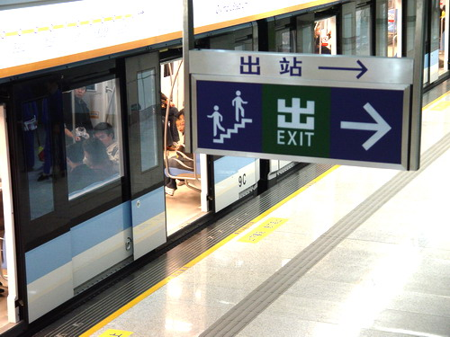
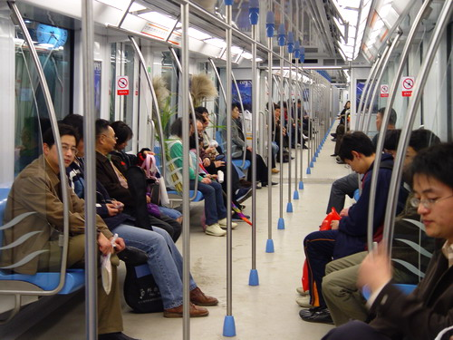
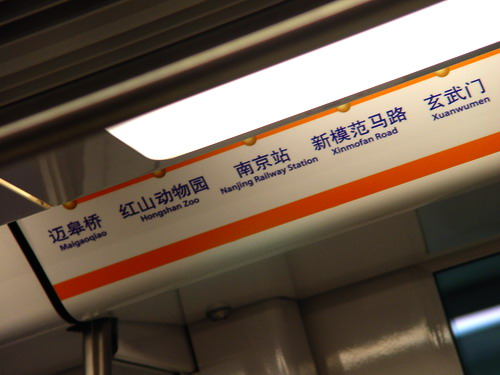
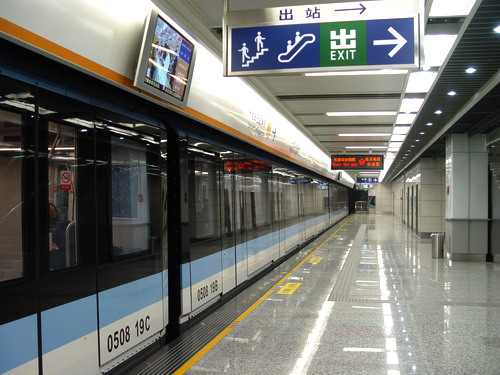
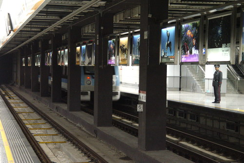
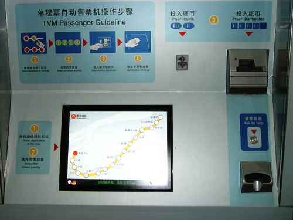
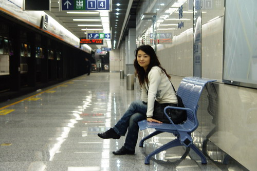
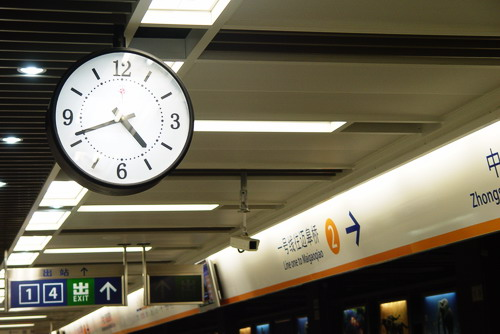

# 南京地铁

中文网志年会上几个人谈到南京，居然有人还不知道南京有地铁了，我有义务做个宣传。

---

## 评论（17）

**[rainbow](http://silicone.i170.cn)** · 2005-11-17

有几个视角很好,是SONY F717??

**[puppy](http://iamthinking.yculblog.com)** · 2005-11-17

车上扶手好密集!  
  
漂亮的站台，和人 呵呵

**[joanna](http://spaces.msn.com/members/joanna72082)** · 2005-11-17

通地铁了？感觉工程还蛮久滴。几年前看报纸，说是还计划通到隔壁的马鞍山市阿，现在实现了？

**[Nio](http://www.infor96.com/~nio/)** · 2005-11-17

“新模范马路”，这个名字比较强，有机会去南京一定去看看，坐坐南京的地铁

**Jonathan** · 2005-11-17

站台上没有屏蔽门？这样不太安全。

**[yaohui](http://yaohui.blogbus.com)** · 2005-11-17

哇，地铁修好了。那年去时正修了。

**[airylea](http://www.airylea.net)** · 2005-11-18

新建的地铁永远比旧的好，北京的地铁还要人工售票检票呢，广州的地铁也破旧了很多。

**ANJIE** · 2005-11-18

没去过南京，有不知道有地铁，不过，看起来很干净哦

**babybbt** · 2005-11-18

缘于一次无意的google认识你,吸引我的是你和狗狗悠闲的坐着,这个下午突然相信这是一种相识的缘份.冒昧的问声hello.留下我的MSN给你...- 喜欢你的北京女生

**puppy** · 2005-11-18

增加一个屏蔽门 成本至少要增加几个亿；好处就是防止卧轨事件和高跟鞋被卡在门缝等意外事件。  
听说深圳的地铁有这个门，学HK.

**[njmetro](http://www.njmetro.cn)** · 2005-11-22

是啊，南京通地铁了，要了解更多欢迎到南京地铁风网站上看。http://www.njmetro.cn

**[njmetro](http://www.njmetro.cn)** · 2005-11-22

哦，对，是索尼(sony)Cybershot相机。

**Sherry** · 2005-11-23

你是在元通站拍的吧？那站人特少，而且小。

**[sumnny](http://sumnny.net/weblog)** · 2005-11-23

南京火车站造好了么???...

**[gototop](http://www.ncn.cn)** · 2005-12-01

增加一个屏蔽门不仅仅为了安全，可以有效控制能源、利用更充分，比如空调、供暖等。

**jenniferuk(少爷)** · 2005-12-20

哇, 很吃惊.很现代,很干净.

**Jun** · 2006-02-14

很不错，我对南京地铁狠感兴趣，如果可以的话希望和你交流一下

