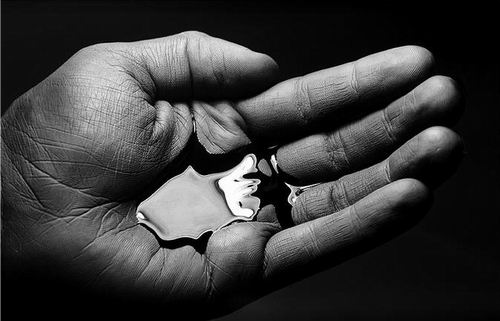

# 记录＊遗忘

“你用什么记录自己的生活？”我问道。  
A回答：文字。  
B回答：摄影。  
C回答：音乐。  
D回答：冥想。  
E回答：Blog。  
F回答：恋情。  
G回答：影像。  
H回答：工作......  
......  
有一个人回答：遗忘。

---

## 评论（8）

**James** · 2005-11-18

能如斯回答者非凡人也:-)

**puppy** · 2005-11-18

想到一句话  
当和别人聊天时，对某个既熟悉又陌生的话题  
"似懂非懂，却也频频点头"

**Jonathan** · 2005-11-18

Time can heal...

**Michael** · 2005-11-18

I choose H.

**anxd** · 2005-11-19

分享。

**angie** · 2005-11-19

遗忘记录生活,感觉有点消极情绪

**Joshua** · 2005-11-19

按照這種趨利避害生物本能的邏輯，他/她於生命中無論歷驗過多少的人間冷暖，所能留下的也祗是一張PS過的平面圖。

**pei** · 2006-02-01

回忆和狂想。  
不过活在回忆中真的很痛苦，狂想让自己消沉，很久都没有解脱了，渴求一颗平静的心，一颗幸福的麦芽糖。

