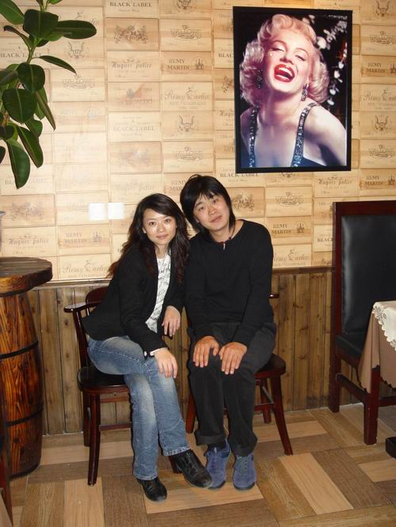
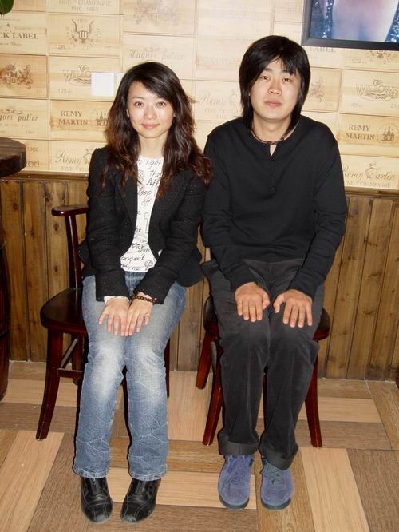
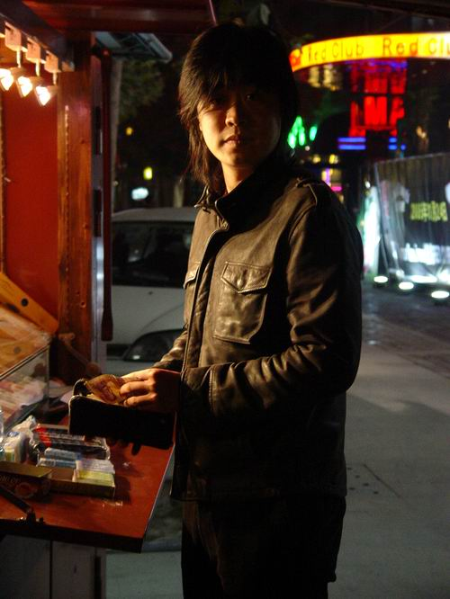

# 昨天是感恩节

昨天感恩节，和前来南京参加”法国Fashion TV全国模特大赛”的虎子在Phil’s吃了晚饭。

 

---

## 评论（8）

**[moko](http://moko.blogcn.com)** · 2005-11-26

我喜欢他站在灯光侧面那张，有剪影，很有意思。：）

**[郑六](http://www.tecinese.com/?p)** · 2005-11-26

最后一张很有意思，像很久很久以前的那种结婚照。  
呵呵，我比较喜欢黑白照片。

**[joanna](http://jinking20.yculblog.com)** · 2005-11-26

fashio tv?  
倒是在网路电视上看过名字。  
偶在法国只能看到tf1,f2,f3,f5,m6  
:-(

**[Kaifry](http://www.tecinese.com/?p=577)** · 2005-11-27

嗯，蛮好的...

**angie** · 2005-11-28

这次照片的色彩特别喜欢。

**问个问题？** · 2005-11-29

请看这里  
  
http://timesofindia.indiatimes.com/articleshow/1118016.cms  
  
或是这里  
  
http://www.nightly.net/ubb/ultimatebb.php/topic/6/13153.html  
  
这是一个南京的餐馆，不知道是哪一家，能给介绍介绍码？

**[gototop](http://www.ncn.cn)** · 2005-11-30

地方不错，这个blog的页面好漂亮:D

**hannah** · 2005-12-01

I entered your blog unconsciously, but I liked it at once. I am a native nanjing girl,but now I have left nanjing for more than one year. I like your blog, go ahead!

