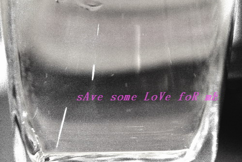
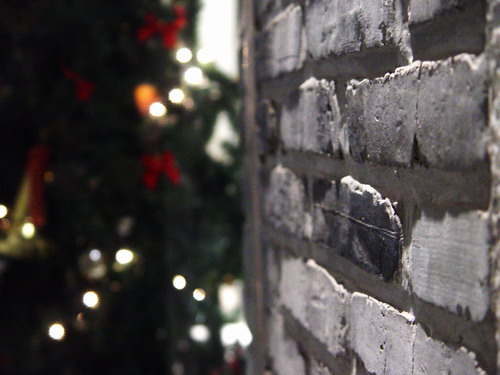
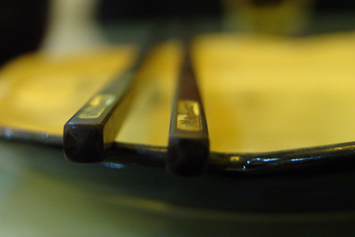
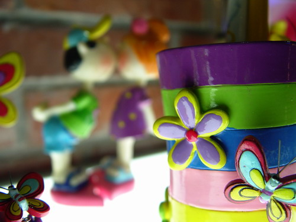
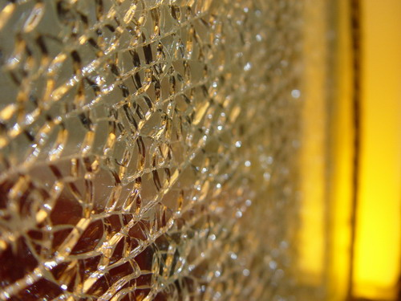
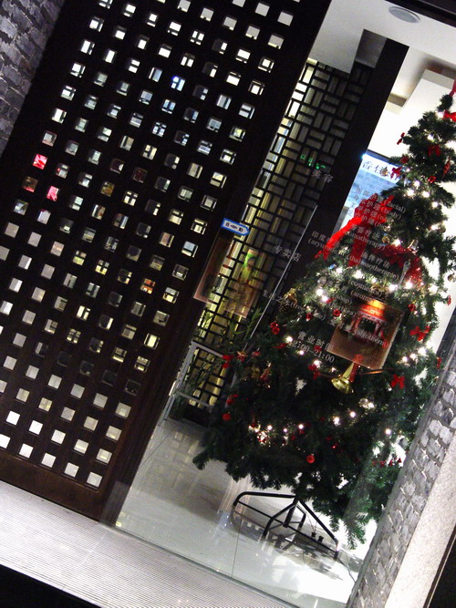

# @save some love for me

被朋友描述“独立坚强...比较硬”，一旦形象如此必然没得便宜占，博取同情未必不好，如今弱者被授予的更多，不过不是自己争取来的会有多珍惜呢？我问他是否如朋友所说的独立和坚强？他持相反意见，认为：脆弱，感性，晚熟，心智也比实际年龄要幼稚。

晚饭后拍了些片子，骤冷的天气，避闪不及，穿着裙子在寒冷中瑟瑟发抖，体会着早期的圣诞气氛。

   
*shot by Christina  
Sony F717  
@1912 Nanjing*

---

## 评论（12）

**[yaohui](http://yaohui.blogbus.com)** · 2005-12-02

这三张图片拍得好漂亮!

**angie** · 2005-12-03

我说的是表象,而他说的是内象

**angie** · 2005-12-03

表象也未必是不真实的,人的情绪有时也是分时间阶段来表现的

**[SILICONE](http://SILICONE.I170.CN)** · 2005-12-03

PIC   
VERY GOOD FEELING

**ANJIE** · 2005-12-03

喜欢第3张

**ＨＺ** · 2005-12-03

我喜欢第二张，是因为我喜欢女人做饭，你要多干家务呀

**[joanna](http://jinking20.yculblog.com)** · 2005-12-03

国内也有圣诞树卖了吗？奇怪地说，看见人家摆着圣诞树，竟然生出亲切，可俺4中国丫……？  
通过chris的文，偶是明白了——人前人后差别总是如此，他亦说“你的美丽都留给了外人，难看全给家里。”  
性格也如此，父母、爱人面前总是孩子，外人哪怕相近朋友都以为自己多么冷静的一个年轻女子。  
其实并不矛盾，以为都是真实的我们。

**[Kaifry](http://www.tecinese.com/?p=580)** · 2005-12-04

写意...

**okdata2003** · 2005-12-04

1912 距离较远，百姓人家似乎近些。有时格调与距离成正比。

**[wetnt](http://www.boboking.com/bbs/)** · 2005-12-08

抱歉打扰了你这里的清静，  
请问你这几张照片，用的是什么相机，，只能看到是sony，但不知是哪一款，  
你的照片一直都很不错，关注许久了，也收藏了你的一些片子，见谅。

**[wetnt](http://www.boboking.com/bbs/)** · 2005-12-08

shot by Christina  
Sony F717  
@1912 Nanjing  
  
刚看到，冒昧了，我的留言，影响了你blog的风格意境，删除吧，，

**Grace** · 2005-12-08

喜欢彩色，喜欢第4张

