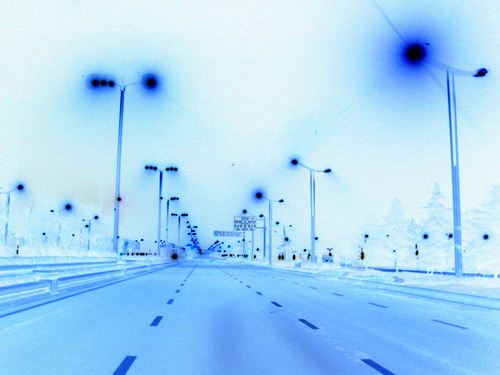

# 寻找失去的现在

按照米兰.昆德拉的解释，安娜.卡列尼娜的自杀显然带有某种“即兴”的成分。似乎她的死是铁轨和车轮所酿造的。在这部作品的开始，安娜在车站上即产生了自杀的预感，预设中死亡的种子在她体内发芽并生长，注定要在日后的某一个瞬间兑现。福克纳笔下的昆丁的自杀与此大致相仿。他们在活着的时候实际上已经死去。

  

我们至少可以将自杀分成两种：浪漫的和现实的，浪漫的自杀渴望永恒和不朽，带有某种英雄主义的反叛情结而现实的自杀仅仅渴望消失。对这部分自杀者来说，生活的理由同时也构成了死亡的理由。  
*—格非*

  

\*\*\*\*\*\*\*\*\*\*\*\*\*\*\*\*\*\*\*\*\*\*\*\*\*\*\*\*\*\*\*\*\*\*\*\*\*\*\*\*\*\*\*\*\*\*\*\*\*\*\*\*\*\*\*\*\*\*\*\*\*\*\*\*\*\*\*\*\*

  

  
*shot by Christina  
sony F717  
@Nanjing*

  

中午休息时间走进车库坐进车厢，斜躺在座椅上听音乐，看着表情矜持严肃的人们驾着车进进出出，渐渐觉得滑稽与可笑，那些面孔下的灵魂......那时我是一个生活之外的观众。人生是为他们那种状态持续还是为自己这一刻进行？有人几乎不关心周遭事物，只活在自己的世界中。我听新闻关注他人心思变化，于是矛盾。昨天在公司附近第三次遇见那个表情愤怒的精神病人，每每都引起我的惶恐和心酸，事实上一个精神病人的世界比看似正常的人纯粹！

  

生活在这样一个有意思的时代，你表达的越清楚越明白，人们反而越是不明白，他们的困惑和误解使我加深了对自己的明白。这没什么，当年龄越来越长时，我不再期望获得大多数人的理解和认可。有时这种无望也包括对亲密的人。

---

## 评论（6）

**anxd** · 2005-12-15

Whisper wisdom words Let It Be

**[Kaifry](http://www.tecinese.com/?p=587)** · 2005-12-15

有时候真想解脱了，不晓得是不是太年轻的缘故，会有这样的想法...

**[angie](http://angie.tecinese.com)** · 2005-12-15

思想无法依靠,恍惚中倾诉,清醒后自解

**kevinzhou** · 2005-12-15

图片有点后工业化的味道。

**mike yang** · 2005-12-15

Hi,我是一过客,喜欢你家的妞妞,我家有一个淘小子班尼,想传几张照片给你,能告知你的E-mail吗？谢了！

**Yucheng** · 2005-12-15

对于忧郁症患者，死亡是一种幸福。

