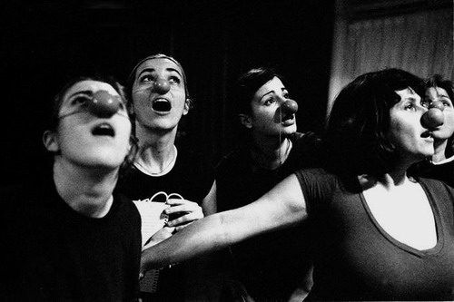

# 2006，我要什么？

你快乐吗？  
快乐是什么？

每年的春节前街上会出现许多乞丐，现在的乞丐穿的就跟逛街似的，有的还背着很不错的双肩背包。他们不再伪装成可怜的摸样，难道是想试探一下人们的同情心到底有多少？这个世界如此冷漠，这种冷漠感染着每一个人。我非常厌恶年轻手脚健康的乞丐们，不过看到老人小孩还有残疾人时常会丢下一些零钱。每每遇见衣衫褴褛营养不良的人，便不忍多看一眼，那些寒冷冬季在工地上劳动的工人，洗车场稚气未脱的孩子，穿着单薄的西服站在寒风中瑟瑟发抖的推销员......太多不幸的人，愿彼此能多些怜悯。

去年8月三亚旅行之后一直到现在没有任何的外出安排，最近特别想度假，松弛身体松弛精神，找个有灿烂阳光的地方过几天懒虫的日子。  
朋友问：“最近在干些什么？”  
“工作，睡觉。”  
“这不符合你的风格？！”  
是吗？但的确很长时间没写blog…很长时间没有做一次充分准备的拍摄...很少无所事事沦落到逛街...不再看哄人的爱情韩剧...历史记录上长时间的平静与快乐...不屑于争辩也不期望得到理解...日子过得倒也自由逍遥，除了工作有点累有点烦。

昨晚和SHERRY到NICK家，分别3年多的NICK胖了很多，家庭好男人的形象渐渐定格在他脸上，周日晚上还在家写工作报告，够辛苦了。他那未出世的孩子今年三月的预产期，日子过得中规中距，算是大众眼里的模范生活。日复一日的复制着一模一样的生活，人若自私冷漠缺乏尊重，是否有幸福可言？婚姻对女性来讲充满着风险。男人想用规则来约束女人，让女人遵循规则听他们的话，他们自己却从不信仰什么。NICK也许是个例外？

现实束缚着人们，在真相面前，有人面对，有人麻木，有人逃避，有人无奈。  
2005年的最后一个晚上，开车和朋友到紫金山顶，夜晚细密冰冷的小雨未打消人们迎接新年的热情，一大群人走路上山，人群中还有一只穿着坎肩的小猎狗，狗喜欢有人陪伴，或者能让它陪伴人也好，我想那天晚上它一定高兴坏了，那么多人那么长的散步时间，呵呵...那些人站在山顶上在新年时间到来时面朝我们生活的城市，齐声呼喊“我要幸福，我要幸福，我要幸福...”

2006年，我要什么？

---

## 评论（8）

**[Kaifry](http://www.tecinese.com/2006/01/09/608/#respond)** · 2006-01-10

"那些寒冷的冬季在工地上劳动的工人......"  
  
金字塔之上的人们看不到他们。

**Benben** · 2006-01-10

人人都会追求幸福！  
人人心中的幸福都各不相同！  
IT'S UP TO YOURSELF!

**[hehe](http://www.google.com)** · 2006-01-10

革命后代

**Rabbit tooth** · 2006-01-10

幸福是什么?幸福是边看着喜欢的blog,边听着英文歌,边想着明天的日语课会如何开始.:lol:其实这也算不了什么,换一种角度看,可能就是一种无所事事,孤单亦或是无奈.事物并没有变化,而在乎于人的感觉.你说的那只狗挺逗,乐了我半天,居然它是最幸福的.:mrgreen:

**[埯姬](http://angie.tecinese.com)** · 2006-01-10

幸福要我!幸福要我!......

**[ANJIE](http://blog.sina.com.cn/u/1423375155)** · 2006-01-11

幸福是自己、家人、朋友健康！每天都能微笑感受生活

**[博容](http://www.iborong.com)** · 2006-01-11

看你的blog很久了，我个人感觉改版后不如改版前。  
2006年我想要的还是身体健健康康！这比什么都重要。

**okdata2003** · 2006-01-20

what I want

