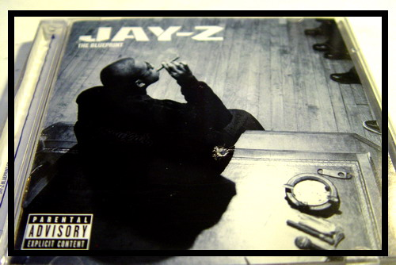
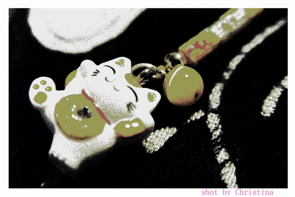

# 我．JAY-Z．亲爱的MP3．招财猫

 

 

 

 

 

---

## 评论（24）

**[airylea](http://www.airylea.net)** · 2006-02-17

sony,sony,  
明天要给各地项目来总部的人培训新项目，老总给了个三星的录音笔做录音，可对我来说叫它mp3更确切。 :mrgreen:

**[airylea](http://www.airylea.net)** · 2006-02-17

还叫收音机。

**christina** · 2006-02-17

叫什么无所谓，只要能满足各个人的需求:wink:就好~~  
不晓得你那个录音笔是不是比俺的SONY E500 1G的MP3音质优良？喜欢音乐的耳朵对音质不会没有要求，若能听到更好的音质，大家一定愿意买录音笔听音乐咯~~  
以前经常用手机听广播，现在有MP3，真是一举两得哦！

**Kaifry** · 2006-02-17

照片很温情，呵呵，刚发现tag多了个‘独资等待’...

**don** · 2006-02-18

mp3的音质还是不如CD,毕竟是一种有损压缩。 不过一般来讲，应该听不出来。  
以前听过APE的，现在比较好的应该是 FLAC， 至于WMA loseless没试过。  
建议大家，尝试一下FLAC的。 毕竟这些都是无损的压缩，虽然文件大小会很大，但是有1G的空间，应该提升一下音乐品质了。

**[airylea](http://www.airylea.net)** · 2006-02-18

hehe~  
功能越多反而每个功能都不会做得很好。 :oops:

**christina** · 2006-02-18

这会儿你对音质又有要求了？在你看来MP3不过是录音笔和收音机哦！:grin:  
那您外出带的东西可多了，CD机、录音笔、收音机....

**龙龙** · 2006-02-18

:smile:不错呀,可以看看吗

**[Cécile](http://spaces.msn.com/shanghaicecile/)** · 2006-02-18

风华正茂！  
美女姐姐！  
:grin:

**hello** · 2006-02-19

pp,pp非常pp

**[ANJIE](http://blog.sina.com.cn/u/1423375155)** · 2006-02-19

嘎酷拉 ，呵呵

**Alvin** · 2006-02-19

u r cool~

**Jonathan** · 2006-02-19

You got a cool mp3, you got some cool pictures and what's more, you got the coolest earings.

**ch** · 2006-02-22

健康的肤色，动人的。。。。。。

**[Leo](http://www.evperception.com)** · 2006-02-23

不错，小克，这几张蛮好：）

**[冰古](http://bingu.net/blog/)** · 2006-02-23

:razz:ppmm哦～～

**[博容](http://www.iborong.com/default.asp)** · 2006-02-23

jay-z好听

**流浪的燕子** · 2006-02-24

“小资”的生活，让我们点滴都快乐！ 春天的问候，燕子飞回来了。

**山果果** · 2006-02-24

喜欢，呵呵。。很生动。。。那件毛衣也不错。。。

**Christina** · 2006-02-24

流浪的燕子回来了，欢迎欢迎哦！

**lionhead** · 2006-02-24

有些见老了！:)

**Christina** · 2006-02-25

谁也逃脱不了岁月:wink:

**[Zoula](http://www.amazonpark.com)** · 2006-02-25

人很漂亮。MP3也很漂亮。我也喜欢Jzy～Z^^

**jim** · 2006-03-08

那里可以找到 Jay-Z 的cd？

