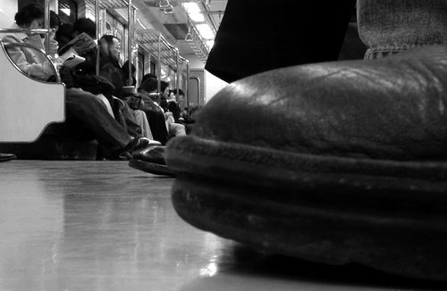

# 三寸生活

生活很累很疲惫，工作也累也疲惫，特别想休假。可惜现时的阳光不够明媚。  
昨天下午吃了家里的过期食品，痛到呻吟，躺在被窝里想着自己倘若在那刻死去都没人知道，这悲哀的生活。

某段时间特别讨厌自己，忽然生出的厌恶情绪，觉得事事不顺，认为没有人比自己的感受再差了（:shock:会不会是抑郁症？）。后来接触了一些人，他们收入微薄，甚至无业，几乎每次看到他们的面孔都是那么开心。和他们相处轻松而自然，不用表现上进摸样，极其懈怠也可以。他们拥有的东西比我少，拥有的快乐却比我多得多....为什么？

过去有个男人曾说朋友的发型不好，衣着幼稚，学她说话的口气语调，常质问她的智商、情商，对她听的音乐指手画脚，讥笑看过电影后伤感的情绪......这种频繁的带有压迫感的”指点”俨然成了他的娱乐，把圆形弄方，方了再弄圆，乐此不疲地行使“家长”权利。事实上他自己也不清楚到底要对方怎样才能令他满意？在他的指点下她的言行仿如裹起的三寸金莲。不明白是什么赋予他对别人生活指手画脚的权利？他认为舒服的方式也许在别人看来并不惬意。他看重的方式，在另一些人那里狗屁不是。总要允许不同的人存在吧！生活不是戏剧，骗得了别人却骗不了自己。无论什么人怎样的人生，只要自己觉得快乐就好！天生就是一双大脚，你干吗非要让她穿上小鞋被你娱乐让你开心呢?你知道她穿小鞋的痛苦吗?:sad:你既然知道，还继续让她裹着小脚，又是为什么？

---

## 评论（11）

**[SUN](http://SUN)** · 2006-02-21

生病了就看医生。  
多多回忆一些美好的事情，心理暗示一下。  
祝尽快好起来。

**tingyu** · 2006-02-21

:razz:每天都很关注你的博客，这已经成为我生活的习惯了。其实每个人都有不开心的时候，只是一段一段的，不必讨厌自己。我觉得你的生活很丰富多采，很是羡慕呢！要多多给自己加油喔！你是非常优秀的！  
祝早日好起来，笑着度过每一天！

**月下酌** · 2006-02-21

不知道，我也总怀疑自己得了抑郁症，生活总不是那么如意，想要单纯的快乐也不行

**雨后虹** · 2006-02-21

我一直觉得你是自信并快乐的，因为你已经拥有了我想拥有的东西比如美貌才华

**[ANJIE](http://blog.sina.com.cn/u/1423375155)** · 2006-02-21

christina：该为心情放假了，去年的你是很阳光的，随时让我们欣赏到好的音乐、美丽的风光、还有那些你中意的车子，呵呵，今年你一定会更不错！

**Kaifry** · 2006-02-21

旅行吧，路上有好看的好玩的好吃的... ，嘿嘿，人生如此最惬意不过了

**didida** · 2006-02-21

无论什么人怎样的人生，只要自己觉得快乐就好！天生就是一双大脚，你干吗非要让她穿上小鞋被你娱乐让你开心呢?你知道她穿小鞋的痛苦吗? 你既然知道，还继续让她裹着小脚，又是为什么？  
  
因为无论什么人怎样的人生，只要自己觉得快乐就好！:lol:

**Chrisrina** · 2006-02-22

:???::roll:

**anxd** · 2006-02-22

一个人的快乐并不取决于他拥有的物质的多少。快乐其实也是很容易的东西...就像庾澄庆唱得那样。

**[bluejoyce](http://none)** · 2006-02-22

这种男人最讨厌了，自以为是！  
这个男人进行着所谓的EB情感敲诈吧，丈夫通过此法可以把老婆弄得言听计从，失去自瓦，严重心理残废，再在某天有了第三者时被抛弃后才能得到重生

**someone** · 2006-02-23

这种男人有严重的心理缺陷，就是要用这种方法将对方弄得无所适从，以达到控制的目的。一贯自大的男人，最自卑。

