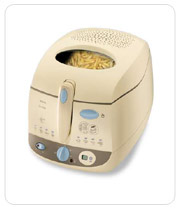
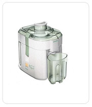

# 我有口福

食欲开始疯狂。

站在姐姐身边看她做孜然羊肉，从超市买来切片羊肉，不放油倒入锅中干炒，然后添加些姐夫从重庆带回来炒好的红辣椒屑，炒一会加超市“好美味”袋装孜然粉，起锅前撒点盐，那口味简直酷毙了。:lol:咔咔~~流口水咯。

某天电视上介绍法国烹饪，介绍牛排做法。私人农场养牛的主要工作就是种植草坪，风景秀丽，广褒无际的青山，绿油油的田野，黑牛在这种毫无污染毫无压力的环境下生长，牛肉品质绝佳。我一直认为西餐做的正宗必定可口，只是没想到法国菜的烹饪还比较讲究呢，冲动的我跑去书店找西餐烹饪的书看。

看见书上介绍飞利浦几款厨房小家电，令人特别有使用欲。家庭必备的除了榨汁机，我还想要一个电炸锅。工作之后，家才是释放自己的地方。挖掘生活细节，乐趣无处不在。如果重新安排自己的生活，我会怎么过？

飞利浦HD6155Cucina电炸锅 / HR2826榨汁机  
 

---

## 评论（12）

**yatou** · 2006-02-25

口，口，口，口水啊~~~:mrgreen:

**Alvin** · 2006-02-25

看上去简单易行阿。。。  
btw 羊肉的臊味如何去除的

**Kaifry** · 2006-02-25

"工作之后，家才是释放自己的地方"---英雄所见略同 :lol:

**[carine](http://jinking20.yculblog.com)** · 2006-02-25

其实法国的一般家庭厨艺是国人不敢恭维的，那种两三层的蒸锅，京葱、土豆……煮到稀烂，个人依据口味自己加点盐、胡椒粉了事。我们理解的法餐只有到了法国餐馆，才谈得上所谓艺术。  
chris，买个烤箱吧，自己做蛋糕、flan……的感觉真的好，绝对让做的人充满成就感。

**水清浅** · 2006-02-26

电炸锅？炸出的东西跟普通做发做出来的能一样吗

**[Cécile](http://spaces.msn.com/shanghaicecile/)** · 2006-02-26

还好吧，欧觉得法国人家里做的西餐还不错呢，很讲究的。一顿下来，吃撑掉了。也可能是我运气好，吃过的那几家正好不错吧，哈哈！:wink:  
  
不过，好的饭店里的东西，哎呀呀，真的好吃哦！除了有点贵，不能经常吃呀！  
  
另外，好像tefal这个牌子比较专业点，厨房用。  
  
买电炸锅炸薯条是欧刚来法国时的梦想亚，后来被欧抛弃了，原因是欧家人对欧日渐臃肿的身材指指点点:oops:

**[carine](http://jinking20.yculblog.com)** · 2006-02-26

cecile运气好咯，我除了圣诞时候吃的房东家东西有些花头，平日里一般只是巴望着最后上来的甜点的，至于从rosee到vin rouge，最是让不怎么酒精的我头疼的了

**anxd** · 2006-02-28

这种榨汁机不大好用，怎么说，not user friendly?   
现在我都搁置不用了。

**Mandy** · 2006-02-28

只要是亲手做的，都会有乐趣！:oops:

**gudongman** · 2006-02-28

那个油炸锅其实没有什么用,我测试了不少,基本上是个烧油的机器.  
而且有油烟的哦.   
除了炸署条和鸡翅膀,还可以做什么?我想不起来了......

**Christina** · 2006-02-28

:oops::neutral::shock::roll::mrgreen:啊 ?!

**水清浅** · 2006-03-02

我说，这两天都没更新，尽享受美食去了？

