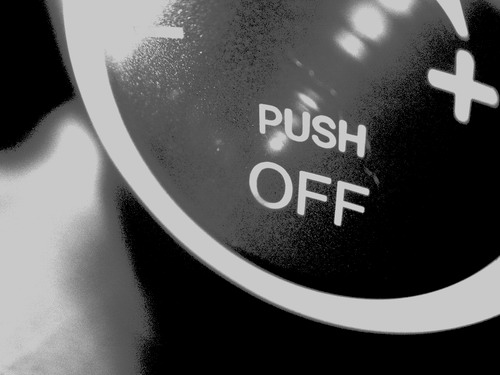

# 不是机源，不在世外

一对非常年轻的恋人坐在对面的餐桌上用餐，他们看上去还处于小心翼翼地热身阶段。女孩儿细薄的双唇颤动着嗲笑、诉说，抛洒着稚气的媚眼，男孩儿憨态可掬，一副陶醉摸样傻傻望着女孩儿...这情形让我想起许多年前也是这家餐厅，和Y一起，那应该是我第一次用西餐刀叉，陌生的餐具使我感到微微脸热，Y挥动着细长手指向我说着英式与美式吃法的区别，至今记忆犹新。这家餐厅从小小的三四十平米扩大到楼上楼下，晚餐时间依然很多客人光顾，好多年过去了，居然餐厅的背景音乐都没换过，仍然执着地播放着过去的氛围。

前两日南京下了场中雪，早晨醒来拉开窗帘，期望能看到铺天盖地厚厚的积雪，然而近几年南京的雪很难给人激情了，梅花节在春雪中静悄悄地开幕。当春天的暖阳开始灿烂，心也象小鸟一样渐渐欢跃，整整一天工作热情高涨，心满意足的下班，想用晚上充裕的时间来做自己的事，但驾车回家的路上仍然被孤独感侵袭，总觉得少了什么。如果没有家长管教，我的身体随着精神一起是自由的，可家长时不时就会出现，冷不防就被拖进现实的冰水里，逐渐冷却。

我，更加贪婪于默声世界的幸福。

---

## 评论（19）

**[moko](http://moko.blogcn.com)** · 2006-03-03

很喜欢这几张图片啊

**[猫头鹰](http://www.wayaya.cn)** · 2006-03-03

:razz:网上每天都有这么多象我一样的无名网友来这看看你，默默地支持你，你不孤独！:oops:  
  
希望不要悲观，人活着，就这短短几十年，所以，能够开心快乐就好:smile:！

**雯子** · 2006-03-04

每天上班第一件事就是打开电脑看你的博。所以，我觉得你并不孤独。因为有很多人关注你的。其实每个人都是孤独的。以前看到过一句话“能够忍受孤独寂寞的女子才是最美丽的女子”。跟自己做伴未尝不是件好事。情绪这东西真是不好说啊！情绪始终会左右着我们的。要是我们能完全自如的控制自己的情绪哪该多好啊！  
今天是周末了。祝你周末愉快:lol:

**Christina** · 2006-03-04

一早看到这些留言还是很感动的，谢谢你们！:wink:  
尤其这次拍的PP能得到MOKO的喜欢，更是让这个早晨激动起来！:grin:

**anxd** · 2006-03-04

是啊，看博的时候我第一个打开的也经常是你的博客。  
你的博客写得很...好，应该是很多人喜欢的风格（也许你并不在意有多少人喜欢，但看博的人都很在乎）。  
我想你只是being alone, 却不是longly, 至少，在这个平台上是酱紫。

**[jiajia](http://www.imissme.net)** · 2006-03-04

我也是很喜欢这几张照片的感觉哦:razz:

**游子** · 2006-03-04

你好，无意中到了你的BLOG，觉得很好，不过，心情不好的时候还是要看看医生，我在美国做PHARMACIST，对忧郁症比较了解，有时间再和你聊天，保重。

**月下酌** · 2006-03-04

“当春天的暖阳开始灿烂，心也象小鸟一样渐渐欢跃，整整一天工作热情高涨，心满意足的下班，想用晚上充裕的时间来做自己的事，但驾车回家的路上仍然被孤独感侵袭，总觉得少了什么。如果没有家长管教，我的身体随着精神一起是自由的，可家长时不时就会出现，冷不防就被拖进现实的冰水里，逐渐冷却。”  
  
感性的生活体味~~

**[Kaifry](http://www.tecinese.com/2006/03/02/730/)** · 2006-03-05

"贪婪于默声世界的幸福"  
  
说的好.

**Jonathan** · 2006-03-05

Christina, when feel upset, please hold on with our support.

**youzi** · 2006-03-05

hi. how are you doing today? Sorry I could type chinese at my office. Your blog is wonderful and you are a beautiful girl. I am from Beijing and live in the USA. I graduated from Beijing Medical University in 1995, then I went to the USA in 1998. I graduated from the University of Michigan College of Pharmacy. I work in hospital as a pharmacist. Can I be your friend? I read some articles in your blogg. I know you are feeling alonely. Do you have attempt to suicide? Actually you don't really know how pupolar the depression is. In the USA there are 5% of population sufferring depression once or now in thier life, but it is treatable. Unfortunately, most patients don't realize they are suffering this disease. If you are feeling very down more than two weeks, you should consult with your psychiatrist. I have a lot of my patients suffering depression. Usaully Doc prescribe Zoloft, Paxil, Prozac,  
Celebex, Effexor to them. The medicines are very helpful. It takes two week to function, then the patients feel better and better. Sorry to say it. I am a profeesional and specistist in mental illness. don't suffering too long.

**youzi** · 2006-03-05

If you have three or more the following symptoms for more than two weeks, you should see doctor. Talking therapy is very useful. Sometimes friends can solve your problems.  
  
Depression  
Persistent sad, anxious, or "empty" mood   
Feelings of hopelessness, pessimism   
Feelings of guilt, worthlessness, helplessness   
Loss of interest or pleasure in hobbies and activities that were once enjoyed, including sex   
Decreased energy, fatigue, being "slowed down"   
Difficulty concentrating, remembering, making decisions   
Insomnia, early-morning awakening, or oversleeping   
Appetite and/or weight loss or overeating and weight gain   
Thoughts of death or suicide; suicide attempts   
Restlessness, irritability   
Persistent physical symptoms that do not respond to treatment, such as headaches, digestive disorders, and chronic pain

**[sixhair](http://sixhair.isme.net)** · 2006-03-06

每个字好像都有伤感的情绪哦！

**denny** · 2006-03-06

人都有低落的时候 这个时候需要朋友

**Christina** · 2006-03-07

对于你们给予我那么多的关心非常感谢！  
  
不过我的低落情绪倒真没超过2周的，只是时不时会有这样而已。也可以称之为多愁善感？  
  
这个周末我过得非常开心，见到许多朋友拍了好些照片，还有非常好的阳光....在阳光的照射下一切都美好起来！等有空上传PP给你们看哦！:lol:

**Mandy** · 2006-03-08

生活不会每天都是阳光灿烂，也会阴雨，也会有狂风，只要自己能坦然的面对就足矣！

**[灰子](http://yaohui.blogbus.com)** · 2006-03-08

最后一张感觉刚睡醒，呵呵

**christina** · 2006-03-09

恰好不是，是晚上在灯光下自拍的！:lol:

**[灰子](http://yaohui.blogbus.com)** · 2006-03-09

:cool:可爱

