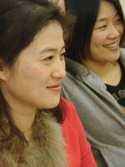
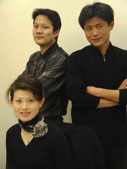
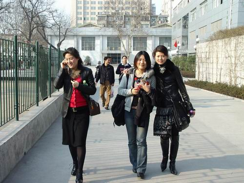
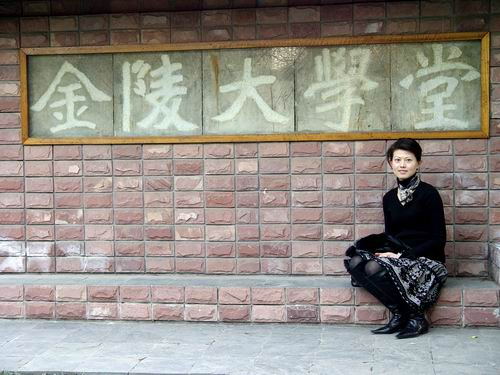
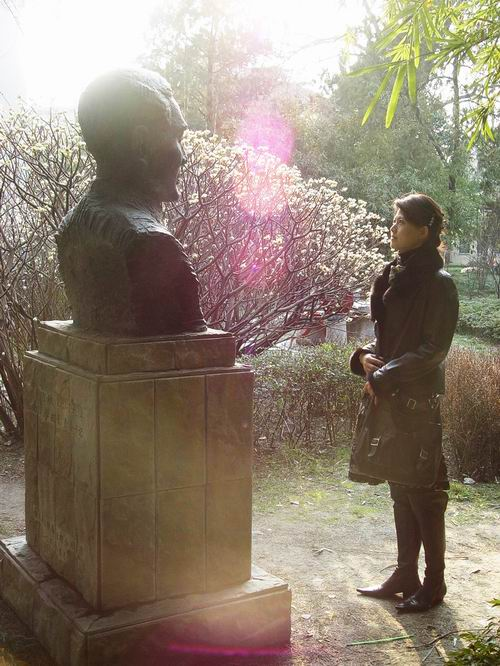
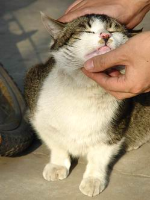

# 周末阳光

周末借着Bess的生日，朋友们相聚在南京。  
阳光好的一塌糊涂,再邪恶的心也会美好起来。

有的朋友许多年未见，有的刚认识...结识新朋友非常有意思，好象发现一个新大陆，充满瑰丽和神奇。有时对于同性的喜欢并不压于对异性的，第一次见到Jessica，这个四分之一俄罗斯血统的女子，比照片和想象中的精致。女人若事业上有所成就的，魅力自然会多些咀嚼的味道。很巧的是同样有人说她象李湘，自然我们的眉眼也有几分相似，更有趣的是她在北京，我在南京。

 

 

陪他们回母校的下午  

  

。

南大校园自行车棚里遇见这只晒太阳的猫，上前摸它没反应，抱着它往前走，也不挣扎，心理素质狂好。  
 

 

---

## 评论（36）

**Jonathan** · 2006-03-07

真不错！此外，原来这所学校（我想应该是南大）和我们学校的景致竟然有几分相似，尤其是在古朴厚实方面。

**[airylea](http://www.airylea.net)** · 2006-03-07

雅。

**anxd** · 2006-03-08

宿舍，校道，操场，久违了。

**Sherry** · 2006-03-08

俄罗斯美女眼睛真大啊，但是跟你不像不像。还有不要把你们两个美女跟李湘那个恶俗的女人联系在一起嘛，让人感觉不舒服。:smile:  
你有空也给我拍几张照片撒，我很久没有照相了:wink:

**Mandy** · 2006-03-08

南大，虽然没能在这里读书，但毕竟在这个熟悉的校园里生活了近二十多年。喜欢这里的环境，熟悉这里的每一条小路。

**Mandy** · 2006-03-08

失去了才知道它的珍贵！这句话很适用！对于现在的家教你会感到束缚，如果你再也不用面队家长管教时，我相信有一天你会感到对管教的留恋。  
家长管教--也是成长道路的一个站！

**游子** · 2006-03-08

I can't believe it. JESSICA确实很漂亮，

**[灰子](http://yaohui.blogbus.com)** · 2006-03-08

好舒服的阳光

**Fanny** · 2006-03-08

不知道照片中有几个是真正在南大读过书的,气质和南大很不相称。如果只是在那里旁听过或者以乱七八糟的名目进修过的，甚至那些只是去玩，根本就没有经历过大学的人，以为这样蜻蜓点水就进入了南大，感受到了南大的氛围，实在是有点盲人摸象的感觉。  
南大不是一个如此肤浅的地方。

**Christina** · 2006-03-09

那么喜欢攀比呀，南大这个不肤浅的地方不也培养出你这种肤浅的人了吗！

**Sherry** · 2006-03-09

Fanny, what a stupid name. why not name FUNNY? or we can call you ASSHOLE, because it has same meaning of your name!  
Just LEAVE!!! Here and NJU are not the places that you belong to. Don't put them to shame!

**fanny=fannies** · 2006-03-09

Hey Fanny, do you think it’s FUNNY to say that or do you think you are superior to others? So tell us what do ya look like? What kinda cloth do you wear evey day? Do you mind publishing your own photos here? People might say it looks like a crap, moron, … or something like gay, lesbian…  
However I’d like to call you your plural/real name——-FANNIES!!!   
SHUT YOUR FACE!

**[haha](http://haha)** · 2006-03-09

fanny=屁股,有人取这样的名字已经很有勇气了

**Fanny=SB** · 2006-03-09

Fanny就是一傻B！

**Jimmy** · 2006-03-09

楼上的FANNY典型心理有问题。  
可以分享一下你的照片和Blog吗？让我们也领教一下你的气质和内容。  
请放心，我和你不一样的。

**COOLMATE** · 2006-03-09

A college/university's just a place to study, not the right criterion to judge one's ability or sth else. If you judge it by the fame Fanny, you are so shallow! You wil l be such a little guy! Those guys in the photos just go there and take some pics. What's wrong with your feeling on that? Do you lack of mother love coz your mom died early? Anyway even you yourself might say it's not your business. So why are you so MEAN to say those craps? Shame on you!!  
You'd better get your ass out of here! Just go!

**Grace** · 2006-03-09

我是香港大学博士生，**按照你那可笑的逻辑**，是不是可以被嘲笑讽刺一下...一个南大本科生的气质？！人品低劣，再硬的文凭都是假的东西。如果你是南大毕业生，这种言行岂不为母校蒙羞？赶紧收起你的“Fanny”离开吧。  
  
Te Cinese总是把南京最温情的一面展现给我，使离开南京的我有了想回来看看的愿望。请不要污染这里的气氛！

**Fuck Fanny** · 2006-03-09

Fanny，什么鸟人啊，是不是脸长的象屁股一样啊？？？真有气质！！！:lol:

**James** · 2006-03-09

Isn't it shallow-minded and stupid (pardon my choice of this word cuz I really can't find a more accurate adjective for the mentality reflected in FANNY's comment) to attach a sterotyped and over-simplisitic trade-mark to the graduates from the NJU? One of the most charming characteristics of the NJU's culture, if any, is its emphasis on cultivating its students' "taste"; therefore, if this someone named Fanny is really a graduate from NJU, I must advise you not to be so snobbishly foolish or so foolishly snobbish, cuz the comment you left irresponsibly here was truly of very bad taste. Learn to respect other people if you wish to be respected, and the kind of arrogance revealed so childishly in your comment, I have to say, has insulted the fame of the NJU, and consequently, has also humiliated your good self.

**Tina** · 2006-03-09

那个Jessica真的美，够味道。  
还是版主Chirstina对FANNY的反击最艺术、最到位，赞一个。  
其他人如果继续骂下去，真的要破坏这里的氛围了，哪怕是用英文:mrgreen:

**[steven](http://www.eauto.com.cn)** · 2006-03-09

女人这辈子挺难 ：漂亮点吧 太惹眼 不漂亮吧 拿不 出手；学问高了 没人敢娶 学问低了 没人想要；活泼点吧 招蜂引蝶 矜持点吧 装腔作势；会打扮 是妖精 不会打扮 没女人味；自已挣吧 男人望而却步 男人养吧 傍大款；生孩子 怕被老板炒鱿鱼 不生孩子 怕被老公炒鱿鱼。哎！这年月做女人真难 所以要对男人下手狠点 对自己宽大处理为上。祝所有MM妇女节快乐！！ :grin:

**[Richard](http://anonymous)** · 2006-03-09

酸怨刻薄，难成大器，你应该混得不怎样吧，见不得别人混得比你好吗。有点BT啊

**我靠** · 2006-03-09

SB从来不跟比他混得好的人比，SB只会在一定范围内抖抖FANNY，无知样倒是十分可笑。

**三八节** · 2006-03-09

三八妇女节欠揍的男人！:mrgreen:

**丫丫** · 2006-03-09

Fanny,你老爸老妈你大叔大婶都是南大毕业的？我是南大硕士生，怎么没你那份嚣张呢？！:wink:  
没那么多光环非用手电筒照着，你丫不嫌累么？喜欢攀比怎么不和比尔.盖茨比？拿自己的Fanny出来比了？对了，人家比尔.盖茨还是肄业哦，看来真的是人品问题！:mrgreen:

**游子** · 2006-03-09

I come here because I like Christina very much and she is a wonderful girl. Who cares what school she graduated and what city she is living.

**[红裤子](http://www.blogcn.com/user23/yongsr/index.html)** · 2006-03-09

我也喜欢猫猫，可是最近听说猫猫会传染禽流感阿，所以为了健康期间还是不要和她太亲近了。:mrgreen::oops::cry:

**甩货** · 2006-03-10

FANNY这SB一定喜欢舔别人屁股:mrgreen:

**funny** · 2006-03-10

Fanny就是一市井小人，和他计较等于降低人格。

**Michael** · 2006-03-10

从此以后"Fanny"就从江湖上消失的无影无踪了......

**Jessica** · 2006-03-11

感谢Christina，为我们难得的聚会留下这么多温馨的照片。两次从南大毕业，最后一次至今也有十年了，这是第一次回南大，既熟悉又陌生。竟然已经步入怀旧的年纪了。一切都好，遗憾的是北大楼后面怎么会出现一个风格迥异的摩天大厦呢。回想当年入学的时候也是在北大楼前这个位置拍照，背景只有瓦蓝瓦蓝的天空啊！

**angie** · 2006-03-11

那年下大雪中午我们没吃饭就冲到北大楼附近去拍照,那照片至今我还保留着呢:wink:

**孤舟四邻** · 2006-03-12

:oops:

**[游子](http://www.flickr.com/photos/16491531N00/show/)** · 2006-03-12

去年大学毕业十年，本来想在北美也有个校友聚会，我们班34个同学在北美的有十三四位，本来说好在TORONTO，可是，最后去的只有四位，变化很大很大。同学中居然出了一位YAHOO NEWS记者，一位VOICE OF AMERICA的播音员。CHRISTINA，你要是想听他的RADIO，我可以MP3给你，母校一次也没回过

**yaya** · 2006-03-13

气质确实只是一般，再好的学校学生也是各色各样，南大也只是很多学校里的一个嘛。:mrgreen:

**williamfan** · 2006-03-20

汗，这地方居然也有人吵嘴 :evil:

