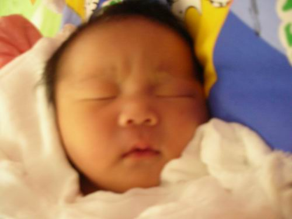

# emotion.city

三八节公司没有放假，移到周五下午休息。和Sherry在珍记粤菜馆吃午饭，一身浅色装扮的她俨然又一个韩剧中毒份子，听说冈本的母亲也看韩剧，韩流真强，上到60多岁女士下到十几岁的小女孩，说起韩剧来头头是道。还好我只看了三四部，尚能抵抗韩流感染。也追随过一小段时间的韩国服饰，发现并不适合那种嗲嗲的过于女性化的装扮，于是放弃。

今天午饭点了池上便当的快餐，一只硕大的油炸鸡腿，配上青菜和豆腐。食欲好的时候吃饭会觉得享受。湿漉漉的空气弥漫在城市，傍晚春天的气息十分浓郁。3月2日早晨NICK的孩子出生了，一个8斤1两的男孩......造人真快，怎么突然就是孩子他爹了？！呵呵~~

  
*NICK的儿子*

读到一篇文章[《上海，今夜请将我埋葬》](http://sh.mop.com/readsubart.jsp?b=005&sl=0&sid=18)，写得犀利，也有些极端，但的确反映了一些真实情况。每次去上海，都有被这座城市欲望淹没的感觉，会被卷进力量很大的旋涡。

上海，不是一个恋爱的城市也不是一个生活的城市，是充满铜臭与肉欲的文化荒漠。这里的物质世界与精神领域到处都遵循了商品经济“等价交换”的原则。穷小伙即便是爱上一位长相普通的女孩也需要太多的理由；所谓的一见钟情只可能发生在你潇洒打开车门的一瞬，所谓的含情脉脉可能出现在你疯狂刷卡大笔一挥之后，一切来得却又是那么地简单，那么地自然。这样的爱情即便是得到了又有几个人会真正地去珍惜......

---

## 评论（11）

**[游子](http://www.flickr.com/photos/yangnan/show/)** · 2006-03-10

http://www.flickr.com/photos/yangnan/show/  
  
the best picures I'v never seen before

**sunpower** · 2006-03-10

很不错的一个blog,继续关注。

**[红裤子](http://www.blogcn.com/user23/yongsr/index.html)** · 2006-03-10

八斤一两，妈妈很辛苦的哦！ :mrgreen: :mrgreen::lol:  
我生下来的时候才三斤多吧，放到床上被子一盖，找不小孩的那种。呵呵...  
  
我在上海也有那种感觉啊，尤其是外滩那里的消金库，从门口过都觉得压抑。呵呵...  
繁华似锦与普通人无关的，呵呵。。。。得平衡心态哦。 她还是有她的优势的。一分为二嘛。:lol::grin:

**雯子** · 2006-03-11

在这个荒漠里，我努力去适应．曾经一段时间极度反感呆在上海．现在都以渐渐习惯（但并不表示喜欢上了）．找准自己的位子，生活的目标．对人生的态度还是有自己决定的．

**雯子** · 2006-03-11

:wink:在这个荒漠里，我努力去适应．曾经一段时间极度反感呆在上海．现在都以渐渐习惯（但并不表示喜欢上了）．找准自己的位子，生活的目标．对人生的态度还是有自己决定的．

**水清浅** · 2006-03-11

韩剧的影响力真的很大，但是深圳这边好像没受什么影响，这边的女孩只是无限多地追韩剧看罢了。

**水清浅** · 2006-03-11

《上海，今夜请将我埋葬》  
我也看了，很极端，其实文章里描写的情况跟深圳差不多，夜深人静的时候是不是有烦躁空虚的感觉。上海还算有文化气息的，深圳简直就是一片沙洲——文化的沙洲和感情的沙洲。  
这才知道，一个城市的文化底蕴直接对这里人的生活心态有直接的作用。

**[Nio](http://www.infor96.com/~nio)** · 2006-03-11

跟我宝宝出生的照片很像，哈 :smile:

**sam** · 2006-03-11

吓我一跳! 我真的生活在这样一个城市中么...

**[游子](http://www.flickr.com/photos/16491531N00/show/)** · 2006-03-12

喜欢也罢不喜欢也罢，生活就是这样，现代社会就是这样，想挣钱多就是要WORK HARD，压力也会更大，NEW YORK， LOS ANGELES人人走路都象跑步。我老家在昆明，我做梦都想过那种很悠闲的生活，只有退休以后再说了。

**aimless** · 2006-03-14

太夸张了吧？下回去上海找个幼儿园考察下……

