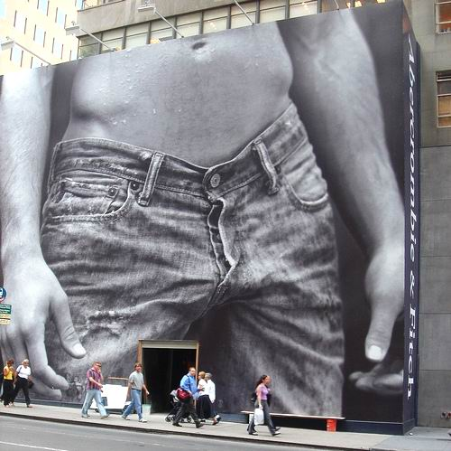

# Abercrombie & Fitch

去年接触到[Abercrombie & Fitch](http://www.abercrombie.com/anf/index.html)这个品牌，外贸店里淘过几件Abercrombie & Fitch衣服，质地很不错，体恤的款式侉侉的，看上去没什么型，但穿在身上休闲味十足，不过要小心仿制品，买过一件外套，估计是打样的，一只袖子紧另一只袖子松，穿着的效果还不错。Abercrombie & Fitch的色彩很正，整体风格简洁，很符合我的审美。

全美国共有366家Abercrombie & Fitch分店，是美国知名品牌，由同名公司经营，主要走休闲年轻路线，衣服质感超佳。AF衣服突出胸，腰，臀，完全贴身，性感不凡，颓废不羁。此品牌最有名的地方，就是在广告尽显肌肉男造型，且基本上都是身材好、年轻的白人。据说Abercrombie & Fitch在韩国卖价较高，比较流行。从[BING](http://bing.echina.com/2006/03/diesel.html#comments)那里得知此品牌是让俊男美女都变成乞丐打扮，但有种族歧视倾向, 常因应聘员工长得达不到其标准不予录用引起法律纠纷, 不过纽约的店里现已可见亚裔面孔的销售代表呢。据传黎明曾买过这个牌子的衣服送脱星。

2002年4月18日Abercrombie & Fitch曾宣布撤回当时新出品的以亚洲人为主题的T恤衫，回应当地亚裔团体抗议种族歧视。这件体恤售价25美元，上面印着张漫画：一个斜眼、戴着圆锥形帽子的亚洲人，旁边印着口号，“黄氏兄弟洗衣店：两个黄能变成白”（WONG BROTHERS LAUNDRY SERVICE: TWO WONGS CAN MAKE IT WHITE）和“碗与球—中国饭与保龄球”（WOK-N-BOWL-CHINESE FOOD AND BOWLING）。

“我们决不想冒犯任何人”， Abercrombie & Fitch公司发言人卡尼（Hampton Carney）说：“设计T恤衫上的图案时，本意很单纯，只是想给我们的产品增加点幽默和变化，既然有顾客觉得不舒服，我们就从商店撤回来。”

卡尼声称，制造商以为这些T恤衫可能会吸引亚裔顾客，没想到招致如此的愤怒，实感意外：“本来以为大家都会喜欢，特别是亚裔社区。我们觉得T恤衫大胆、不敬、可笑，每个人都会喜欢。事实却大相径庭。”

Abercrombie公司在全国有500家商店，卡尼不能确定能从店里撤回多少T恤衫，同时一些T恤衫还没有送到店里。Abercrombie & Fitch总部在俄亥俄州的新阿尔伯尼（New Albany）。

Abercrombie & Fitch在曼哈顿搞的超大超酷牛仔裤广告，让人们玩钻裤档方能入内  

---

## 评论（15）

**[anxd](http://anxd.wordpress.com)** · 2006-03-18

Christina你好。我刚刚申请了一个blog. 加了你的link. 有空来坐坐。:mrgreen:

**thelastmango** · 2006-03-18

这个牌子是不错，很有味道，不过主要是面对年轻的小朋友，我老公总觉得它家的T SHIRT 不就是块麻布吗，这码贵！ 我喜欢可惜身材有限。  
喜欢你的BLOG，追看很久了，我也是南京人，看这个特亲切。

**christina** · 2006-03-18

:grin:欢迎你哦！

**christina** · 2006-03-18

看美圆售价也不是很高呀，不晓得韩国卖价能有多高？！:roll:

**jay** · 2006-03-18

这年头，有哪个牌子不用肌肉男卖广告啊?  
  
和其他well-known的名牌比当然不算贵。但对不追求名牌的人来说，没必要花$25买一件全棉的Tshirt。这牌子在美国的市场主要是青少年，最近才打入canada. 档次上和tommyHilfiger差不多吧。

**water_proof** · 2006-03-19

:oops: 每次都累得要命，还是舍不得放下那件T恤。这件手感好，那件颜色好，还有件啥都好可惜是女生的。。。。

**Brooklyn** · 2006-03-20

真长见识啊,呵呵,都说衣服和化妆品是女人的专利,也不尽然嘛~~有些东西男人也应该了解,这是常识...hoho

**[游子](http://www.flickr.com/photos/16491531N00/show/)** · 2006-03-21

A&F在美国就是TEENAGES的衣服，30-50美元，PROFESSONALS没有人穿，还是POLO，TOMMY，RALPH LAURO更好一些，女士穿ANN TAYLOR，BANANA REPUBLIC

**lazycat** · 2006-03-21

楼上那位说得差不多，A&F 在美国很受年轻人的欢迎，属于休闲服装，号码都小小的，我虽然还不算老，想穿可没那身材， 相比我更喜欢 J. Crew (www.jcrew.com)。 Christina, 有兴趣你看看，不过A&F 倒也适合你 :smile:

**[游子](http://www.flickr.com/photos/16491531N00/show/)** · 2006-03-21

其实，美国人很不讲究穿衣，在学校的时候不管中国学生美国学生都穿UNIVERSITY T-SHIRT ，10美元一件，质量挺好，我们学校SPORTS NO 1， FOOTBALL的STADIUM叫BIG HOUSE，全美最大的STADIUM，能装下10万人，衣服都是往洗衣机里一扔，再好的衣服一个月就不成样子了，从学校出来当了药剂师，得跟CUSTOMER打交道，买了几件POLO衬衣，开始还手洗，实在洗不过来，还要烫，现在也是往洗衣机里一扔，有时候也来不及烫，小孩都穿BASKETBALL，FOOTBALL，BASEBALL 和ICE HOCKEY的队服，好的要70美元一件，要JORDAN的鞋，100美元。还有人偷，上次游泳我儿子的PISTONS的衣服就被别人偷了，其实，我们这里一般衣服就是放在GYM一个月也没人拿的

**雨** · 2006-03-23

不知道,呵呵,头一次见博客,感觉很好奇.总之,认识你们很高兴!可惜不知道该如何建博客,希望你们有谁可以教我呢,谢谢.

**alpha** · 2006-03-24

在日本的乐天购物网上看到了A&F的胸牌,很不错呀!:shock::shock:

**[more](http://www.silkday.com)** · 2006-04-13

if you have time to spare,you can visit my website of silk fashion.

**kiefer** · 2006-05-22

什么小朋友穿啊．确切的说这个牌子是年轻人穿的．每个牌子都有自己的尺寸，风格裁剪不同而已．ＣＫ裤还比ＡＦ小点呢．难道是ＫＩＤＳ穿的啊．ＡＥ针对的年龄层比ＡＦ还低一些，可它的裤子的腰围比ＡＦ大呢．ＡＦ的ＴＥＥ是７０年代风格的复古贴身设计．ＣＡＮＡＤＡ都有几十家店．除了美国加拿大其它地方没卖．今年在爱尔兰开欧洲第一家旗舰店．明年将会在日本东京开出第一家店．ＴＯＭＭＹ这个牌子的衣服尺寸都比较大．

**[80经典](http://8)** · 2008-03-06

AF批发相册http://photo.163.com/photos/china80jd  
淘宝http://shop33528008.taobao.com/  
相册有模特实物拍摄,欢迎看版.  
有实体批发档口.有稳定工厂提供物美价廉的货源.  
欢迎下单批发,招网络代理.

