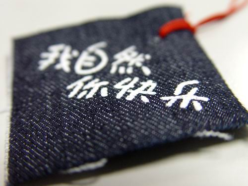

# 我自然你快乐

整个下午得了吃东西狂想症，吃完牛肉干留下“我自然你快乐”的标签，没有什么比吃更能令人愉悦了！尤其当你为工作烦心，为他人烦心，为不知名的情绪烦心的时候。越来越喜欢夜晚，这时候的夜晚有很浓的春天的气息，乍暖还寒，空气中夹杂的记忆汹涌澎湃。南京的春天非常短暂，穿长袖衬衣的时间没有秋天长，容不得你细细感受恍然间就进入夏季了，有时人生好象南京的春天，推着你往前走，过了一季又一季。

“已经星期二了，日子过得真快。”我懒洋洋地说道。  
N莫名地笑起来“每周都有星期二，呵呵~~”  
“我是说一周到了星期二，这周很快就过去了。”忽然害怕时间过得太快，可又希望某些东西能够拥有更长的时间，希望听见指针滴答滴答行走的声音，矛盾而复杂。

大多周末去郊外，今天中午按捺不住去了水榭，人少车少。对于东郊我总是百去不厌。沿着水边走了一圈，看见去年夏天的两只野鸭子在水里悠闲地荡漾，两个男人垂钓，静谧中的景色可以使人贪婪整个下午。环卫工人清扫路两边的兰花花瓣，真是可惜了......

  
*shot by Christina  
SONY F717*

---

## 评论（33）

**Jonathan** · 2006-03-23

还认得去年的鸭子，真厉害！

**[3water](http://spaces.msn.com/3water)** · 2006-03-23

怎么这里又开始更新了：）

**流浪的燕子** · 2006-03-23

虽不曾谋面，但似曾相识。对你似乎多了一份挂念，想与你成为日暮相见的朋友。我的MSN随时等着你的加入，流浪的燕子lisa

**水清浅** · 2006-03-24

越自然越舒适

**[南方雪](http://blog.donews.com/lcmgz)** · 2006-03-24

季节总是承载着我们的情绪。春天，应该是属于多愁善感的吧。

**[好博网](http://www.okblog.cn)** · 2006-03-24

您好，您的博客内容十分优秀，我们在赞赏您能与他人分享生活快乐的同时,很荣幸的希望能够收录您的博客，愿您与众多中文博客共同分享生活的乐趣。   
  
好博网中文目录编辑敬致   
http://OkBlog.cn

**雨** · 2006-03-25

看到很多人在你留言,觉得很好奇,不知道什么是博客,也不知道建立,觉得你们只可远看,不可涉及,对了，其实,网上也可以谈爱情的呀,听我好友说，现在通过网络结婚,恋爱的人很多，我相信你也许可以在网络上寻找到理想的她.

**[爽客甲](http://spaces.msn.com/issomebody)** · 2006-03-28

我自然你快乐……

**水清浅** · 2006-03-28

Christina,你另一个blog怎么打不开了？

**Jonathan** · 2006-03-28

提醒：前两天上不了你的blog，提示说是prohibited access to server。如果是普遍现象，可能需要查一下。

**游子** · 2006-03-29

看了国内一些所谓白领的BLOG，我发现你们的思想和我们在美国工作和生活的中国人有很大的不同，你们好像结婚有孩子的人不多，而且，尽说一些新名词，口气很大。其实，我们刚到美国的时候也充满了幻想，以为自己很了不起，到了美国以后才知道美国人不过是把我们当廉价的劳动力，大把大把从中国印度来的PHD学生，拿着20000美元/年的奖学金，每天工作10几个小时，90%的人毕业以后只能做POSTDOC，挣30000-40000美元/年，能当教授的外国学生很少，除非很聪明勤奋的人。现在能有份好工作养家糊口就行了。

**Michael** · 2006-03-30

中国人在国外本来就是劳动力。而且中国人很少抱怨。

**水清浅** · 2006-03-30

这颜色太重了，看不清楚字

**aimless** · 2006-03-30

11楼的游子你出国多久了？我想你也应该理解我们国家在长期闭锁状态下养成的外表狂妄，内心自卑的国民气质吧？你也不是ABC相信你也不能免俗。我喜欢christinamm在于欣赏她的生活态度，象赵mm讲的“以悲观的心态过乐观的生活”，所以每次来看mm的blog都会感觉到恬静的愉悦，可惜的是她也忙了，这么长时间也不来了。christina，你在哪里？你在哪里……

**游子** · 2006-03-30

AIMLESS：你好，我是1998年来美国的，虽然时间不长，但是，对美国中国应该是比较了解的，也许我的专业不同，对事情的判断和理解也不同。许多CHRIASTINA的朋友都是搞网络的，他们都是一些自命不凡的人，天天把GOOGLE，MICROSOFT 挂在嘴边，也许，他们有一天真能成为BILL GATES那样的人，不过，对我来说，BILL GATES比上帝离我还遥远，尽管GOOGLE的两位创始人都是我们UofM毕业的(如果我没记错的话)。我一直认为努力和勤奋才是成功之母，我真的不认为有一天会冒出一个IDEA 就可以赚到一百万，一个亿。可以说，美国人比我们中国人务实肯干，他们做每一件事都要尽自己最大的努力，我的工作性质决定我只能兢兢业业，每一个ERROR都可能是致命。我不知道是不是我住的MICHIGAN州太落后保守，我们的思想已经跟不上这个时代。最后，衷心的希望他们梦想成真。

**aimless** · 2006-03-30

游子,首先俺对你的这段话表示赞同.留学是俺的梦想,同时意味着短期内实现不了……俺的生活正如大腕里葛优讲的悲剧人生：NO MONEY,NO WOMEN。不过俺并没有放弃俺的理想，也已经提前三年进入而立心态，找到了自己生存的意义。俺对chrismm的朋友木有兴趣，偶感兴趣的只是她本身……游子只要你明白了异性相吸的道理就不会这么说了，哈哈。你跟她对不上路的。

**Michael** · 2006-03-30

背景不错，但是文字颜色太谈了

**[lcm](http://blog.donews.com/lcmgz)** · 2006-03-30

Hi Christina,  
I created a link to your blog in my space. Hope you won’t mind. But if you do, please let me know.  
Have a nice day.

**[airylea](http://www.airylea.net)** · 2006-03-30

丁子江曾经有过一本书《美国之劫：华人与美国法律的真实较量》（中国工人出版社2002年版），里面写美国人通常把华人按照居住地分成四类，旧中国城、新中国城、校园和高科技行业，几类人群虽然各有特点，但华人在美国社会的印象基本上都是天资聪颖，工作兢兢业业，理论性较强，应用能力不一定强，鲜有创造性，不少仅为职业机器，相当多的人喜欢单干，而不喜欢合作，不少人注意个人事业，不重视回馈社会，不热心公益事业。

**[airylea](http://www.airylea.net)** · 2006-03-30

我的意识是说，虽然美国人对华人的看法有失偏颇，有些一概而论（比如南北方人有差异，大陆和台湾人有差异）但华人自身的一些东西确实不够到位。

**[阿帆](http://afan1.blogchina.com)** · 2006-03-30

游子说得我很赞同，不能不否认中国大城市变得很时尚（还是一直都很时尚，不过程度不同而已，80年代流行日产冰箱彩电，90年代流行卡拉OK，21世纪是房子车子），也正是这样哈根达斯和星巴达才能中国横行。如果放假很多国人希望能出国欧美旅游，我则希望能每天驾艇出海去钓一个星期的鱼。

**[漫步的壁虎](http://blog.sina.com.cn/u/1198901884)** · 2006-03-30

好久没来看你了，2004年下半年、2005年的上半年，几乎每天都会来这里看看。希望你每天都快乐，不快乐的时候就多点字、多拍点照片给我们看。

**[爽客甲](http://spaces.msn.com/issomebody)** · 2006-03-31

游子兄比较的时候还要看看环境的不同啊~~~感觉上在国外的华人会比较务实一点。

某人自己自从出国后各方面都务实了很多，但是很难保将来某一天回国后不会浮燥起来……

另外，对airylea引用丁子江的观点表示80%以上的同意。至于参与公众事业，个人差异很大。有些华人是很热心的。还有，并不是大部分外国人都很热心，而且不少是年纪稍微大点之后才开始热心的。

以上仅代表某人对英国地区生活人群的一些看法。

**[david](http://sunsethouse.apro-g.com)** · 2006-03-31

哈哈，手撕牛肉。成都溜洋狗 :-)

**游子** · 2006-04-01

我对CHRISTINA和她的朋友没有敌意，只不过想交换一些自己对一些社会现象的看法和理解。AIRYLEA 提到的书我没有读过，就我亲身经历而言，美国是一个移民社会，每一个种族都有自己的特点，美国人爱说：WE ARE DIFFERENT，BUT WE ARE AMERICANS。但不可否认美国社会最大的矛盾是种族矛盾，很多黑人和白人在美国生活了好几代了，应该没有语言和文化的差别，但是，每个美国的城市都有黑人区，而白人区很少有黑人居住，还是SPANISH 区，ITIALIAN 区，FRENCH 区，GREEK 区等等。其实，白人也不是铁板一块，有POLISH，GERMAN，IERLISH，DUTCH，ITIALIAN。。。  
他们的生活习惯也不一样，他们也一样会取笑别的种族的缺点。很多美国人把韩国人，日本人，泰国人，越南人都统统称为中国人，就跟咱们分不清欧洲人的国籍一样。改革开放以来从大陆来的中国人应该算是最成功的移民吧，大部分人都有很好的职业较高的收入，基本上和其他族裔都能和平共处，很多白人挺愿意有中国人当邻居和朋友，中国人虽然不是社区的积极参与者，但都能承担自己的责任，同时也是遵纪守法的好公民。

**游子** · 2006-04-01

关于阿帆所谓的时尚，我不敢苟同，90年代的时候北京人把吃麦当劳，KFC当成时尚，其实，不过，都是一些垃圾食物而已，听说，现在流行哈根达斯, 星巴达, PIZZA HUT, 这些东西和麦当劳，KFC一样也都是营养价值极低热量很高的JUNK FOOD，西方流行的HOME-MADE FOOD，HEALTHY，实在没有时间，不得已才去吃FAST FOOD，很多人吃完很懊悔，我真搞不懂，在中国这些东西贵的离谱，居然还有很多人追捧。

**Michael** · 2006-04-01

非要中英混合排版吗？不能全用中文写啊？

**[williamfan](http://www.newhots.com)** · 2006-04-03

嗯,很久没更新了,RSS也一直报错,主人生病了吗？祝愿没网络的日子，主人的生活一样特别幸福……

**[小林](http://spaces.msn.com/ffspider)** · 2006-04-03

这个blog给了我很多新鲜东西。一直关注，怎么最近主人没有更新了？

**[Christina](http://www.tecinese.com)** · 2006-04-03

改版改程序，请耐心等待....

**thelastmango** · 2006-04-04

游子大哥是来晒的把，在美国就可以批评这批评那吗，烦人。依我看，好上纲上线到是中国男人的本色，读再多书提高不了基本素质，到了月球也没用。

**游子** · 2006-04-05

芒果批评的好，我接受，你一语道破，咱的素质就是不高，出身不好，祖祖辈辈都是农民，除了会读书考试几乎一无是处，最大的毛病就是爱发牢骚管闲事。

**thelastmango** · 2006-04-05

我靠，游子大哥我改称你晒大哥得了，在我芒果的理解里面，基本素质的其中一条是尊重，懂得尊重不同的人不同的文化，说到农民，我到是满尊重的，中国的过去是靠农民，将来也是，绝不是靠只会念书的满嘴牢骚的书匠们。

