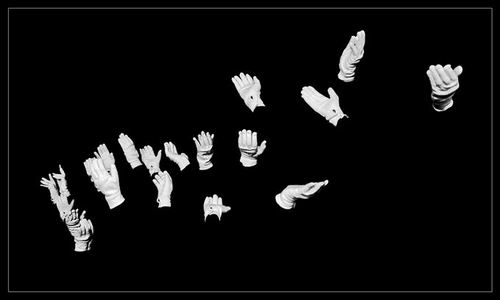

# Dreams

这周繁忙、琐碎、压迫感、很郁闷的一周，这些情绪大多来自工作。这种不良的情绪直接或间接影响到其他方面，本可以轻描淡写一带而过的事情，却因为情绪的原因格外有压迫感。我在郁郁寡欢，整日整夜，得想办法解决...

---

## 评论（2）

**oakland** · 2006-04-13

明朝挂帆去,枫叶落纷纷。

**[angie](http://angie.tecinese.com)** · 2006-04-13

那是因为你还没学会自释

