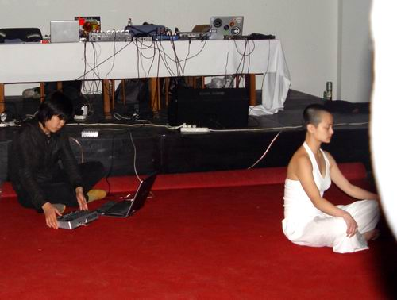
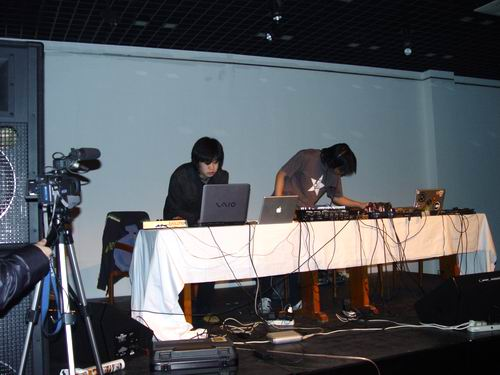

# 非主流

夜色下的朱屺瞻美术馆，门头低调简洁，透着令人想要探索的气质。虎子问我：“南京这种活动很少？”的确少，也或许是得不到信息，不过即使有，对于南京所谓的艺术工作者我会有种莫名且刻意的近而远知。观察中发现相同圈子南北方艺术工作者在风格、方式（包括做人方式）、气质上会有些区别。典型的是在艺术工作者前面加上“上海”两个字，定义则有些微妙。负责影像的S.T.来自上海，从晚上7点多到9点多一直在调试投影，演出的时候仍然是个大白墙，任何影像也没有，他的身份马上转变为自由观众，赋有典型南京华新形象，用北京话讲“不靠谱”。据说日本人组织的活动，在所有艺术表演者到达前，前期准备工作均会就绪，机器连接好，线头贴好，暂且放下民族情结，我们是否可以思考一下日本人这种工作到极致的精神和态度？

我并不了解虎子目前的名气有多大？艺术造诣有多深？从频繁被邀请的机率可判断一二，在我看来他所涉入的艺术领域尚属小众艺术，小众既避免滥俗又与商业无关。在他身上看不到明显的“功利”，更无极尽所能的炫耀。某人说过：“希望别人把我看得很轻很轻，轻得如一粒微尘，在不经意时刻体现其价值和份量。”“不经意时刻”并不是那些欲望与自负充斥眼神、炫耀和自大写满嘴角的人所制造出的“欲擒故纵的不经意”！

“你以什么来判断艺术的好与坏？”好坏其实没有唯一的标准，用好坏两个字来定义艺术亦有不妥，在我看来被接受的艺术是能引发精神共鸣，理解、满足。A说：“喜欢、接受。”小柯：“在喜欢的艺术面前，无论主观还是客观都不会受到自己控制。”这里特别要提的是西方观众在观看表演时，不是出于喜好保持安静或热烈鼓掌，而是出于礼貌和对艺术的尊重。这也是中国人需要思考的问题。

这次拿到虎子新出的[《两个人的旅行》](http://music.ent.tom.com/1282/1293/20051220-64646.html) ，电子乐效果非常好。渐渐喜欢上这种音乐风格。

前卫艺术工作者:虎子 & 小柯  

虎子 & B6  
   

小柯，Christina，虎子  

外国观众居多，虎子表演的时候有三个外国人居然忘情地躺到调音台下面  

沪宁高速上熟睡的虎子，这副大大的眼镜很有意思，据说是在意大利古董市场EUR90.00购买的，60年代制造。  

前卫现代舞表演者：小柯  

---

## 评论（6）

**Jonathan** · 2006-04-17

Great. Hope i could attend the captioned show.

**[joanna](http://jinking20.yculblog.com)** · 2006-04-18

小柯工作的状态更有魅力

**yooyoo** · 2006-04-20

哪里的朱屺瞻美术馆，南京的还是上海的，上海的我是知道的，在欧阳路

**youzi** · 2006-04-22

Chicago Museum of Science and Industry

**youzi** · 2006-04-23

**youzi** · 2006-04-23

