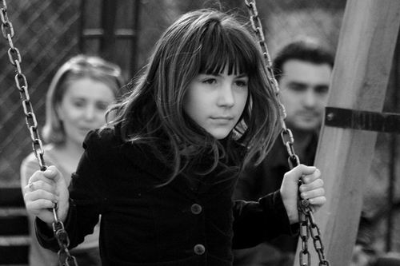

# 变化

有段时间了，我的舌头好象被什么咬着，说出来的话都是自己不想说的。MP3随身听的好处在于能让人沉默而不觉得尴尬。  
以前话多，现在话越来越少，不知道该说些什么。  
现在话少，以后是不是话会越来越多？  
所有的人都在变化，每一分每一秒。  
不要再说你不会变化...

昨天晚上到虎子参加活动的酒店，看到吴大维作为某房产形象代言出现在小舞台上，看过小柯和另一个甜美女孩的舞蹈，看过声乐串串烧，看到模特走猫步，一个舞台艺术表现形式多起来，感觉就象个大杂烩。没有了朱屺瞻美术馆里那场浓缩的精华。

白天上班的时候，脑子突然冒出一个场景，小柯要是坐在我现在的办公桌前，进行我手上的工作，长年累月下来会是什么心态？是不是会有枯萎和逐渐死亡的感觉？原来小柯在美国强生工作过三年，考虑是否辞职进现在的工作室考虑了一年。据说每天早晨一打开电脑就是100多封E-MAIL，电话里的 “喂”差点变成每天的口头禅......有谁会用前男友的名字给宠物起名字？小柯给她的小狗起名C小吊。对她的真性情有些许好感，很自然的一个女孩。不同工作培养了不同的心境，就象big friend说的：“你进了国企，虎子成为前卫艺术工作者。”

---

## 评论（3）

**[airylea](http://www.airylea.net)** · 2006-04-19

环境确实影响人的心态。

**passerby** · 2006-04-20

才出现这种变化？幸福

**Jonathan** · 2006-04-21

感同身受。 but although we sometimes eagerly wish to change, we sometimes are afraid of changes.

