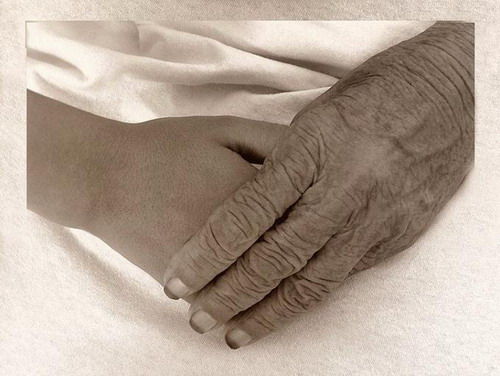

# 母亲节

给母亲送礼物一直很难，母亲节这天还是选了一枚普柏林戒指送给她，结果仍然是唠叨。父亲建议我将戒指换成理疗仪。见到别人母亲收到礼物时的可爱表情，心里不免羡慕！母亲之所以唠叨是不想让儿女花钱，也许折现是最容易的礼物？！

---

## 评论（8）

**james** · 2006-05-15

买珠宝首饰应该找我啊，我可以给你很大很大的折扣：-）

老一辈人喜欢实际、实用的东西，他们不太接受奢侈品，这主要是因为他们长期生活在一个物质生活不很富裕的社会所造成的。虽然现在生活改善了，但他们的消费观也已经定型了。很难说服他们。

我父母亲也有类似的问题。

**Ｄａｎ** · 2006-05-16

谁说父母不是嘴硬心软呢。无论送什么礼物，只要能体会到儿女的心意就足够了。就算送的是无价之宝，也远比这心意轻得多。

**[afan](http://afan1.blogchina.com)** · 2006-05-16

这张照片应该是祖母辈和孙辈的手  
当然外祖母是妈妈的妈妈

**Mandy** · 2006-05-16

我为两位母亲买了马蹄莲。她们嘴里说浪费，但是我相信女人都喜欢花。

**youzi** · 2006-05-17

送保健品，医用健身器件(血压计，电动按摩椅，走步器)，老年人要吃一些降血脂，多维补品。这些最好从国外买，国内假货多。国内医患关系紧张，我每次打电话回去，父母最多的问题就是保健方面的，很多亲戚朋友也问很多问题，而且，我也帮他们买药品，父母挺有面子。

**youzi** · 2006-05-17

我一般建议他们在国内做一些血液检验，再根据他们的健康状态送一些保健药品。父母亲戚朋友都很满意，效果都很好。

**thelastmango** · 2006-05-17

送 钱 不 好 ， 送 了 还 是 存 起 来 。

**Juana.Cafe** · 2006-05-22

我妈妈比较喜欢玉质的首饰，但我觉得老人适合带大颗珍珠的耳钉或者胸针或者挂坠之类，不过，还是买妈妈中意的好~

