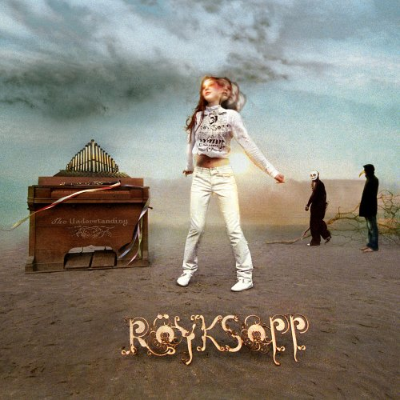
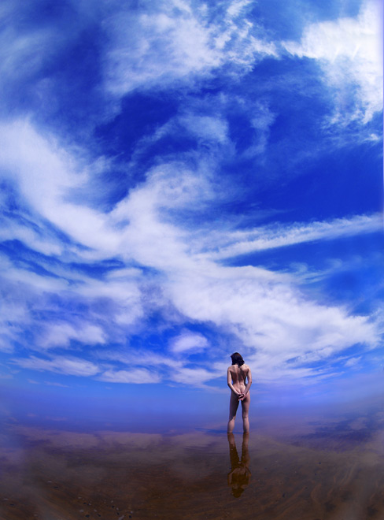

# Röyksopp

这两天工作后喜欢听重金属，麻木的神经需要刺激才能恢复常态。偶然的机会接触到一些电子乐，激动不已，开始牵挂。音乐可以纯净人的心情，使人内心安静。音乐也可承载及驱除人的不良情绪！找副音质好的耳机，一个人的夜晚，一个人驾驶，一个人郁闷，一个人欣喜...播放适合心情的电子乐给自己听！

较喜欢Röyksopp的电子风格，ö代表着非英国团体（和 Björk 的ö一样，经常被人打成 O），或许也因如此对这对组合增添多少神秘又难以接触的感觉。这支挪威二人组的成员的名字写起来要比读起来困难得多，Torbjørn Brundtland和Svein Berge创造了他们首张专辑《Melody A.M.》的佳绩，其中的单曲发行横跨三个年度。最新专辑《The Understanding》融合多种时尚电子舞曲元素，部分可以说是chill-out，部分是trance类型的歌曲。听Only this moment，[Boys](http://v.qingyinyue.com/wma2/2005/02/00482/4.Wma)，[Follow My Ruin](http://mp3.ge520.com/zwhundan/geshou7/166/1/5.Wma)，[What Else Is There](http://www.mytlsp.net/yinyue/r/royksopp/Royksopp-What_Else_Is_There.mp3) 时感到这种音乐完全调动着我的心脏和身体，激动且陶醉！

工作之后如果感到疲惫、郁闷，不妨听听Cafe Del Mar的电子乐，2006年4月3日Cafe Del Mar发行的新专辑《La Caina-Vue Mer》中有几首很好听的曲子：  
[We’re Gonna Make Love Tonight]( http://fs6.139.com/0/312/falook/sound/200642372655604.wma)，  [Arabiza](http://fs6.139.com/0/312/falook/sound/200642372447355.wma )，[Calling Back]( http://fs6.139.com/0/312/falook/sound/200642372335566.wma)， [Bailando Va](http://fs6.139.com/0/312/falook/sound/200642372421237.wma )，[Bop Blues](http://fs6.139.com/0/312/falook/sound/200642372553851.wma )，[I Gotta Know Now]( http://fs6.139.com/0/312/falook/sound/200642372710322.wma)，[I Know The Score]( http://fs6.139.com/0/312/falook/sound/200642372627207.wma)......

位于Ibiza岛海岸边的Cafe Del Mar是一座可以从海水看到日落倒影的海岸咖啡馆，面朝夕阳无限好的橘色日落，结合令人心旷神怡的DJ音乐，使这家咖啡馆成为Ibiza的一处著名的消闲胜地。

1980 年初，Del Mar咖啡馆建成于 Ibiza 海岛的岸边，其极具特色的装潢建筑与令人神往的日落马上吸引了许多游客。 伴随着优美景致应运而生的音乐文化涵盖了爵士、蓝调、古典、电子等，自此日落和音乐便成为Cafe Del Mar的一部分 。如今，Cafe Del Mar 除了是Ibiza的代表外，更变成了Chill Out音乐的代名词，甚至成为时尚词语。

Chill Out的音乐特点是优美女声的运用，配搭上音乐本身的放松风格，营造一种舒缓释放的情境，抑或带点淡淡哀伤的人声吟唱，让人得到另一种悠然的感受。
