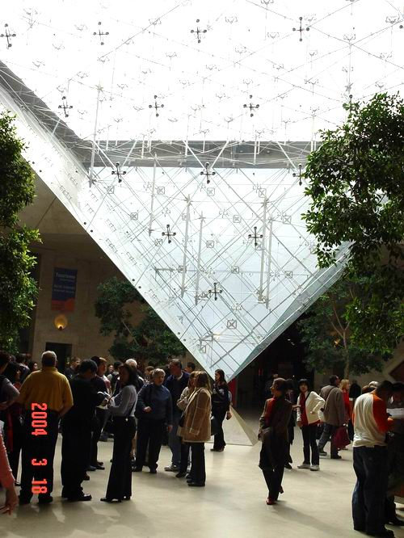
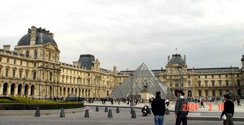
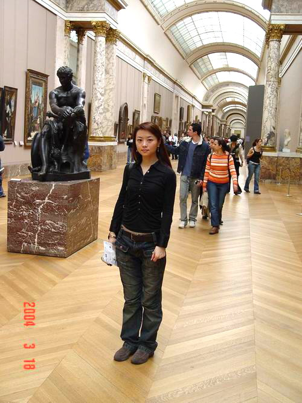

# 达·芬奇密码

想去买本丹·布朗写的《达·芬奇密码》的书。电影永远没有小说精彩，如果想象力更丰富和发散，阅读小说应该是个更好的选择。电影《达芬奇密码》上映一周多，票价仍然保持在45元，有关“达芬奇密码”的手机屏保、体恤衫、猜谜、PS2[游戏](http://www.davincicode.com.cn/)等等节目几乎也是同时在市场上出现。

丹·布朗在小说里描述了一种带有黑色幽默的人生哲学，同时通过小说主人公之口对卢浮宫收藏的经典画作进行了别具一格的点评，对创作这些作品的画家也有非常有意思的介绍。

卢浮宫是一个非常巨大的文化艺术宝库，影片最后[TOM HANKS](http://konary.com/tom/)站在倒玻璃金字塔上，耶稣的妻子[**抹大拉**](http://ent.sina.com.cn/m/2006-05-24/19541092117.html)有名的圣女之一，她的石棺就在其下面，这个镜头勾起[我对卢浮宫的亲切回忆](http://tecinese.com/article/14/)，很巧的是我正好也拍了张卢浮宫入口倒玻璃金字塔的照片。电影中的让·雷诺针对卢浮宫前的玻璃建筑物说道：“这是巴黎脸上的一道疤痕！”

---

## 评论（20）

**youzi** · 2006-05-31

听说电影很好，可惜没时间看，月初完成 1000 小时PHARMACY INTERNSHIP HOURS，上星期参加NAPLEX (北美药剂师考试)，今天是PHARMACY LAW 考试。通过考试应该没有问题，只有通过这两个考试才能成为正式的PHARMACIST，工资才能涨上去。

**Jonathan** · 2006-05-31

如果要去看电影，最好先看一下书，这样就不会像我去看的时候很多旁边的观众一样闷的睡觉了。但电影的确没有书精彩，特别是由于时间所限，很多思考、解密的过程都无法呈现。此外tom hanks的表现实在一般，不能表现原著中主人公的睿智机警，倒是女主角表现尚可，虽然比其此前的《天使爱美丽》要逊色些许。  
坦白讲，作者的另外一本书《魔鬼与天使》(上次去香港见到书商的噱头是“达芬奇密码前传”)要比《达芬奇密码》精彩不少，估计迟早也要拍成电影的。

**flos** · 2006-06-01

这blog 关注很久了　只是默默的支持（电脑前有很多我这样性质的人吧）很喜欢简洁舒服的页面　还有会说话的图片  
耶６．１快乐！！！

**sumu** · 2006-06-01

路过这里，很不错的地方。  
我也去看了《达芬奇密码》的首映，感觉这就是一部标准的好莱坞娱乐大片，故事情节上有意地回避宗教问题，反而让影片相比原著要逊色许多。

**[Christina](http://tecinese.com)** · 2006-06-01

我觉得男女演员表现都不是太精彩，电影对于宗教表现也只是点燃了N个小火苗，并没引深下去描述。这部电影就象我面对卢浮宫.....茫然不知所措！基本情节清楚，但细节上的空缺必须了解宗教背景之后才能补上！
看电影睡觉？不可思议！我看电影一般都比较投入，即使看给党员拍的专场电影也看得津津有味！

**[灰子](http://yaohui.blogbus.com)** · 2006-06-01

能去那里真好：）节日快乐

**[波斯猫](http://www.boxmao.com)** · 2006-06-01

哇，美女，6。1 快乐

**don** · 2006-06-01

昨天看了 The Da Vinci Code.   
没看懂为什么会由Blood Line想到RoseLine，进而想到罗浮宫。under the rose =under the blood?

Matrix不需要背景知识，最多知道点哲学和计算机方面的知识就可以了。  
The Da Vinci Code.需要你对拉丁语的形成,基督教的典故，西方历史有深入地了解。  
同样是看不懂，同样是要多看几遍才行。  
Matrix的结尾，在虚拟的世界里统一了人和机器。  
而The Da Vinci Code的结尾，在现实的世界里统一了人和神。  
无论虚拟和现实的世界，重要的是你相信什么？

**Dan** · 2006-06-02

丹布朗的书写得很不错，可惜还没有机会看到Tom Hanks的表演。听看后的朋友说情节模糊，不知所云；相信阅读原著会对他们的理解有帮助。有机会想去看看电影，不管是好是坏！

**Jonathan** · 2006-06-02

我想don没有看过原著，其实don的这些疑惑在书里都有详细描述，这也正是电影的败笔(即由于时间所限，很多思考、解密的过程都无法呈现)。对一些英语词源词义、圣经的大意有了掌握基本都应该能看懂，倒不一定对“拉丁语的形成,基督教的典故，西方历史有深入地了解”。  
反而The Matrix则不同，大部分人都认为黑客是一部很“炫”的科幻片，但如果真正看懂了黑客，会了解到黑客系列（当然，黑客二弱了些）阐述了很多内容，譬如宗教（电影的编剧，也就是导演兄弟受到了较深的印度教思想影响，主要体现在《奥义书》）、未来学、哲学（黑格尔思想）、现代科技引发的人文思考等等，更涵盖了商业电影的悬疑、动作甚至感情（谁能说neo与trinity之间的爱情不是最伟大的爱情？而neo对zion中人类的感情不是最深厚的情感、以至于最后甘愿以己身换取和平呢）诸多元素。同样作为电影这种表达形式而言，the davinci code显然苍白无力了许多，不可同日而语。  
当然，只有多次观看、勤于思考探究，才能够逐渐明白the matrix系列的内容，这个过程中，黑客帝国的动画版可以作为很好的铺垫和头绪。  
我想，为何导演两兄弟此后再也不愿执导影片，主要就是觉得再难以超越黑客系列吧，虽然，他们最近监制了一部片子，印象中名字是V (for Vendata)，并且专业影评似乎颇持正面意见。

**sumu** · 2006-06-02

V字仇杀队 V for Vendetta  
像是一本激情充沛的“造反”檄文。很不错，市面上有较好的D5版本。  
关于《达芬奇密码》，我觉得《芝加哥太阳报》的评论很好：电影十分平庸，却很有娱乐性。

**someone** · 2006-06-02

只想说笔者美女一个： ）

**[airylea](http://www.airylea.net)** · 2006-06-03

出差去了南京，看了十里秦淮，吃了臭豆腐、鸭血粉丝汤，逛了新街口，去了紫金山。  
一方水土养一方人。

**[阿帆](http://afan1.blogchina.com)** · 2006-06-04

看完电影，只好去买了小说，其实应该拍电视连续剧，这样能多点细节，电影进程太快了。就好像Prison Break，拍电影估计就没人看了。

**[阿帆](http://afan1.blogchina.com)** · 2006-06-04

对了，我和去看的其中一位朋友也睡着了。汤姆汉克斯表现在这部片里确实一般，毕竟年纪不饶人。

**[水手](http://www.donews.net/sbewcw)** · 2006-06-04

昨天刚看过  
TC版的，那部TC的已经很不错了  
音，可以说上质  
只是图像没那么的好而已 贫学生呀！看得很有意思，书最近没时间咯,好几本正交换着看呢。

**[BENM](http://blog.sina.com/m/BENM)** · 2006-06-05

之前看了凤凰的“达芬奇密码之解密”就感觉没什么意思了，其实之前一部分“耶稣受难记”也有关耶稣娶妻生子的故事。不过感兴趣的是里面（凤凰台的节目中）提到“尤大福音”说“更讽刺的是有种说法尤大才是真正了解耶稣的弟子，正是他的背叛成全了耶稣的不朽，而这正是耶稣本人的意旨……”以前也听说这，这些只不过是为了证明耶稣也是一个人，不管耶稣是神还是人，信仰在于内心，佛家说“佛在心中”。  
喜欢罗浮宫的玻璃“金字塔”，记得是一个貝聿銘作品，艺术本来就不应该都是死的，如果都只是那些古典建筑，艾菲尔铁塔，加上达芬奇的Mona Lisa，那不是太死板了，想起就像鬼片里阴深的古堡，说不上中西文化的结合，但溶入了古今的元素：金字塔和玻璃建筑，我认为这道scar才能出血，才能让人们看到巴黎是活的。

**[Christina](http://tecinese.com)** · 2006-06-05

airylea有没有在东郊好好转转呀?  
十里秦淮，臭豆腐、鸭血粉丝汤，新街口...没什么意思的！外地人到南京来大多喜欢去夫子庙，我不怎么喜欢那里！

**[Anitagtf](http://rgdfbsfffaasf.host.com)** · 2006-06-05

http://rgdrbsfffaasf.host.com  
desk3  
[url=http://rgdsbsfffaasf.host.com]desk4[/url]  
[link=http://rgdabsfffaasf.host.com]desk6[/link]

**微微清风** · 2006-06-05

呵呵,偶尔来你这里看一下...  
达·芬奇密码,书2年前就看过了,不过是包装成有宗教背景的侦探小说,看书倒是欲罢不能,一个晚上就看完了,电影嘛,觉得很拖沓...跟书一样,其实都没什么值得再去探究一次的,除非你对那宗教背景有兴趣..

