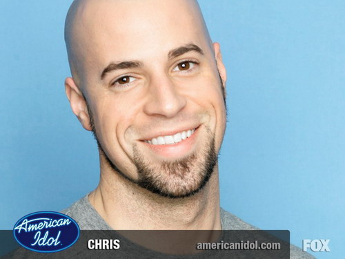
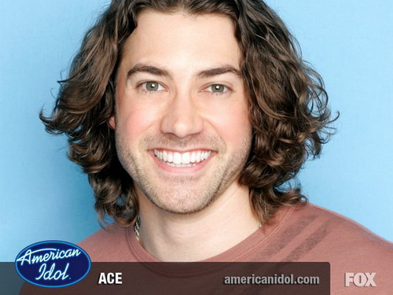
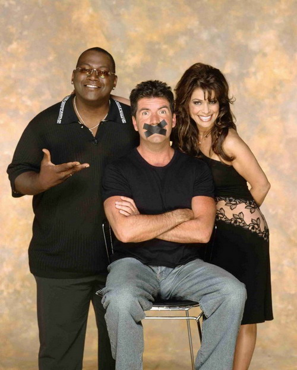
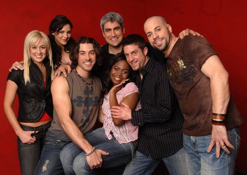

# American Idol

周末看完朋友寄给我的三碟自己刻录的DVD《American Idol》，忽然感觉国内“超女”比赛简直就是一群大人带着小孩儿在搬家家玩，超女是不是抄袭美国偶像？互动性强是收视率高的原因？不过湖南卫视光是短信收入分成可能也有几百万了吧？！

“《American Idol》美国偶像”是福克斯公司在英国系列电视节目“流行偶像（Pop Idol）”的基础上经过改编推出的真人秀电视节目，开始于2002年。说没有门槛，其实还是有要求的，那就是参赛者必须是美国公民，年龄必须在16岁到24岁。到了今年，参赛年龄限制才被放宽到28岁。这个节目一直是福克斯公司的收视法宝，其冠军获得者的奖品就是一纸演唱合约。节目播出4年来，虽然舆论也是褒贬不一，但无疑受到了很高的关注。去年五音不全的[孔庆翔](http://ent.163.com/ent_2003/editor/news/star/040426/040426_241729.html)极具喜剧感的表现被评委嘲笑并被当场淘汰，他却以一句“我已经尽力了，因此我不会有丝毫遗憾”一夜成名，不但赢得了美国观众的支持，还成功签约发行了第一张专辑，引发了世界各地关于偶像的讨论。

基本是一气呵成看完[《American Idol》](http://www.americanidol.com/)，特别喜欢[Katharine](http://www.americanidol.com/contestants/katharine_mcphee/)、[Chris Daughtry](http://www.chrisdaughtryfans.com/)、[Ace Young](http://www.idolonfox.com/contestants/ace_young/)、[Mandisa](http://ent.sina.com.cn/v/2006-02-26/0021997298.html)，后来[Elliott Yamin](http://www.idolonfox.com/contestants/elliott_yamin/)的歌声打动了我，渐渐喜欢上他了。今年美国偶像得主[Taylor Hicks](http://ent.sina.com.cn/v/2006-02-26/0021997303.html)，这个白色乱发男人从开始海选我就没注意过他，到了50强才发现这个人，吹着口琴，走路东摇西晃站不稳的样子。他获冠军真是出乎意料呢！不过倒是比较风趣的先生。

这次American Idol由FORD和可口可乐公司赞助，节目中插播广告里的演员皆为American Idol前10强参赛者，广告和American Idol和谐得流畅，并不令人讨厌！国内超女节目中间突然插播几段广告，那种感觉就象呼吸的时候突然打了个嗝！Taylor Hicks和Katharine分得冠军和亚军，FORD公司分别赠送给他们一辆Ford Mustang。蒙牛酸酸乳与其相比真是小巫见大巫。

在我喜欢的选手中26岁的已婚选手Chris Daughtry由于表演[Fuel乐队](http://www.bala.com.cn/disc/discinfo.html?aid=35502)的一首[“Hemorrhage”](http://web.mit.edu/minaf/www/Songs/Fuel%20%20-%20Hemmorage.mp3) 太出色，已经获得Fuel乐队亲自邀请，担任该乐队主唱！消息称，Fuel乐队贝司手Jeff Abercrombie在一次接受采访时表示，“Chris非常的棒！他的声音非常有感染力！当时他表演那首歌，简直就像是他自己为自己量身订造的一样。 ”

Fuel乐队的原主唱Brett Scallions今年二月上旬离开乐队，此后主唱一直空缺。目前Fuel乐队的官方网页上正在招募歌手，也提及了考虑“收下”Chris的决定，不过正式的声明并未发表，相信一方面是顾及到原主唱忠实歌迷的想法，另一方面是考虑到Chris在半年内仍将被“偶像”节目合约束缚，但不管如何，Chris的“音乐前程”看上去的确一片光明。

Chris Daughtry演唱的FUEL的[《Hemorrhage》](http://web.mit.edu/minaf/www/Songs/Fuel%20%20-%20Hemmorage.mp3)   
Memories are just weighing me down  
Treading waters til the depths give up their dead  
What did you expect to find?  
Was there somethin’you left behind?  
Dont you remember anything I said when I said

Chorus:  
Don’t fall away, and leave me to myself  
Don’t fall away, and leave love bleedin’  
In my hands, in my hands again  
Leave love bleedin’  
In my hands, in my hands  
Love lies bleedin’

Oh hold me now I feel contagious  
Am I the only place that you’ve left to go  
She cries her life is like  
Some movie in black and white  
Dead actors fakin’ lines  
Over and over and over again she cries

Repeat Chorus  
And I wanted   
You turned away  
You don’t remember, but I do  
You never even tried

Chris & Ace  
  
我喜欢Chris的原因很简单，因为他太太好象比他年纪大很多，还带着两个孩子和他结婚的，欣赏他的勇气！

喜欢Ace则是因为他那卷卷的短长发，始终微红的面颊显得有些腼腆害羞。想不明白，大多数美国人的牙齿为什么都那么白呢？梦想国内也有很专业的牙齿美容机构提供美白牙齿的服务，让中国人也能拥有闪亮的笑容！

美国偶像从头至尾三个评委，其中属[Simon Cowell](http://www.tv.com/simon-cowell/person/104611/summary.html)最为尖酸刻薄，这位唱片业的决策者从未想过要当一位电视明星。当初答应为英国的一档选秀节目《流行偶像》(Pop Idol)担当评委，仅仅是为了针对获奖者保护公司的利益。即使今天，他仍然认为自己首先是个商人，不同的是这个商人仅靠批评歌手们唱得多恐怖、多烂、多么像垃圾就能愉快地赚到百万美金。他称之为Syco的公司的一部分，包括一个唱片公司和一个电视制作单位，两者都在以超群的速度制作产品。所谓“西蒙有限公司”规模惊人。考威尔对大量歌手、演唱组合的事业进行运作，包括爱尔兰演唱组合“西城男孩”和以歌剧风格演绎流行歌曲而在大西洋两岸登上排行榜的四人组Il Divo。他的公司每年卖出数以百万计的专辑并且今年将推出5个歌手及团体。考威尔还在英国创建了一档新的电视节目《X-Factor》。这档节目太成功了，甚至阻止了英国版的《流行偶像》节目的继续播出，他因此被控上法庭。另外，在英国和美国的电视网，还有不少于11个电视剧出自他的制作。

《美国偶像》节目三位裁判：Randy Simon Paula  

American Idol前七强合影  

---

## 评论（12）

**MLee** · 2006-06-05

American Idol 今年已经是第四个season了，第一届的Idol 得主Kelly Clarkson 去年的专辑 Breakaway大卖，是2005年全美销量第三的专辑，还得了好几项Grammy 奖。除了主打歌Breakaway以为，我最喜欢的是Since U been Gone 和 Because of you, Christina 有空可以找来听听，估计你一定会喜欢Kelly Clarkson 公认的powerful 歌喉的。

**[Christina](http://tecinese.com)** · 2006-06-05

[Kelly Clarkson](http://ent.sina.com.cn/y/d/2005-01-26/1357641149.html)的歌听过，Grammy颁奖那天还收听收音机的：）当时还不知道她是美国偶像得主。

Kelly Clarkson mp3：[Because Of You](http://ihome.ust.hk/~cs_hwl/Music/title.mp3) ，[Breakaway](http://player.toodou.com/dl/www.toodou.com-21944-820-kelly%20clarkson-break%20away.mp3)，[Behind These Hazel Eyes](http://www.12wap.net/photo/44883/FbuQpW/Kelly_Clarkson_-_03_-_Behind_These_Hazel_Eyes.mp3) ，[Since U Been Gone](http://home.vs.moe.edu.sg/chongwp/kellyclarkson-sinceubeengone.mp3) ，[Addicted](http://listen.00544.com.cn/music/enlish/female/KellyClarkson/kellyclarkson/6.wma)，[A Moment Like This AI finale](http://www2.hawaii.edu/~trishag/myfavorites/Kelly%20Clarkson%20-%20A%20Moment%20Like%20This%20(Very%20Clear!).mp3)， [You Thought Wrong](http://www.corkyjames.net/MP3s/you_thought_wrong.mp3)
毋庸置疑，Kelly Clarkson是到目前为止“美国偶像大赛”所诞生出的成绩最为显著的明星之一。作为首届偶像大赛的冠军，她的竞争对手都已经不知所踪，当年的亚军Justin Guarini已经因唱片销量不佳而被唱片公司解约，今年第三届偶像大赛的冠军Fantasia在发行首周也不尽如人意，只有去年第二届比赛的冠亚军Ruben Studdard和Clay Aiken销量一直比较好。Kelly Clarkson这张专辑在发行首周就以25万张的销量名列排行榜的季军，比她首张专辑《Thankful》首周销量29万7千张的销量略有下滑。
更换了新的制作人，Kelly Clarkson的音乐风格也大为不同，这个曾经以演唱的嗓音酷似“花蝴蝶”Mariah Carey而被广大歌迷所熟知的女孩，如今也像很多女星一样转向了“摇滚”。

**Jonathan** · 2006-06-05

虽然没怎么看过american idol, 但kelly clarkson 的嗓音挺不错，特别是breakaway，唱出了一个平凡女孩向往变化的心思。

**MLee** · 2006-06-06

呵呵，说错了， 今年是American Idol 第五个season了。当年最后的决赛偶还给Kelly Clarkson 投过好几票，后来再没那么投入过。

去年的Idol Carrie Underwood 也很不错， 乡村风格，非常的sweet。 Christina 喜欢乡村风格么？ 按你如此洒脱的性格猜测，应该会的。

**[Christina](http://tecinese.com)** · 2006-06-06

很遗憾，我不是太喜欢乡村风格的歌曲：P这界American Idol Carrie Underwood出来演唱了两次，感觉还行！

**[Christina](http://tecinese.com)** · 2006-06-06

American Idol 为海选时的参赛者评了几个奖，很有意思。国内超女可以借鉴的。

**[afan](http://afan1.blogchina.com)** · 2006-06-07

非常喜欢Simon的风格，超女的裁判除了巫启贤就只会说好好好。中国的超女和国外的偶像比，和中国的任何东西和国外的比一样，那就是游戏规则太乱。如果游戏规则定好了，大家都按规则来，任何事都好办多了。说白了，就是要有公平公正的民主法制社会。

**[afan](http://afan1.blogchina.com)** · 2006-06-07

嘿嘿嘿，难道今年的美国偶像要被男人拿走了么？

**[afan](http://afan1.blogchina.com)** · 2006-06-07

刚查了一下  
还真的被男人拿走了，没想到  
我还是等着看Australian Idol吧

**youzi** · 2006-06-07

AMERICAN IDOL 没什么意思，去年ABC 还报导 PAULA 勾引一个男选手，其实就是开始的时候好玩，后来也没什么意思。今年我就没看，太长了，有点蒙事。FORD 也抠门，MUSTANG 也就3万，美国随便一个小节目都能奖这么多。

**youzi** · 2006-06-07

还有美国小男找大女人的情况很普遍，而且，人家也不象咱们中国人那么看中血缘，除了少数变态，大部分对STEP-CHILDREN 也很好，

**viggi** · 2006-07-30

看Rockstar Supernova-http://rockstar.msn.com/。RockstarSupernova 比American Idol 好。It rocks!

