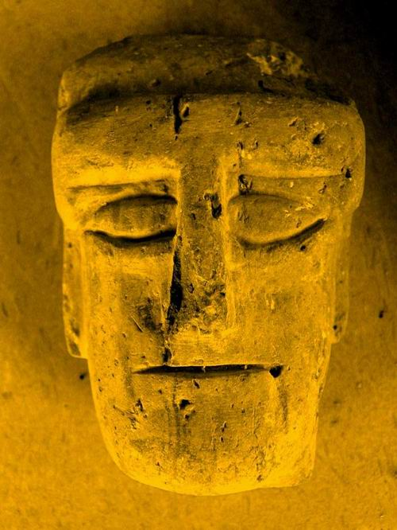

# 无表情

看这张脸许久，不知道确切是什么表情，说他懦弱憨厚？自私冷漠？或者说他阴险？没有表情不代表没有情绪，可是没有表情的面孔上你什么信息也获取不了，捕捉到的仍然是无尽的惆怅......总有一些我不了解的东西隐藏在这副面孔下，不知道他在想什么，他真正的用意，他的朝向！？人，怎可以如此冷漠而自私？象一块不为任何人、不为任何事、不为任何情感所动容的石头！在他人需要关怀时，无论关系是否亲密都要先举起尺子量一量，多么可怕的面孔！

---

## 评论（16）

**[joanna](http://jinking20.yculblog.com)** · 2006-06-20

进入30后，瞧世界总会多少悲观吗？还是透过现象看本质的本领高明了？  
关注tecinese从国内开始，两年有了，chris以前比现在阳光、乐观。  
还是希望你能开心起来啦，不要让俺们这些25边缘的小丫害怕未来的30阶段咯~~~

**Christina** · 2006-06-20

我要说让自己都要呕吐的老话了，女人总要经历过一段或几段的磨练才会风清云淡。别说有的女人就没经历过什么，那等于说她没机会经历，比如白痴？！我不相信有这样的女人存在。不过一个多愁善感，极其感性的女人或许经历得会相对多一些！

25边缘也好，过30也好，悲情伤月或者阳光乐观，该怎么样还得怎么样，变化总在不知不觉间，有时自己也控制不了。

**youzi** · 2006-06-20

应该是要个孩子的时候了，有了孩子会变的现实一些，我孩子要上中学，这阵子忙着看房，想换到好的学区，房子比我现在的贵了一倍，开车上班也远了很多，有这么多事情要做，没太多时间抱怨了。

**[阿帆](http://afan1.blogchina.com)** · 2006-06-20

哈哈哈，游子同学说了我刚想说的，一个字，俗！

**Christina** · 2006-06-21

游子有时的观点有点老年人的思想哦，我周围的老年人常常叨叨，所以听起来会有“腻”的感觉。

8月份我才32岁，离衰老的心态心情还远着呢，心理生理思维自然也正年轻活跃：D我很喜欢BABY，现在不是提倡计划生育吗？生育除了数量上计划之外，还要衡量生活情感物质及心理的状况。这些准备好了才可以计划要不要孩子。目前......我觉得各方面还不太稳定。

其实我都没觉得自己过了三十岁，好象还在25、6岁呢。不知道别人怎么想，我并不想象父母那样活一辈子！我追求有质量的感情和婚姻！其次才会考虑到孩子问题。

**Christina** · 2006-06-21

嘿嘿~~你们还真不给人家留面子哦~~

**youzi** · 2006-06-21

经历不同思想也不同，只要开心就好，俗话说：穷人的孩子早当家。

**nicole** · 2006-06-22

其实觉得游子这样的想法才是成熟的表现。我们都在极力的想让生活不平凡，想让生活精彩，可我们都是大凡人一个。生活的真谛也许就是在平平淡淡之中。能在上下班路上，卖菜做饭，带孩子，擦地板时有好心情的，才是真正幸福，快乐的人。

**youzi** · 2006-06-22

谢谢夸奖，人就要活的真实，其实，做什么事情都不可能十全十美，机不可失，把握机会更重要。大家生活观点不同不要紧，相互交流，取长补短。

**youzi** · 2006-06-22

丫同学：你的观点也不完全正确吗？职业不分高低，美国有资格抓药的还都是博士 (PHARMACY DOCTOR)。就算我是WAITER，咱们也是平等。

**Christina** · 2006-06-22

自己觉得怎么好就怎么生活~~

我一个女同事，自从进公司到现在就从来没恋爱过，好象也不和男性同事怎么交流，只沉浸在自己的世界中，她的生活其实蛮丰富的，喜欢动漫、音乐、化妆品、小说，她是坚定独身了。她能把一个人的生活安排的很多彩有趣，也是快乐而幸福的吧！

另一个28岁女同事和上面这个女孩差不多大，情况一样，但是这个28岁女孩却有种单身的烦躁和不安，内心渴望爱情，却总没有心仪的男性与之呼应。个人生活内容苍白平淡，每日上下班，不知道要怎样生活才幸福。

同样单身的两个女子，一个知道自己要什么，过得有滋味；另一个既不能安于单身状况又无法走出自己去主动追求爱情......这样来看，幸福莫过于按照自己所想去生活，知道自己要什么，陶醉在自己想要的生活中！

所以无论怎么样的生活状态，只要自己觉得舒服，是自己要的，就是幸福吧！

**nicole** · 2006-06-23

呵呵， 今天不上班，一早起来就来看你啦。

丫同学也太激动了吧，因为经常来这里，所以把christina当朋友，分享一下自己对生活的看法，没有任何人说一定要照着什么模式生活才对啊。人的心态总会是在不断改变的，今天否定的，明天可能会接受。不同经历，不同性格，对生活的看法也会不同。安与平淡，但在心里拥有生活的激情，这就是我现在想要的生活状态。

能给心爱的人当佣人，能为孩子牺牲，像父母对我一样，能有个家让我奉献，我觉得这些都是莫大的幸福，看似平淡，俗，但我发现，这些俗人都很可爱。而且觉得他们怎么能这么幸运呢，简直比中彩票还幸运。

anyway, 不管怎么活，有颗豁达的心，开心就好。

**joanna** · 2006-06-23

游子同志生活中也总是易成为大伙搅和的对象么？:-)  
其实他说的生活状态，多数中国人民最终都不可避免如此的，时间早晚的问题，20，30，40而已。悲哀么？未必，好象chris说的，自个开心就好。有人觉得柴米油盐乏味、无趣，有人认为只要和亲人、爱人一起，这就是平凡中的幸福……能乐儿就成

**youzi** · 2006-06-24

现实中我这人特随和，我也不明白说错什么？ 说实话，我才一个孩子，在美国的老中基本上都是两三个小孩，我想再要一个，但是，媳妇说什么不要。我也没治。我觉得既然喜欢BABY， 就要一个了，不用等什么都成熟了，咱不到24就有孩子，那时真是一穷二白。当然，不喜欢小孩也别强求。

**youzi** · 2006-06-27

You worry too much. Kids are like pets. You feed them and they know how to take care of themself and make fun with you. Why don’t you have firm confidence on your ablilities and marriage?

**youzi** · 2006-06-29

I don’t want to fight with you. don’t take my words seriously. It is a joke. Sure, kids are very expensive pets, you have to pay food and education. Simply, they cost too much.

