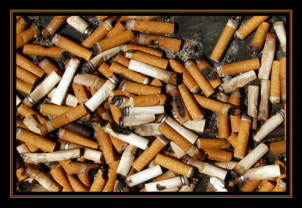

# 死于肺癌

好几天没上网，好几天没上班，不知道是否要写下这几天发生的事情？犹豫不决之下写出来。

上周四参加一位69岁老人的葬礼。看着人象缺水的鱼儿一样张着嘴巴努力呼吸，虚弱的身体仍然持着强烈的求生欲，周二晚上在看到他之后的一个多小时内他去世了。曾经在我眼里他是慈祥而可爱、高大且深沉的老头子，喜欢他甚至超过对自己的父亲的感情。他不怎么爱说话，常常闷声不响地抽着烟。曾两次进医院治疗肺病，出来仍然继续抽。他说不抽烟，人没有精神，好象打瞌睡似的，只有烟能让他清醒些。最多时一天可以抽两包，脸色黝黑，有着重重的黑眼圈，但他的形象却和香烟不可分。葬礼庞大的场面出乎我的意料，他去世后第二天就有300多人上门来凭悼，人放在冰棺里摆放在家中客厅中央，望着他我没有一丝恐惧，一年了……只有这时候的面孔安详的仿如在梦乡。

我的外公外婆也是因为肺癌去世，外公在冬天见到他北京的弟弟之后辞世，临走时紧闭双眼长长地叹了口气；外婆是在炎热的夏天与我们告别的，一直昏迷，眼睛微微虚着，眼睛因为白内障泛着灰白色，骨瘦如柴，挂的药水肌肉已经吸收不了了，皮肤象一张大大的水袋，那情形特别让人不堪回忆……

无论怎样，与世长辞都透着一股悲凉，有时我想起外公临终前长长的叹息，让生者思考颇多。听说母亲的表妹四十多岁也是死于肺癌。他们四人皆有长期的吸烟史。不过书上介绍造成癌症的原因有30%是由于心情心态引起的。当然现在得肺癌的有一些根本不抽烟，也许和空气污染有关。jiajialing这阵子从澳洲回来休假，说国内有两点特别不适应，一是空气脏，一回来好象要得哮喘似的；二是街上乱糟糟的人特别多。

在生者看来死了的倒是苦难的解脱，一个长期失眠的女人对我说，生活好象没有什么美好的事情可期待的，每天就是那样，活得特别没劲。有时我也有这样的感受，可想想其实每个人应该都差不多！？快乐总是少于苦闷，然而必须努力活着，努力活得好一些快乐一些，努力的往前走。至于前面什么情形谁也不知道。走一步看一步，总之健康比什么都重要，健康不仅仅对自己重要，也是对亲人爱人负责。我和姐姐现在就希望父母健健康康的，他们身体没问题，行动方便，可以相互照顾，我们就可以安心工作生活。年老的人身边需要伴儿！

---

## 评论（5）

**hehe** · 2006-07-04

过去看你的blog，还能觉得你的记述中流淌着淡淡的快乐和对世界的好奇。不记得从什么时候开始，你的文字中开始透露着悲伤和失望。  
不知道你是经历了什么事，只希望你能找到新的快乐。

**[afan](http://afan1.blogchina.com)** · 2006-07-04

comfort  
我外公和奶奶去世我都没有在身边，慢慢对这些事看得也开些了。对他们来说，也许是最好的解脱。看着亲人老去是何尝的痛心，然后目睹新生命的成长又是何尝的开怀。新老交替，本来就是自然界的规律啊！

**[lcm](http://blog.donews.com/lcmgz)** · 2006-07-04

生老病死，有些事无可避免。期盼父母能够安度晚年是我们共同的心愿。

**zyz** · 2006-07-05

哭着来,笑着去,莫哀

**youzi** · 2006-07-05

也曾有过相似的经历，记得是中学好朋友的父亲去世，胃癌，才58，59。老人爱下像棋，听说还是市里业余冠军，我的棋也不错，每次去他家都杀几把，同龄人里就我是老头的对手。也巧，老头去世正好回云南。参加完老头葬礼，心里郁闷了好久。希望你能早点恢复正常。

