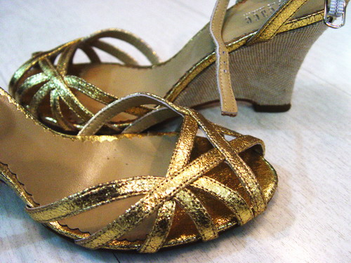

# 天足 VS 金莲

观看一个小脚女人走路，就像在看一个走钢丝绳的演员，使你每时每刻都在被她揪着心。—林语堂《中国人·缠足》

傍晚下班后一个人逛街，好久没去商场逛街，没想到又在搞活动，买300送250，太crazy@\_@等于用一条裙子的钱买了两件衣服，裙子+体恤，有便宜占，全世界人民都开心。同时，我脚上穿得那双将近10公分金色的高跟凉鞋招来不少回头率，有个女孩跑来问我穿的波西米亚风格大摆裙在哪里买的...正是为了配这条裙子买的这双金色坡跟凉鞋。逛街最忌讳穿高跟鞋，渐渐我的脚底开始酸痒，钻心的痒，恨不能脱下鞋来揉一揉。旧时女人裹小脚为了取悦男人取悦世俗，这晚虽未裹脚脑子里却跳出“残废”二字，对于一双走起路来大刀阔斧的脚丫，为了臭美半脚尖站在海拔10公分的鞋跟上。陶宗仪《南村辍耕录》告诉我们，南唐后主李煜在唐人对“弓鞋”痴迷的审美基础上，别出心裁地将这种弓鞋用长长的布帛缠起来，以代替袜子。并在他的妃子娘身上做试验，始行缠足之法，开创了中国女性缠足的记录。可以想象出旧时小脚女人走路东倒西歪的摸样......而我努力不让人发现我的窘迫，尽量保持平衡，坚持上了车立刻脱下鞋子一路开回家，松了棒的双脚未能立即轻松下来，虽不痒可还有酸疼感。于是，光脚从车库走到家门口，奇妙的体验！

以前有个人问我：“你好象从来不穿高跟鞋啊？！”不仅不穿高跟鞋，早几年大汗衫球鞋直接套了上班去，无论如何心理上也接受不了高跟鞋。可是，从什么时候开始我不再拒绝穿它了呢？！
