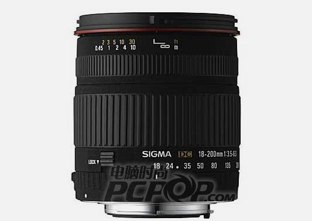

# 我的新镜头

SIGMA 18-200mm F3.5-6 远摄变焦镜头

镜头全长约78.5mm，重量比18-125mm重了约10克，但仍有405克，是同类镜头中重量优势明显，符合便携要求。如果将跨在62mm口径的镜头前端的红色线条改成银色的就好了。尤其喜欢镜头表面处理，磨砂泛黑，手感很不错。大大遮光照让摄影跟有感觉！可是佳能机器拍出来的照片过于柔和，我喜欢有力度的那种效果！

---

## 评论（4）

**JC Li** · 2006-08-07

You will soon find that a Canon red-line circled lens is really what you need, and find your pocket is too shallow to afford at the same time!

Anyway, someone say “the most important is head instead of lens!” You can still have good pictures.

**[ACMiler](http://acmiler.cn/blog)** · 2006-08-08

此头的胶卷版拍的（Sigma 28－300F3.5-6）  
http://acmiler.cn/blog/?p=65

**Christina** · 2006-08-08

我现在已经感觉到沾染上单反钱用起来那个快呀！中毒中毒！

**[ACMiler](http://acmiler.cn/blog)** · 2006-08-08

那些小虫子也都是那个Sigma28－300拍的，你的也可以，这个18－200有一点点微距的功能。大概最近距离是30mm远，所以可以比较靠近小虫子拍，^\_^。

