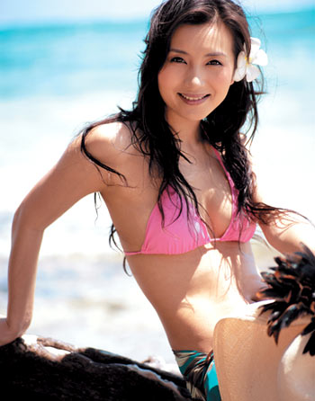

# 陈好在塞班

搜索“塞班”，无意间看到演员陈好在塞班的照片，真漂亮！那种漂亮很标志，有点味道就更好了。我并不喜欢标志美女，有些女孩子五官并不标志，但是搭配在一起很和谐，耐人寻味。除了脸蛋，气质也要好，气质在我看来由声音、举止、眼神、性格，包括智慧头脑、包括品味等等无可言状的因素构成。从照片看陈好的气质挺不错，身材也让人羡慕！

陈好的BLOG：[陈好和你在一起](http://blog.sina.com.cn/m/chenhao)

打开陈好的旅行箱  
　　\*SONY数码相机  
　　\*SONY笔记本电脑  
　　\*SONY Mp3  
　　\*SKⅡ补水面膜  
　　\*LA MER护肤套装  
　　\*GUCCI比基尼  
　　\*特别定制的宽檐草编帽  
　　\*书《河童旅行素描本》

---

## 评论（1）

**youzi** · 2006-08-11

这小妞是不错，我最喜欢的华人女影星是伊能静

