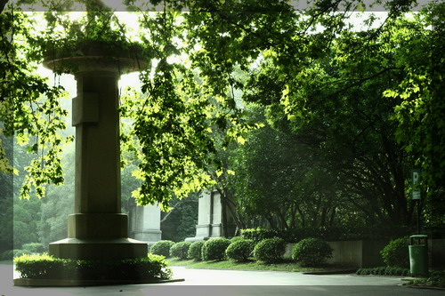
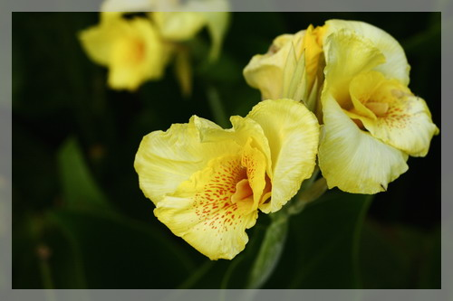
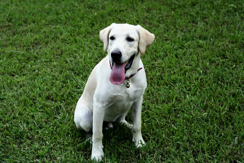
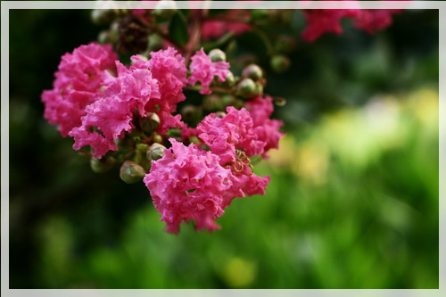
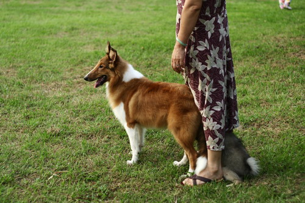
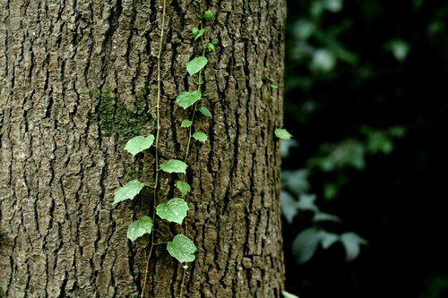
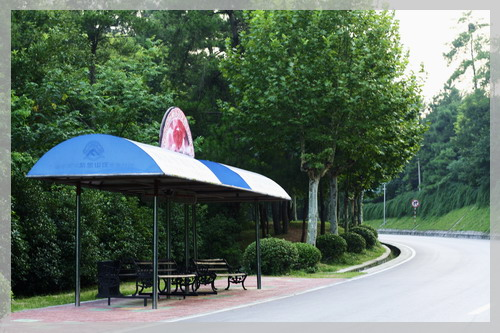
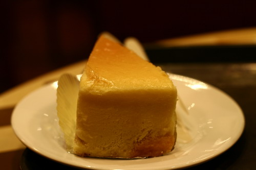

# CANON 50MM/1.8

下午转了好几个圈才找到艺风国美，在那里买了一只BENRO的铝合金三脚架，一只CANON 50MM/1.8的定焦镜头，性价比很高，老板740就卖给我了。毕竟是新手，老板和我讨论镜头的时候，我脸上一直冒汗，有个老手带着我去照相器材店总比我一个人去强。已是傍晚时分，还是忍不住开车去了东郊，今天的片子让我喜出望外，当时光线不算好了，利用我刚学到的摄影知识调整相机参数不断练习拍摄。主要用AV模式多一些，单反相机好就好在即使场景昏暗，依然可以拍摄出清晰明亮的图片，图片没有DC机那么多颗粒。那时侯背着一个大大的摄影包，浑身是汗，从东郊返回的途中心里乐呵呵地冒出一句话：“从此走上单反之路!:)”后来我给朋友的短信中串改了台词：“从此走上不归路。”

难道SIGMA 18-200MM的镜头真的很烂？老板告诉我变焦镜头最好不要超过4倍，当然定焦镜头更好。傍晚所有片子均用50MM/1.8拍摄，原厂镜头与附厂镜头真的有区别吗？不过这是我买了单反机后第一次在白天的户外拍摄，找时间要试试SIGMA 18-200MM，看看区别到底有多大？现在才理解人家文章里为什么写“一箱旧镜头”，套机的镜头托朋友在淘宝网上卖了，其实买了不过两周，只拍摄过一次，应该算是99新，加上滤光镜标价500人民币，老板讲可以标600卖的。希望有人把我之前、以后淘汰的镜头都买了去，箱子里的镜头永远都可以派上用场，也不会浪费了！

廖仲恺、何香凝墓的门口   

美人娇   

6个月大的拉布拉多犬   

树上玫红色的花朵   

胆小的博美和喜乐帝犬躲在主人脚下望着旁边的大型犬   

当时光线非常暗，虽然画面对焦有点虚，光圈和ISO调整的还算满意，树干在构图中向左移三分之一就好了   

水榭附近的汽车站   

今天的晚餐   

---

## 评论（6）

**[阿帆](http://afan1.blogchina.com)** · 2006-08-13

嗯，很漂亮

**jiajialing** · 2006-08-13

调子格外清新，是50/1.8的?

**jiajialing** · 2006-08-13

倒，这不是我前两天避雨的地方，kao，亲切

**JC Li** · 2006-08-13

http://club.pchome.net/topic\_2\_3\_61882\_\_.html

看看我04年用300D狗头拍的。：）

**youzi** · 2006-08-14

照的不错，可以当摄影家了，就是绿色太重，画面太单调。

**[atbyin](http://www.atbyin.com)** · 2006-08-17

现在热情挺高的，估计过不了多久，就没有心情带着笨重的器材到处跑了。我大一的时候带着单反相机和三脚架跑了一年，什么快门线等乱七八糟的东西，还啃了两本书，上培训班。后来就觉得累了，主要是缺乏交流，而且冲洗费用也挺大。大二就不搞了。哈哈。还属傻瓜相机方便，又小又好使。缺什么想什么，一种体验能带来乐趣就行。

