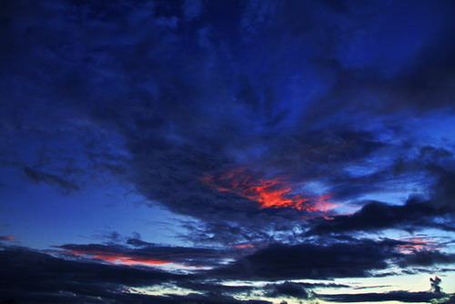
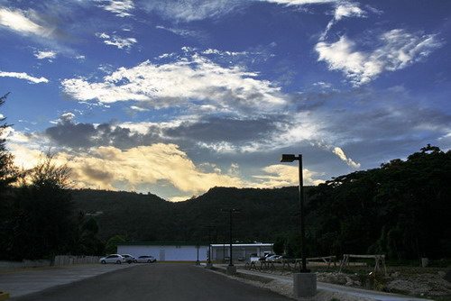

# 塞班之晨

4点半从酒店驾车到塞班最北端的万岁崖，打算观看日出。然而天公不作美，太阳一直被浓厚的云彩遮挡着，后来听导游说，塞班观日出最好在4-6月间，晕~~其实想看日出找片麦田也一样看，不过会少了太阳跳出海平面的壮观！这张照片虽然没有日出景象，却依然是我所喜爱的氛围，大图层次更细腻。出发前特别买了BERO的三脚架和球型云台，走的时候嫌体积过大，还是带着60元的铝合金三脚架前往，只在那天的黎明派上用场。值？不值？还是值得的吧~  

回酒店的路上天蒙蒙亮了，房屋山脉在天地之间，天与地被清晰的分割，从照片上依稀还能感受到夏日清晨的空气，天色越来越明亮时身体的汗腺会随之沸腾。喜欢这样的早晨......微亮的天色，没有阳光，没有人，安静的汗腺，风轻轻拂过来~  

---

## 评论（1）

**[afan](http://afan1.blogchina.com)** · 2006-08-31

莫道君行早，更有早行人

