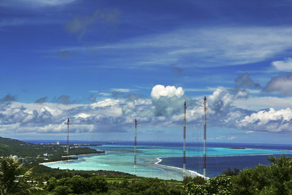
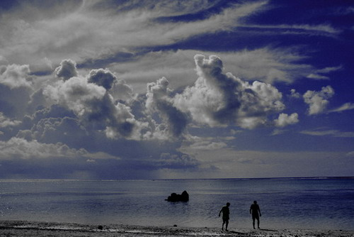
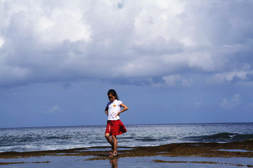

# 塞班的海

塞班除了棉花糖般的云朵，有特点的就是七色海了。照片中从海岸延伸出来淡兰色海面，接着的那条白色的海浪线是天然形成的防波堤，海水击打在防波堤上形成白色浪花。在海岸线与防波堤之间的海面由于海底深浅不一的地理情况及海藻珊瑚的多寡，从而使得海面显示出不同颜色，虽未象当地人称作的“七色”海，但不同颜色的海水结合在一起乍是好看！海岸边上竖着的四根秆子，中间拦着网线，开始还以为是练习高尔夫球的场所，后听说这是《美国之音》面向亚洲的转播站。  

这张照片处理之后，在我脑海里跳出来三个字“梦工厂”。两个人驼着背往海水里走，姿态随意，左右摇摆，顶光将他们的身影投射在沙滩上，因为这两个人显得整副图更赋有想象力，很奇妙！

那片海水底下有许多懒洋洋的海参，要是在国内早就被人捉光了。记得上次去玄武湖，见到有人挽着裤腿站在湖里捞螺蛳，一问是准备自己吃的。南京的生活节奏比上海要慢，可大多数人还是很浮躁，就象挤公共汽车，你不急着上有人上，你不抢座位有人抢......螺蛳你不捞有人捞；看得见的钱你不挣有人挣；房子贵是吗？你不买有人买......你害羞，不愿意去拼不愿意去挤，那机会就给别人喽，大家似乎没有时间与空间去体会生活，也没那个兴趣。

有时人需要和自己对话，问问自己的感受。  

在海边抓拍到这个穿着红色短裙的小女孩，天空海水与她漂亮的裙子形成的对比，令人视觉享受。  

