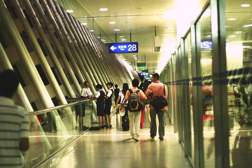
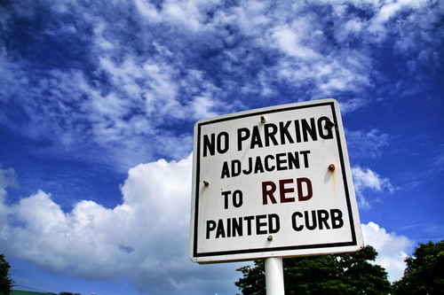
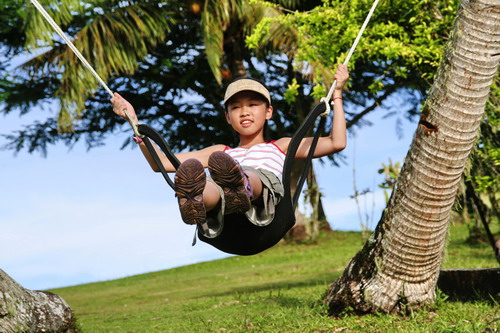
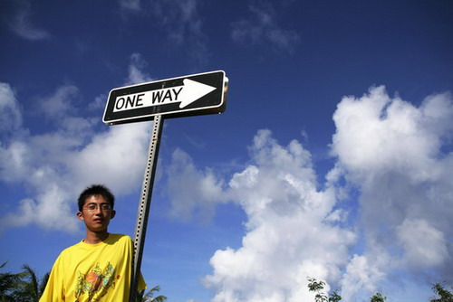
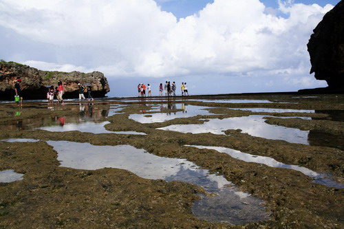
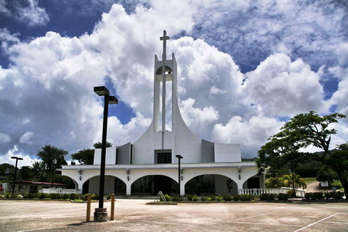
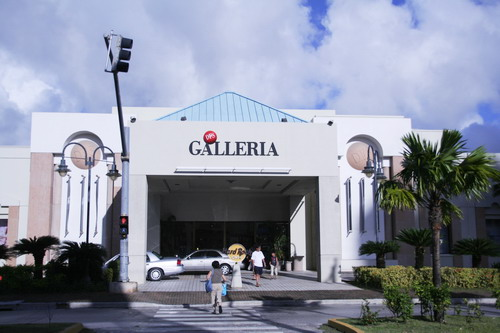
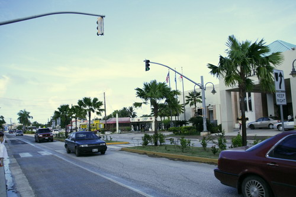
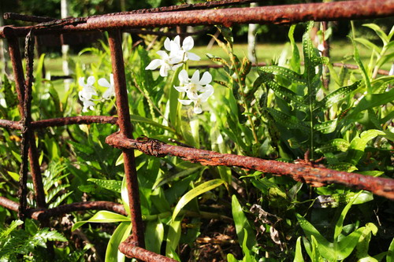
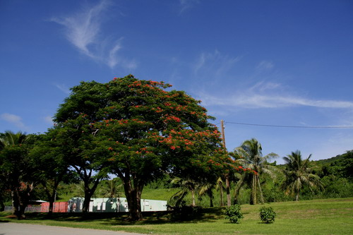

# 图解塞班

一张与塞班无关的照片,但是是前往塞班的浦东机场,特别喜欢的景深,用55MM/1.8定焦头拍摄。  

总督府门口的告示牌  

热带植物园的秋千  

IT中心同事的ONE WAY  

鳄鱼嘴海滩  

去音像店路过这座宗教建筑,不知名$%^#^  

塞班最大的DFS免税店  

市中心主干道  

热带植物园里被禁锢的花草  

塞班有名的凤凰花  

