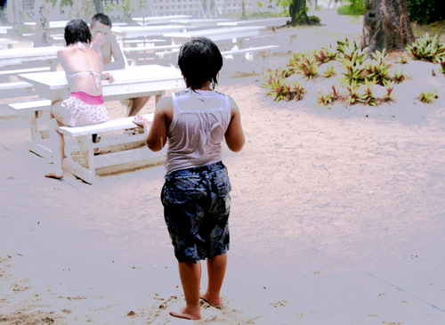
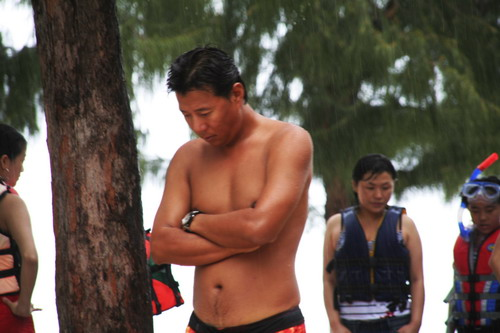
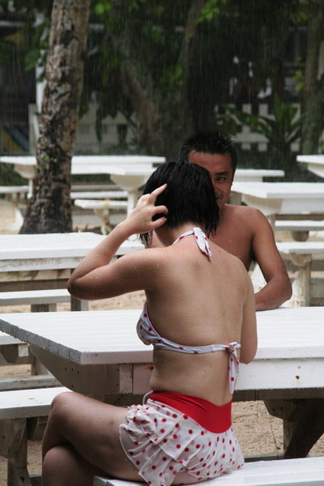
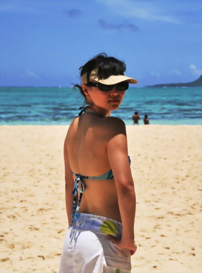
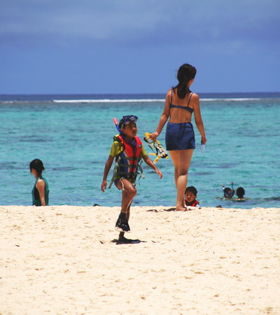

# 雨前雨后

军舰岛上突然下起大雨，好些人躲进棚子，也有人在外面酣畅淋漓的玩耍，这个孩子看着前面一对男女在搬手腕。  

这个男人在等待雨停，黝黑发红的肤色和闲庭漫步的神情，显得与周围人不同~  

不知道他们是否是恋人，他们在雨中嬉戏的欢乐几乎感染到每个注意到他们的人。  

如果说去塞班有什么遗憾的话，应该是我的照片太少太少，没有技术好的人为我拍摄，郁闷~这张照片焦点还不在我身上，真是谢谢同事大哥了！  

觉得这种泛红的古铜色很漂亮，下回去海边不能留有遗憾，晒一次古铜色试试。在酒店买了双胶底鞋，看上去象是慢跑鞋，海底的珊瑚扎脚，还会有海胆之类的东西，穿鞋下海安全。  
   
   

这个孩子全副武装，迈着军人的步伐，准备下海呢。  

---

## 评论（5）

**[May](http://blog.sina.com.cn/u/1224876730)** · 2006-09-03

照片拍的好专业

**afan** · 2006-09-03

你的身材可以上面雨里的背对镜头那位好多了：）  
晒古铜色可要3思，皮肤癌也是现代发病率很高的病之一

**[airylea](http://www.airylea.net)** · 2006-09-04

:)  
替中国mm争足气了。

**youzi** · 2006-09-06

你同事摄影技术不算差，和你照的差不多呀

**bihu** · 2006-09-12

sexy girl!

