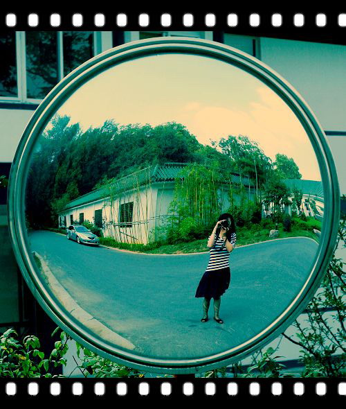

# 放假，下班

下班了，最后走的我得点熏蟑螂的蚊香，一共六盘。我们与蟑螂一起生存在这办公室里好多年，这里到处堆着样品，废弃的纸箱....这时候一个台湾工厂的老板娘打来电话，互祝节日快乐。我问她国庆如何打算，她说2、3号在上海，4号厂里就要上班了。问我，我说3号开车去上海...她说你好FASHION啊，我说女人要爱自己...老板娘说这是节日最好的一句话，她说以后也要好好的爱自己！那个台湾工厂生意好到挑客人做，向我们涨价，我们这里还价还要看着人家脸色，整个厂基本都是老板娘一个人操持，很辛苦，当然家业丰厚。老板则种种花养养草......这种搭配也蛮奇特的，不过夫妻老婆店，一般红白脸都全了。去年开始接触这个厂，有同事说老板娘肯定不会给我好脸色，因为老板好色，而我长得还不错...这种等着看好戏的欲望到现在基本泡汤。这让我想起另一件事，有次和一个台湾客人在一起，人家问我是不是他女朋友....女人稍稍好看点挺倒霉，不是被人防就是人家小蜜，这世道上的人都是那么自以为是，这其中也包括我自己！

发现自己越来越不爱交谈，不愿参加热闹的聚会，为什么呢？以前我不是这样的性格。有天广播上讲说话多的人可能患有忧郁症，还好我现在话不再多了......

---

## 评论（8）

**taipeiren** · 2006-10-02

What are you wearing on your legs?

**an** · 2006-10-02

朋友祝你幸福.....

**[shanjia](http://blog.kaila.com.cn/user1/shanjia/index.shtml)** · 2006-10-03

喜欢你!!

**ILN** · 2006-10-03

Above comments confirms that male humans are not that much different from the wild animals.

**nicole** · 2006-10-04

主页上的图片好喜欢，在哪里弄得？

快把那个恶心的留言删了吧，别玷污了你这里。

希望你能快乐起来

**SK** · 2006-10-04

主页上的图片因該是中茶商的早期的普洱茶包裝吧?

**jiajia** · 2006-10-05

怎么觉得你越看越年轻了：）

**Jonathan** · 2006-10-06

之前都比较忙，很久没上你的blog了。希望最近一切顺利，长假愉快，好好对自己，呵呵。  
相片很有味道，袜子很特别，不错。

