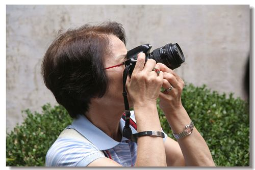
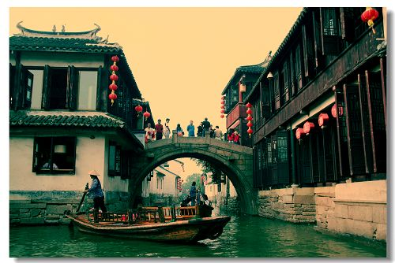
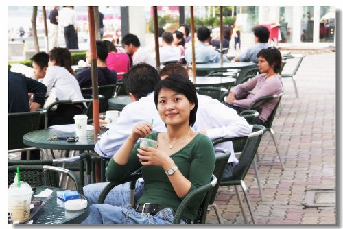
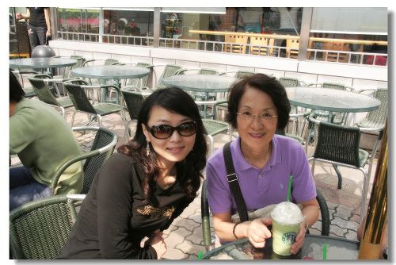
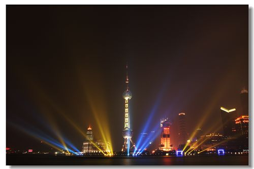
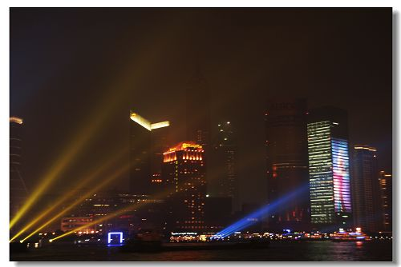

# 城市的国庆节 I

高速公路上开了将近两小时终于回到南京，视觉上忽然空了许多。这次在上海如果没有姿的指引，我一定会迷路。觉得上海的路标指示不是很清楚，路标牌没有南京的大、新、清楚，马路直行、拐弯标识全部在地面上显示，不熟悉上海道路的司机不可能顾了上面的标牌还能看到路面上的直行、拐弯标识，然而错过一个路口可能需要30分钟才能绕回目的地。

上海是个物质非常丰富的城市，当地出租司机说在上海的外国人有120万，外地人口有400万左右。在商场里看到许多爱不释手的家庭用品，我居然买了很多毛巾：D襄阳路拆掉后，据说转移到上海很远的郊区，当你行走在淮海路上时，仍然会遇见一些兜售假名牌物品的人。也许年轻的时候可以随便用什么假名牌的包包，但是现在越来越排斥仿制的东西，无论A货还是某某货都存在质量问题。我越来越看重做工和质量，是不是名牌倒是其次。根本没有太多时间逛街，姿只带我们逛了陕西路一带的小店，匆匆逛过，买了一只毛线编织的包包。Shin的母亲买了件POLO体恤，第二天便穿了，我以为日本人更讲究卫生会先洗了之后再穿呢...Shin的母亲63岁，第一次见她的晚上觉得她看上去顶多50出头，可我还是善意得说看上去40多岁，也许老人听了会更快乐一些。左手戴着OMEGA常见款式的女表，右手戴着我在欧洲看到的那种流行的黑色皮带的手饰，中间一个长方形的银色连接物，比较时尚。60多岁的妇人脸上几乎没有什么老年斑，干干净净白皙的面孔。这在中国很难见到的老妇人的装扮和皮肤。希望到了我们这代年老的时候能有更多这样讲究的人出现，出门旅行带着笔记本电脑，光学数码相机，数码卡片机，3G手机，略施粉黛，和年轻人一样喝喝啤酒，常与朋友们聚会聊天......Shin的母亲让我看到自己年老后的光明，老人也可以一样充满对生活的热情，一样善待自己的点点滴滴，日子就应该这样过才有滋味！

有一次晚饭在鹭鹭酒店吃的，菜肴可口，不过大闸蟹贵了些，一只要120元左右。大约9点多钟，我们晚饭进行到一半，服务员便开始收拾周围的餐桌摆放干净碗筷，他们愉快的抖动桌布铺在桌子上，来回拖着椅子发出令人烦躁的声音......实在忍受不了我大声要求他们停止打扫，服务员们只是放轻了手脚，打扫工作仍然继续进行着。饭后Shin向领班投诉，大致是认为他们这样不礼貌，至少要等客人用餐离开后再进行卫生打扫，并且他们的行为让客人感到我们到9点多还没结束是我们的责任，让客人有心理负担。我想这不仅仅是不礼貌的问题，这些服务员没有错，错在酒店的管理上！有时菜价也包含了一个酒店的消费档次和服务，他们的管理并未起到维护酒店良好形象的作用！这是我们中国向外国人展现的一个面。节前报纸上报道中国人出境旅游要提高素质的报道，大致谈的是大陆前往香港迪士尼乐园游玩的客人，随地吐痰乱丢杂物，甚至小孩在公共场所大小便，香港还不算走出国门，但家丑总是外扬了，大陆游客出境游的人数越来越多，维护中国人的国际形象也就越来越重要！同理，到中国的外国游客及工作的外国人也越来越多，国人素质不知道需要多少代才能达到一个良好的水平上？

这次还看到Shin的小妹妹产房分娩的录象，第一次看到脐带，居然会有那么粗？！只看了分娩到剪脐带的部分，好象生孩子很轻松，Shin的母亲说前面疼痛的过程没有拍摄，女人真是伟大，从孕育到分娩，成就一个小生命到这世界上来，不可思议~~9月初蔡蔡在MSN上向我暂别，说是即将分娩了，会有一段时间不能上网，当时挺感动的。和她在网络上认识有3年左右了，她开始经常访问这里，渐渐开始聊天熟悉，之间一直没有断过联系，我们同龄，大概了解各自状况，这应该也算是难得的网络友谊，期待看到她的小宝贝的照片，希望她生个健康的宝宝。我这段时间觉得生个健康的孩子比生什么性别的孩子要重要许多！

城市的国庆拥挤着各地的游客，大家拿着各式相机徘徊在城市的各个景点，我倒愿意和姿一直坐在浦东starbucks露天座椅上喝着冰咖啡，呆上整整一个下午，看着太阳从城市的另一边消失，华灯初上，外滩的景色开始迷人......

---

## 评论（9）

**youzi** · 2006-10-08

节日快乐！

**雯子** · 2006-10-08

呵呵,我也去了滨江公园那里的星巴克.可惜没碰到你.

**[airylea](http://www.airylea.net)** · 2006-10-12

第二张，是哪里啊？

**[airylea](http://www.airylea.net)** · 2006-10-12

俺这个国庆去了和外滩差不多的一个老租界，不过建筑没有上海的漂亮。

**Leo** · 2006-10-12

aunty green is good:)

**afan** · 2006-10-13

我儿子的脐带是我剪的，剪的时候手感怪怪的

**lala** · 2006-10-15

**素质低的不只是中国人**

其实，提起这个内容的人真的是很愚蠢，因为它根本就不懂。不可以这样说一个国家，因为大家都是一样地。如果我们丑陋，你们也是丑陋的。每个国家、每个地区都有那么一部分人，真的很丑陋。而应该说人类，为什么这么丑陋，人吃人，人杀人，人对人的不文明等等，这些才是真正的丑陋，而发生这些事的地方，不只是中国，还有全世界的每一个角落。

　　下面我就根据中国人真的丑陋吗？这个内容所提出的依据，类似地提出反驳的例子。

　　中国人真的丑陋吗？说了中国人出国旅游，所做的一系列的不文明的行为，被认为非常丑陋的。那么，我倒要问一句，出国旅游的都是中国人吗？外国人就不出国旅游了，他们就没有不文明的地方了，就不丑陋了。开什么国际玩笑，而是一样的不文明，一样的丑陋。伦敦是不是旅游城市，如果算是，那我就举些例子，来回敬这些不知道怎么说话的人吧。

　　我共去过伦敦两次，第一次只看风景了，而我当时看到的一群中国人也没有什么不文明的地方，除了嗓门大了一点儿外，没有什么别的。而在白天嗓门大的要被认为是不文明的话，我可要说话了。举个例子：我住在EXETER，外国人在晚上喝酒后，大概后半夜2-3点，我在屋里都能听到说话声音的话，算不算不文明，这简直就是畜牲，不，连牲口都不如，只是飘着的东西，洋鬼子而已。而你硬要说这是一种文化的话，我也没有办法，因为你这么喜欢舔外国人的大屁股，也就只能由着你了。

　　第二次去除了办事，就特意注意了一下文明的外国人。从EXETER的长途汽车站的候车室开始，真脏啊，这难道都是中国人干的吗？在汽车上，最后一排一个人横卧在三个座椅上，太文明了。到了伦敦，在维多利亚长途汽车站，有一个肯定不是中国人的人上厕所不花钱，直接跨过护栏，真有素质，原来他认识看大门的黑鬼。在英国地铁，就更多迹象表现出外国人有多么文明了，跟我们国内的地铁一样，可能还不如我们，每个站口的扶梯旁都有广告牌，上面有很多人吧，人的脸上都是口香糖，可能由于外国人喜欢口香糖的缘故，所以PICTURE也喜欢。还有一些广告牌没有人，那就只能挨刀子了，一道一道的，被划了，可能他认为设计师没有设计好，所以补充一下。

　　还有很多迹象，例如我的朋友到欧洲旅游回来说，肯定有很多中国人也有过这样的经历，她在意大利的时候被人给抢劫了，真是光天化日啊，厉害，文化啊，外国真的文明啊。再就是歧视，中国人只对一个国家的人有歧视，歧视也不叫歧视了，而是憎恨，那就是小日本鬼子。除了它，我们没有歧视的国家。而我在英国生活，这里的外国人会有很恶劣的种族歧视，认为自己是多么优越的民族，其实有这种思想的人，大家也知道了，肯定不是文明的人，不是畜牲，就是不如畜牲的牲口，哈哈，实际上都一样。

　　总而言之，人在说别人的时候，一定要看清楚自己，如果这个都看不清楚，那它肯定看不清别人，更谈不到说：“中国人真的丑陋了”。这样看来，我的题目：“外国人真的文明吗？”说明了我的问题，看不清楚自己，所以更看不清外国人了，其实也就那么一部分不文明的分子，而大家都把部分扩大化了，这真是大错特错，从我做起，我这里开始改正。

　　所以题目应该改为：“外国人中也有一部分不文明的分子”。

我对文明的界定就是：“一个人在不影响他人的任何情况下所做的行为都可以说是文明的”。这个界定只能代表我个人的想法，虽然不正确，但是说出了我的观点，那就是人不要影响别人。

**Christina** · 2006-10-16

任何现象都不是绝对的，这世上有绝对的事物吗？  
报纸中也提到日本当年开放境外旅游，同样出现“丑陋的日本人”的问题，人类文明需要过程，事物无绝对，这应该是共识吧？

**afan** · 2006-10-17

拿自己的长处比别人的短处，比完了总是会很洋洋得意的，呵呵，更何况是拿自己一堆短棍子找出来长一点的棍子比别人一推长棍子找出来的短一点的，算了，不说了，太绕口

