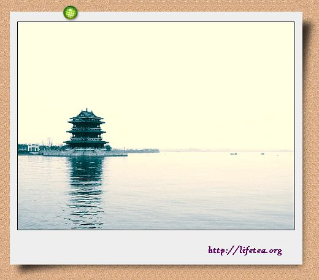

# 原色VS失色

看到一位生活在北京的美国老外[**Brendan**](http://www.bokane.org/chinese/)写了篇blog，大致是说每每亲朋来访，他都想方设法让他们喜欢上北京，可是Brendan认为“北京并不是一座美丽的城市：它没有上海发达，也没有成都休闲；就国都来讲，它没有伦敦喧闹，没有都柏林友善，也没有华盛顿开放；就大城市而言，它永远连梦里都比不上纽约。这里夏天太热，冬天太冷，春天“沙”气腾腾，而秋天 — 它的唯一讨人喜欢的季节－很快就让位给冬天。过去老听说北京有许多美丽的寺庙、道观、牌楼什么的，可如今绝数都被以不知哪门子美学为参照并冠之以“高级灰”的大色块给赶下了台。中国朋友们郑重地说北京如何红墙碧瓦古香古色，可我怎么也看不出来（美国东部的大城市大多倒是古韵犹存）。只有故宫，钟鼓楼等个别的地方暂且还能嗅到北京从前的香味。......”

曾听说北京许多胡同被拆，有一些中外友人试图通过个人的力量引起政府注意，以保留下这些具有中国特色的建筑群。结果要拆的还是拆了。南京除了中山陵、夫子庙，也很难找到什么象样的古建筑，要么孤伶伶的一座老房子被高楼大厦城市喧哗掩盖住，要么破壁残垣年久失修，有些外国人奇怪地问：“为什么城市里都是新建筑，那些老建筑呢？”现在的夫子庙变成外地人喜欢去的大市场，所以我们和大多数游客一起涌向宣传中的乌镇、周庄和西塘，期望感受到梦幻般的“似水年华”，可是，得到的同样是失望！人山人海挤在小小的范围里，哪里还能体会到水乡悠然？哪里还能酝酿望月心情？大家匆匆来匆匆去，草草将闹市、一个摆地摊的集市走一遍，赶紧脱身而出。

我也曾有着与Brendan同样的心情，如何让外地来的亲朋喜欢南京？一旦想法出来却无从着落，好象没有什么可以推荐的特色。宁海路的民国建筑以及马路两边高耸遮天的法国梧桐，有哪些是我们营造的环境与氛围？前些时候看电视上报道，太平南路重新整建，那坐清真寺也要一并拆掉....Grace曾经忿忿不平地抱怨她家门前一棵从她小时侯起就存在的大槐树被街道砍掉了，令她伤心不已。在看了Brendan的《绿洲》之后某种酸楚也涌在我的心头......可是我们的声音太微弱了，不是吗？

每天早晨上班路上，看着许多茫然的、世俗的、麻木的、紧张的...不顾一切“争取”的面孔，会觉得悲哀，我就生活在这样一个调调的城市里，大家忙着挣钱生存，忙着炫耀，忙着虚荣，心房被浮躁充斥着无法自救。没有吃饱穿暖，各式压力等等一切晦涩的东西将生活原色一遍又一遍地冲刷着...中国人比十几年前浮躁许多，自我也要失去了。

---

## 评论（7）

**Jonathan** · 2006-10-25

南京是我一直很想去的地方，不过之前都只是中转，并没有真正逗留，以后有机会一定会好好体会一下。

**yezi** · 2006-10-25

年初不小心转到了城南的巷子，吃到了传说中的老卤面，看到了类似皖南风格的房子，可是最近突然发现那一带的房子围墙上全贴了“拆”字。拆，早晚的事。城南地势那么好，现在土地那么贵，留那老房子，不合时势。就把美好的影像牢牢记着，某日路过，可以和他人说起这里曾经的模样。只能这么招了。

**afan** · 2006-10-25

想说放弃也不容易

**dana** · 2006-10-25

也许盲目烦躁期过后才能趋于平静，可惜城市也避免不了这样命运。

**Sherry** · 2006-10-25

时代不同了，只要城市规划好，该拆就拆了吧。。

**youzi** · 2006-10-25

中国老房子质量太差可保留当古文物的建筑不多，拆是对的。

**Cuentos Chinos** · 2006-11-30

》》中国人比十几年前浮躁许多，自我也要失去了

经济挂帅，自然文化庸俗，这是中国必然的宿命。哈哈，是宿命啊，也就只好得失由之了。

