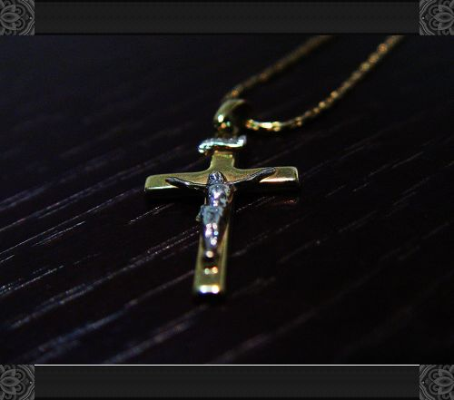

# 《驱魔》The Exorcism of Emily Rose

你相信超自然现象吗？当现代科学无法解释这些现象的时候，人们自然将其归纳到灵异之类的事件中，然后用宗教信仰解释这一切。我没有宗教信仰，可是有枚十字架项链，上面钉着受难的耶酥。当我看完[《驱魔》](http://ent.sina.com.cn/m/f/exorcism/index.html)这部据说是根据真实故事改编的电影后，夜晚开始变得漫长而难熬。  
  
   
  
大多恐怖片都是虚构、夸张的，看完后会自我恐惧一会，很快会过去。可是这部《驱魔》最大的问题来自“根据真实故事改编”，这是造成我恐惧的最主要原因。看看影片是如何简评的：“本片是**由真人真事改编**的，同其它的以吓人镜头为噱头的恐怖电影不同，此片着重于关注情节的铺展和人物的细腻刻画，在驱魔的过程中不时闪回一些吓人的瞬间。”《驱魔》取材于1976年发生于德国巴伐利亚的真实事件，主人公原型为安妮莉丝·米歇尔，深受精神困扰的她最终死于饥饿所致的器官功能衰竭，法医在尸体解剖时诊断其病症为颞叶癫痫，当时实施驱魔仪式的是两位神父，他们与安妮莉丝的父母一道被指控为过失杀人罪，被判入狱6个月并缓期执行。  
  
恶魔会找那些“超敏感”的人附身，至于为什么这样无人能解释，并且被附身的女孩不可思议的表现也有多个目击证人存在。科学无法解释的现象。你相信有鬼魂灵异吗？不过我也曾怀疑这是教会出钱拍摄的电影，或者教会安排了这一系列的奇怪现象，目的是为了让更多人去信奉宗教，增加他们的信徒？如果这些现象发生在中国，不同宗教又该如何解释呢？  
  
超自然现象...超敏感...使得我仍然处于恐惧当中。我开始害怕夜晚到来...

---

## 评论（3）

**Jonathan** · 2006-10-30

Take it easy and have a sweet dream.

**youzi** · 2006-10-30

没有心理承受能力就不要看吗？ 还真有看恐怖片导致精神分裂的病例，不过，身体本身就有问题，恐怖片就是一个TRIGGER。

**afan** · 2006-11-01

I only watched the Ring I and II once. Never have guts to watch them again.

