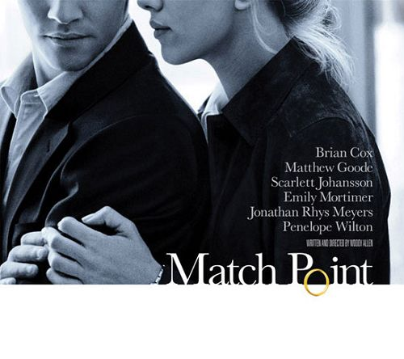

# 《match point》

赛点指网球赛最后一局的局点，拿下此球就赢下全局，否则就得再战。  
当一个人参透了生命中更重要的是运气而不是实力的时候，就参透了人生。  
  
  
  
官方网站：<http://www.dreamworks.com/MatchPoint>  
  
电影的开头就是网球比赛中常见的一幕,球击到网口边缘,是落在对方场地还是弹回来,这时就是听天由命了,如果是在赛点时出现这种情况,就更加显得运气在这前后几公分微小差距中的巨大作用。，“赛点”的意思就是一局比赛中还差一球就赢下这一局。 "There are moments in a match when the ball hits the top of the net, and for a split second it can either go forward or fall back. With a little luck, it goes forword and you win. Or maybe it doesn't, and you lose."  
  
21岁的斯嘉丽·约翰森是好莱坞近两年人气急升的少女明星之一，我从《迷失东京》中认识她，她的身材真是无与伦比的性感，演绎的形象令人难忘！从那部电影开始比较关注这个演员。男主角是爱尔兰人，我对他并不很熟悉。据说他拒绝与恶俗电影同流合污，只出演自己喜欢的角色，比如《纸醉金迷》、《圣师复仇》和《与魔共骑》。片中大量英国演员表演精湛，英式发音给我们这些看多了美国片的人带来一丝新鲜空气。  
  
这部电影可以看出Woody Allen的深厚功利，不乏黑色幽默。爱情与婚姻，世俗功利与真实自我的斗争与挣扎。这个故事中，男女主角都在拿自己做赌注，就看运气如何了！唯一有趣的，是“运气”的概念。运气好，即使你杀人，但也会因为阴错阳差，而让你平安脱困，拥有财富与完美的家庭。运气不好，那就可能身败名裂。这一切，无关你是否是个良善的好人。去他的传统价值！如果要照所有的道德标准，那就不是Woody Allen了。  
  
英俊的Chris通过英国上层社会追捧的网球运动成功的上位。他聪明，谦逊，恭顺，从不僭越……但事实上在这彬彬有礼的躯壳中潜藏着对于名利狂放的渴求。面对Nola他有些动摇，可以看出他对Nola炙热的情感在富豪兄妹不注意时强烈释放。Nola美的慑人心魄，性感绝伦，但他是Tom的未婚妻。他那能使他过上舒适生活的富豪女友Chloe是Tom的妹妹。注定的悲剧。 　　   
  
影片的表达细腻而不拖沓。没有过多渲染，在平和的叙述中体现暗潮汹涌。特别喜欢的一场戏：当Chris得知Tom和Nola邀请他和Chloe晚上看电影而Chloe拒绝后显得很焦躁，他好想见到Nola，不能明说，又不愿表现出来自己很想去看电影，于是反复的试探，与Chloe的拉锯战。其实还有很多场景处理的都很好，比较侧重细节刻画。 　　  
  
古典歌剧的穿插映衬使得整个影片风格和节奏显得如此独特。即便是凶杀场面的配乐也不例外，没有毛骨悚然，依旧是歌剧，只不过更赋悲剧色彩。 　　   
  
功利的婚姻注定会有外遇发生。重新归来的Nola使得Chris心猿意马，对家庭和妻子心不在焉。在怀孕的问题上Chloe很坚持，而在此时Nola怀孕了。母性的缘故，Nola想要独占Chris，想有稳定的家庭，这威胁到Chris的利益，使得Chris很是不安，他向朋友倾诉：在Chloe身边我可以过上安逸的生活，名利、金钱、地位，而离婚后我将失去一切，我做什么？到哪里去？怎么生活？当爱情碰撞名利，其下场必定是粉身碎骨。Nola把爱给了一个野心勃勃之人，她付出了生命的代价，连同她的孩子.  
  
真讽刺，是Chris赢了。在他消毁赃物时扔的一枚戒指......就像影片开头那个在网上弹了一下的网球一样，戒指在栏杆上弹了一下，最终弹了回来，落在地上。命运就像一只魔手，这只没有过“网”的戒指就像是命运的最后一步棋，一个赛点，也是警方一个线索，一个吸食毒品的人捡到这枚戒指，并在凌晨的枪战中被打死了，警察在他的口袋里发现这枚戒指化解了警察对于Chris的猜疑。  
  
新的一天，Chris的老婆生了一个儿子，全家庆祝。然后电影结束了，没有传统意义上的道德审判。这就是生活，这就是人性。但想想，事后的长久的噩梦和对自己良心无休止的拷问与谴责是一种更加残忍的惩罚。  
  
《赛末点》很成功地塑造了一个不惜违反道德混迹上流社会的典型。影片中说：“我情愿做个幸运儿，而不是优等生。”这才叫看透生活的本质。人们怯于直面这样的现实：生活中纯粹靠运气的事情很多，有许多事情自己不能左右，那是令人无奈的人生。看完这部片子，也不由想起梅婷主演的《阿司匹林》，在人生道路上我们究竟该如何抉择？  
  
*You lose the match point, you lost your match;   
You win the match point, you win the match;   
You save the match point, your match goes on.   
Whatever it takes, however it happens!*

---

## 评论（4）

**Anyayaya** · 2006-11-07

真是这样的啊。谁也不知道The Road Not Taken究竟是怎么样的。人们习惯了老说“要是。。。就好了”，这等于没说。关键在于我们偏偏就没有。。。！机缘巧合的小手指轻轻一拨就将我们划到了被Taken的那条路上。我是属于绝对信奉机遇的人。

**youzi** · 2006-11-07

虽然对SUGER CANDY 的影片不感兴趣，不过，你写评论很好。我觉得你真是入错了行，天天跟锤子铁器打交道，你应该做个晚报杂志娱乐版的编辑，真可惜呀。

**Sherry** · 2006-11-10

好主意哦！你当编辑，我当狗仔队。。。。嘻嘻  
刚看完这部电影，跟好奇害死猫的结果一样么，男人把情人杀了，为了保全自己的前途和富裕的生活。。爱情斗不过功利，很现实。。所以说，没钱的女人就不要天真了。。呵呵。。

**Cuentos Chinos** · 2006-11-30

呵呵，这部片子好像是抄司汤达的《红与黑》的情节。

推荐肯·洛奇拍的《面包与玫瑰》

