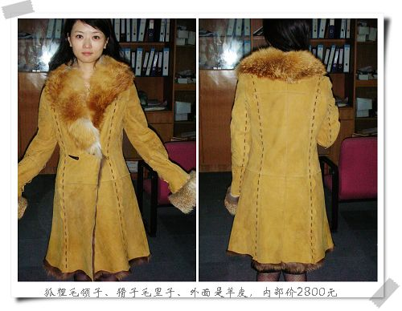
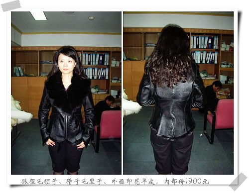
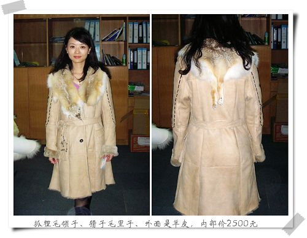
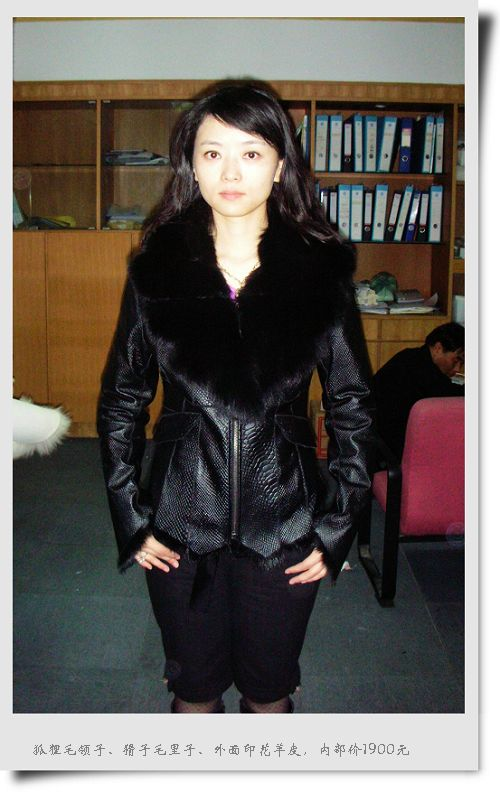

# 出口外贸皮草

市场价格要乘以4哦~~  
   
  
   

---

## 评论（19）

**[Adeline](http://adelinelv.spaces.live.com)** · 2006-11-17

哎呀，爽翻了。  
你们对不对外零售啊？  
哈哈哈。

**youzi** · 2006-11-17

有点贵夫人的味道，很有品位

**[Leo](http://evperception.com)** · 2006-11-17

我其实一直不解，为何好好的人非要披张狐狸皮。绝非冒犯，只是看了心中总是发寒。

**Christina** · 2006-11-18

哪里显示“非要”呢？任何商品有人生产有人购买，完全自愿啊：）你的不解不是自寻烦恼么？

**[afan](http://afan1.bookee.com)** · 2006-11-18

skin & skinny

**daliang** · 2006-11-18

皮草总让人联系到绿色和平组织

**kafiry** · 2006-11-18

黑色的还是很漂亮的;  
国内还没到游行抗议的程度吧?

**Faye** · 2006-11-19

这个图片差点让我以为是淘宝上那个PS你照片做生意的人在被你声讨.

**tintin** · 2006-11-20

之前看过一段世界动物保护协会的针对动物皮草的宣传片,动物皮草的制作过程是极其残忍,把活生生的动物的皮毛拔下来,而且是比较年幼的动物,因为太老的皮毛比较粗糙...他们的口号是”把动物的衣服还给它们”...相信你看了那片子,你也会对皮草另有想法的

**Christina** · 2006-11-20

好在这些不是我做的,也不是我卖的东西~~

**[DLOG](http://www.dlog.cn)** · 2006-11-21

最好也别穿出去，太危险了

**Christina** · 2006-11-21

这些衣服只是样品,我压根就没买,晕!

**youzi** · 2006-11-21

我支持你，你又没卖没买，评什么指责你。晕！

**Michael** · 2006-11-22

你们什么时候开始做衣服了

**huyi** · 2006-11-28

有卖吗？

**luxuefeng** · 2007-01-09

你好，我是浙江的一位皮草生产商，很想跟你交朋友，如果看到信息，请发邮件或电话联系（13666766601，qq：17868414）

**yangjie** · 2007-01-12

你好,我是济南的一位服饰经销商,想与您有进一步合作.如有意请发邮件与我联系.

**Doris** · 2007-03-08

哦哟，真是个美女呢～ 羡慕，呵呵

**[leo](http://咨询)** · 2009-05-08

请问你们公司现在做什么货呢

