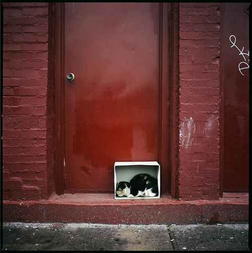

# 无题

   
  
某种情绪的发生有时来自于期待，可是为什么要期待？如果一切可以招之即来挥之即去，任何事情都可拿得起放得下，那么这个冷漠的反问将令我失去对某些事物的热情和关心。  
  
上周无意翻到一个台正在播《阿Q正传》，极老的电影。那天特别有兴趣的看到电影结束，温习了阿Q精神之后，我在想是不是也要拥有一个到死都不知道怎么死的人生？

---

## 评论（3）

**Dan** · 2006-11-21

一个台，，，是CCTV 6。

**youzi** · 2006-11-21

有时候真需要阿Q精神，人比人气死人。

**[xxingl](http://xxingl.spaces.live.com/)** · 2006-11-26

好久没见你的网页，你都搬到这里了，好不容易找到的！

