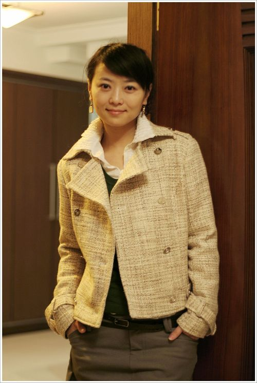

# 傍晚．小雨

几次路过北京西路，才发现马路两边的银杏树已经灿黄灿黄，叶子被雨水和风打落在地，汽车驶过又被纷乱的扬起随地散落下来，不知道从什么时候开始银杏叶子黄的季节我总是不经意地拿着相机跑去东郊拍照，这一年被雨天耽误了，入冬后南京百年不遇的雨天，持续下了两周左右的时间。过了11月，灿黄的银杏叶是否还会为我等待？  
  
好长时间心思心情变得平淡无奇，象周围的人们一样过着看似井然有序的生活，吃喝拉撒睡，看碟子、听音乐、越过文字翻看带着图片的杂志、驾驶车东奔西窜......每个人的生活都是这样的，是吗？下周一是同事的婚礼，本以为他会折腾几年，没想到还是闪电般结婚了。再怎么游戏人生，还是逃不出上苍安排的路线，结婚之后紧接着生孩子，然后养育孩子长大成人，选学校找工作等等诸如此类的生活内容，一步一步按照程序进行着。每天上下班，晚上和家人一起吃饭，或者出去约会看个电影什么的。周末睡懒觉，打扫卫生收拾家务，逛街，约朋友见见面，或者加班。有人说简单的生活就是一种幸福。回顾一下这段平淡无奇的日子，这种按照程序进行的生活就是简单的生活？简单就是是幸福。这个逻辑应该没有错，是吗？所以，我...幸福...  
  
晚上下班在家门口停下来，关灯熄火后，忽然有些心慌，原因有可能是消费过于奢华？整日没有追求？还是对于自己的生活目标力不从心？我又想到简单就是幸福的观点，我想到我的经理，他现在一个人坐在一间46平米的办公室里，全家收入都来自于他，公司几乎事无巨细他多少都要照顾到，40岁出头头发已经花白，他给我的印象就是一个任劳任怨的劳模，从他身上我学到不少为人处世的技巧，这对我个人帮助不少。他的全职太太管理家务和孩子，每年公司组织旅行或聚餐时会出现一两次。大多数家庭从表面上看都是很幸福的，经理一家应该也是吧。这样的生活够简单吧，那么以上面的观点推断也应该够幸福......  
  
有个同事的MSN签名很有意思，大致是“不成熟的男人可以为了事业勇敢的去死，而成熟的男人可以为了生活苟且地活着。”网站上另一个签名更是出乎意料的有趣“真正的男人就应该象金刚一样，站在大厦顶上为心爱的女人打飞机。”曾记得有句歌词:你打开一扇窗,你就看到那样的风景;你爱上一个人,你就有着那样的命运...  
  
[**more pix here...**](http://photo.lifetea.org/v/Its+me/061129/)  

---

## 评论（23）

**Cuentos Chinos** · 2006-11-30

果然是美女，没有白跑一趟你的blog。

以前还不知道，今天是第一次来，还是别人推荐的。你的blog还不能正常访问，要搞个代理才能看，麻烦。

既然来了就瞎说两句，成熟的男人是什么样，没具体标准的，这种属于价值判断的问题，答案完全取决于个人心中的价值观。

**ILN** · 2006-11-30

Christina, it is good that every now and then we reevaluate our perspectives towards our lives. Happiness is state of mind. It is all in your head. It is the way you think.   
For those people who have except Jesus Christ as their lifesaver, they have a very different perspective toward life. They have many more thanks then complaints.

**Those days** · 2006-11-30

It’s the time you should have a baby now. You have too much time to think. Or you may need some religious to halp your mind.  
Life is short. We are all getting older.

**[猛禽](http://www.we8log.com)** · 2006-11-30

路过，果然美女啊。

相机是350D+50/1.8吗？

BTW:  
>Email (will not be published)  
貌似实际上是Website不显示，Email显示了。

**[猛禽](http://www.we8log.com)** · 2006-11-30

汗，原来大家都是反过来填的啊。-\_-|||

**Christina** · 2006-11-30

太多人告诉我“你应该这样你应该那样”......听够了这种话，什么时候结婚，该和谁恋爱，什么时候要孩子，做什么工作.....人人都会老，小屁孩都知道，不要再对我说这些所谓热心的话了！！！！也不要自以为是地认为生活就应该象你说的那样进行！我想怎么过就怎么过，想什么时候要孩子就什么时候要孩子，我妈妈还没操心这些事呢，收起这些所谓的关心留给你自己的孩子听吧！！！！

**Ann** · 2006-11-30

经常默默关注你的BLOG，喜欢你的图片和文字，祝好，另外 我也非常喜欢北京西路的那抹金黄

**Cuentos Chinos** · 2006-11-30

哇。冲冠一怒为红颜，红颜一怒又为谁？

**[afan](http://afan1.blogchina.com)** · 2006-11-30

在一个地方工作5年以上会不会很烦？

**youzi** · 2006-11-30

CHIRSTINA：你是生在福中不知福，你们公司多好蒸蒸日上、兴旺发达，挣钱多福利好，还能说中文。我们这里天天裁员。昨天一位在福特工作十五年的朋友被迫离开福特。明年福特要裁6万蓝领，1万4白领。我朋友46岁，他接受了福特BUY-OUT的计划，一次性买断14万美元，如果不接受明年被裁就什么都没有了，他虽然已经是美国公民但打算回国发展，他在上海GM找到一份工作。现在我每天回来还读练习一小时医学英语，药名，疾病很多都很难发音也记不住。

**Those days** · 2006-12-01

To tell you the truth. You are just a spoiled kid. You have never grown up. I can tell that . Since you get everything so easy, so you get bored so quickly. I do not think you get your job, your house , your vacations and all the luxry stuff you have been showing here all by yourself without your family’s help.

**LaughAtU** · 2006-12-01

Hey Hey Hey! What are you upset about? Christina just wants to think for herself. So give the space her need. That was not too much to ask.  
BTW, you forgot mention the car, she also drives a nice car, and having a rich spouse won’t hurt either.

As far as “the Luxury stuff “, that’s depend on where you live. In China, yes! Oversea, it is good, but not luxurious. (That is just my personal opinion. Not mean to put anybody down.)

**[Syswld[S&D]](http://syswld.yculblog.com/)** · 2006-12-01

幸福是什么 自己也不清楚，只知道每次看到你淡淡的笑，就会感觉很舒服！ \_

**Rachel** · 2006-12-01

生活是自己过的，好与不好在于自我，开心就好！人如果能排解孤独感，为什么要结婚呢！！！

**Christina** · 2006-12-01

I do not think you get your job, your house , your vacations and all the luxry stuff you have been showing here all by yourself without your family’s help.

还是我这个当事人来告诉你真相吧！我从里到外的从上到下的衣服没有一件是我父母买给我的，包括上学的钱我后来也还给他们了。每年的旅行他们从来不会给我一分钱。我之所以进现在的公司工作，是因为我父母希望我能回南京回到他们身边，而我想要走的是另一条人生道路！

您是不是不了解国内的情况？许多年轻人都有房有车，这已经不是什么稀奇事了：）话再说回来，家庭帮助，孩子享受的也在理，父母帮助孩子建立理想生活，孩子孝敬父母...应该天经地义吧？！您要见着我们公司刚上班的同事开着父母买的车，住着父母单位分的或买的高档公寓，您不知道做何感想？生在富裕权利的家庭，家庭财产共享，一毕业就进好单位，进了好单位还有好岗位......那是人家的命！我倒希望我父母能多给我些帮助，不上班也有房子住有车开，可惜他们不能~~所以还是祝福多于埋怨的好，有助身心健康！：D

**Christina** · 2006-12-01

长大？成熟？这个问题是否有一个统一的标准？拔苗助长...怎么努力也无法成就这个成熟与长大的问题！幼稚就幼稚吧，弱就弱点好了，我一直认为生活环境没有太大变化的话，到了60岁我还是这样子吧？！那将是多么美好的事啊：）心态年轻呀！

**[Leo](http://evperception.com)** · 2006-12-01

To tell you the truth. 你丫真就挺烦人：）

**[Leo](http://evperception.com)** · 2006-12-01

I mean “Those days”. 上条留言忘了指名了，哈哈

**Anyayaya** · 2006-12-01

某些人的成见还真是根深蒂固呀。如果看见一个漂亮年轻的女孩子开着名贵跑车，很多人的第一反应就是：傍大款的！第二反应：老公的！第三反应：老爸的！第四反应：高级escort! 是不是听起来很熟悉？还有呐，明明会写中文滴，写得还真挺溜，干吗先吐一圈洋泡泡？不扯别的，就自谋前程这一点，要支持一下Christina, 论据是我的工作、房、车、生活中稍稍奢华的部分也都是自己努力得来的。这在我的同龄人中并不少见。所以别人如果不认同你的观点别立马急白了脸，找这么个幼稚的论点来反击，你看看，大家反应很强烈吧，多没面子啊，呵呵！

**KK** · 2006-12-01

一帮家伙，人家怎么惹了你了，对人家指三道四。每个人都有自己生活的方式，你管人家干嘛，先管好自己吧。而且Christina的生活很普通阿，现在年轻人有房有车的多的是，她那辆也不是什么名车，如果我没有记错的话。

**thelastmango** · 2006-12-01

我喜欢这身打扮，赞一个，精干，大方，还有小牌牌耳环！

**zy** · 2006-12-01

谁没犯过错误，比如你嫁了个喜欢性骚扰女同事的丈夫；比如你的男朋友和不同女人周旋；比如他对你说只爱你一个人，可他对很多人都说过，他常常对你撒谎你即使心里清楚，也了解事实却仍然将错就错！大家都清楚你们的甜蜜美满不过是一场表演，掩耳盗铃好象你做得蛮专业：）

谁没犯过错？你能说你没犯过错吗？有些错误开始的时候并不是错，事情发展到一定阶段当事人发现是个错，知错就改，不在同样的问题上继续犯错就好，只是有人总做同样的错事，比如那些猪头一样的人！指责别人的同时先审视一下自己的过往...

**Cuentos Chinos** · 2006-12-01

哇。吵起来了。

“those days”这位朋友的中文很地道啊，“有几分姿色”这是标准的中国话，能够说这么好的中国话，为什么还要说英文呢？

我英文不太好，也看不懂他说的是啥，反而省心，^\_^

