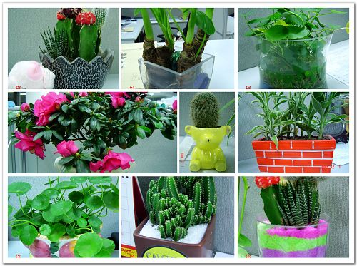

# 与甲醛亲密接触

办公室里的植物有史以来最多的时期，呵呵~~看着这么多绿色植物，上班心情也会好许多。这个周末的南京终于放晴了，有时间一定去郊外拍些照片：）周末愉快！  
  

---

## 评论（18）

**Cuentos Chinos** · 2006-12-01

原来博主是南京人啊。南京，我只去过禄口，停留一下就走了。

看到南京，就想到秦淮河，就想到晓风残月。。。^\_^

**[afan](http://afan1.blogchina.com)** · 2006-12-01

我们单位里也搞过”绿化工程”，大家买了一大堆室内植物回来，再后来，一半都死翘翘了。事实上一些室内植物虽然能净化空气，但是有可能带来别的有害昆虫或病菌。

**youzi** · 2006-12-01

父母挣钱，孩子享受。这个观点我不敢苟同，父母钱再多也是父母的，一个成年人至少能养活自己承担家庭的责任，中国父母太溺好孩子。美国大学生很自立，很多人边打工边上学，就算父母很有钱，他们很少问父母要零花钱，父母为他们交了学费，他们就已经感恩戴得了。我从小就不喜欢被父母摆布，只想到一个遥远的地方他们无法过多干预我的生活，至于我生活的好坏是我自己的事情。

**youzi** · 2006-12-01

你的花很好看，一个人在公司种这么多花有点不太合适吧？

**xx** · 2006-12-01

都能活下来么……

**001** · 2006-12-02

我觉得你是一个十分张扬的女人，并非内敛；你或许自身的家庭背景比较优越（不要否认你的家庭背景给你的一生有很大的影响），你喜欢炫耀你所拥有的一切好的，假装是一个很独立的女性，假装是一个不知天下穷人贫穷的女人，假装是一个思想前卫，但身体又保守的女人，其实你很可怜，你孤独，或许你才写这些。有人羡慕你，但我不羡慕！

**[joanna](http://jinking20.yculblog.com)** · 2006-12-03

能秀也是本领。  
穿件儿新衣裳还希望别人能瞧出来呢。  
人都是矛盾的，最内在的与理智上所想要去表现的……  
你、我，包括christina……况且christina也没说自己是圣人那。  
001的话看着没啥毛病，但最后的句子反倒是添足了。

**youzi** · 2006-12-03

001，说话不要没水平，我看CHRISTINA 挺好，不是每个人都一定要忧国忧民，人家有些小资你也不要看不惯，再说这是她的博克，她想写什么就写什么。

**Cuentos Chinos** · 2006-12-03

我只想看到好看的南京郊外的照片，希望博主多贴一点 \_ 能不能来几张中山陵啊？

听说中山陵的设计很有匠心，上去的时候，看到的是密密麻麻的台阶，但是到了上面之后再回头看，那些台阶都会不见了。^\_^

**Anyayaya** · 2006-12-03

不知道为什么，有点怀疑001和Those Days是同一个人。如果不是，算我无聊瞎猜。如果真是的，呵呵，这个人也忒无聊啊。

**Christina** · 2006-12-03

羡慕的问题根本就不是我考虑的范畴，也根本影响不了我的生活！您还真俗气，真所谓什么人什么角度看问题，什么人说什么话，：）我毫无兴趣对您这种人说话，半句嫌多~~您这么看不惯我，就别看，也别为我操心，小心操心折寿：）这是您的IP地址啊：222.209.255.168 - 四川省 成都市

**Rachel** · 2006-12-03

建造和谐永远是我们要追求的，不是吗？希望能来这里的人，可以来分享CHRISTINA 的快乐和感受，但要明确何为尊重自己和别人！呵呵

**Cuentos Chinos** · 2006-12-04

仔细看了一下这些植物，真的很有“办公室”特点啊。

有“富贵”，有“发财”，有“铜钱”，都是要个好兆头呀^\_^

**002** · 2006-12-04

To: 001

此地无银三百两啊．

二百五，老子把你找出来后劈死你

**Anyayaya** · 2006-12-04

哈，等待007出现！

**Michael** · 2006-12-04

要是我种，我就种一排西瓜.  
心情不好的时候就拿来劈了. 现在搞的全是仙人掌...动都不感动...

To:001  
你...你...你...没...没...没... 没病吧你？！

**fangdanny** · 2006-12-04

Christina可以不在意别人的眼光，但不能不问自己，在物质生活的地表下面，有什么样的“时间的种子”在成长与发芽？

**Christina** · 2006-12-06

照片上的植物是各个同事养的，我可不是辛勤的园丁，养不了那么多的。

