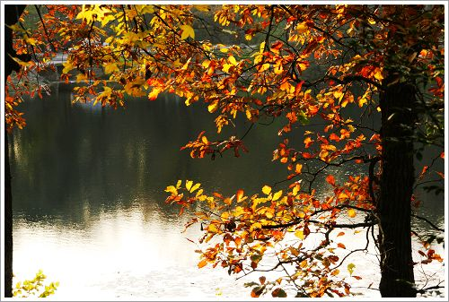
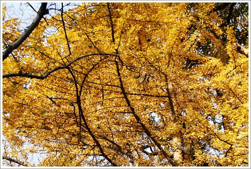
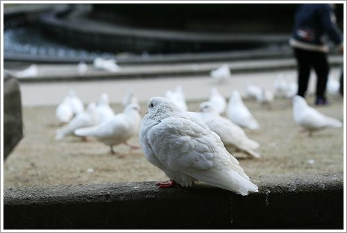

# 初冬

   
   
  
  
照片后上传到相册~~

---

## 评论（10）

**Anyayaya** · 2006-12-03

最上面这张是水榭么？最下面的是音乐台吧，以前怎么从没见过那里有鸽子？总的印象是：好相机拍的景确实是傻瓜机望尘莫及滴。

**Rachel** · 2006-12-03

现在季节间已没有明显变化，虽时以初冬，但仍然能看见深秋的颜色，虽然吹来了冬季的风，心却似金色般灿烂！

**Dan** · 2006-12-03

第一次到南京还是在大学的时候，秦淮河畔，中山陵上，过往匆匆，岁月日久，记忆都已经模糊了。看到这些照片好像回到昨天，还想看看鼓楼的黄昏是否也是原来的颜色？

**[afan](http://afan1.blogchina.com)** · 2006-12-03

http://bj.news.163.com/06/1203/08/31DGFRGE0038006L.html

**Christina** · 2006-12-03

鼓楼的黄昏...只有提前下班或者周末才能赶在黄昏前拍摄，还必须是个晴天：）

**[airylea](http://www.airylea.net)** · 2006-12-04

茶是狮子座吧？

**Christina** · 2006-12-04

是的:P

**Michael** · 2006-12-04

好像楼主现在可以随便出片了吗？  
恭喜！

**Dan** · 2006-12-04

“鼓楼的黄昏...只有提前下班或者周末才能赶在黄昏前拍摄，还必须是个晴天：）”——期待！

**ILN** · 2006-12-05

Those are beautiful pictures!  
HI, Christina, Would you please help me to understand that what is the current average (or a typical rang) per month pay (income) of a white-collar professionals in Nanjing (Who has 4~6 years of college education with about 5 +/- years working experience).

The total income per month (before tax) = ?  
The take home pay per month (after tax) = ?

I have lost touch with the current reality of today’s modern Nanjing. I left Nanjing when the JinLing Hotel was the tallest building.

Thanks you in advance!

