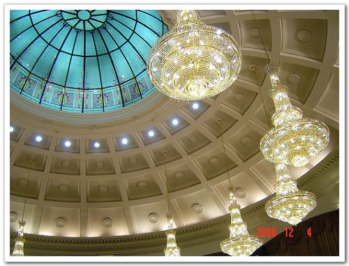
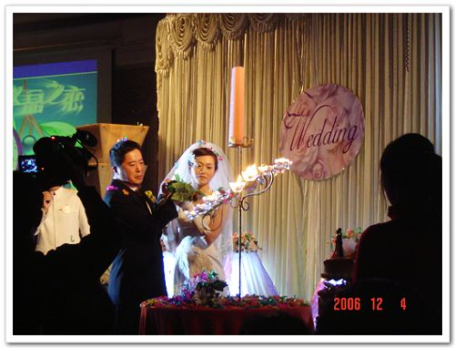
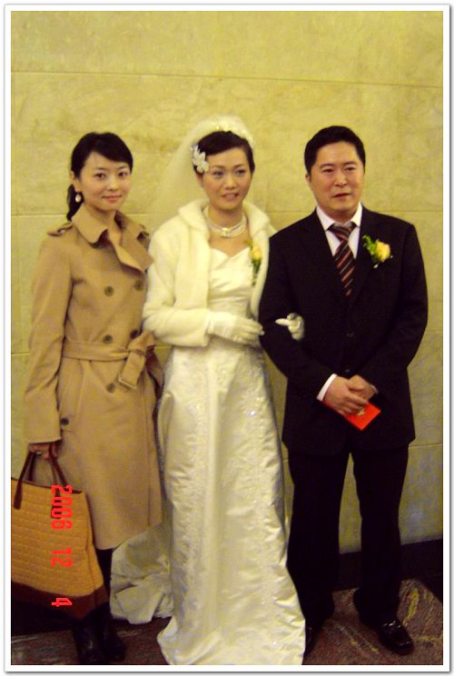

# 同事的婚礼

海归同事的婚礼在苏宁环球的卢浮宫举行，据说这家酒店一天只能办一个婚礼，预订从一年前就开始订满了，所以他只能订在12月“4”号举行，对于中国人来讲“4”这个数字不太吉利，不过这是迷信，信则有不信则无！同事的感谢辞中，最后一句：“感谢这个女人”印象颇为深刻！  
   
   

---

## 评论（10）

**Anyayaya** · 2006-12-05

是从下往上看照片的。看最底下的一张以为是爸爸搀着新娘子女儿，看到第二张才意识到是一对。。。汗。。。实在是很不好意思。到底是新娘太年轻还是新郎太成熟？ ； ）

**[山佳](http://blog.kaila.com.cn/user1/shanjia/index.shtml)** · 2006-12-05

为什么看不到你结婚时候的照片.

**Christina** · 2006-12-05

上传过的，你没看到吧：）  
我这同事72年的啊，新娘78的。

**thelastmango** · 2006-12-06

新娘看起来实在有点老，这同事也是。不过结婚的地方很漂亮了。

**thelastmango** · 2006-12-06

还有就是我喜欢你的包包，今年很流行大包，不过你这个看起来不死板，也很配大衣的颜色，有牌子吗。

**Christina** · 2006-12-06

Jessica的包，前年买的，这个品牌今年我好象看到有大包卖的，你可以去看看。

**金陵一哥** · 2006-12-06

这位老伯身还好啊。。。

**[afan](http://afan1.blogchina.com)** · 2006-12-07

很有夫妻相

**Michael** · 2006-12-07

在这个地方办婚礼要花不少银子吧？

如果最后一张照片中,LZ拿着一只猎枪的话，不知道效果会怎么样？：）

**NICOLE** · 2006-12-09

好久没来了，你这里还是更新如常啊，Christina 结婚了吗？ 看你的文章， 我一直以为你还是单身啊

