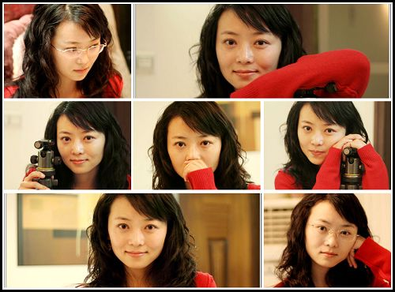

# 2006年倒计时

2006年剩下最后两天，给自己拍了照片留念。  
  
一周前一觉睡醒，左眼底出现血块，渐渐匀开变成血丝，现在还有点残留没消。上班时眼睛干涩、酸酸的，有时酸得流泪，也许空调吹的也许是装修后的余孽造成的？总之，这段时间我只能戴着眼镜度日。  
  
傍晚外面下起小雨，温度徘徊在零度上下。寒冷的季节看完[《SCOOP》](http://www.imdb.cn/title/tt0457513)，是Woody Allen与Scarlett Johansson 继人伦悲剧《MATCH POINT》之后再度携手合作，这会打的是浪漫喜剧的名号，Woody Allen居然在电影中也扮演角色，饰演一位魔术师，认真可爱而又唠叨的小老头。据介绍“这部新作几乎延续了《MATCH POINT》所有重要的元素，同样的伦敦，同样的女主角，甚至还有同样的谋杀，让人感觉就仿佛是一部《MATCH POINT》的‘灵异搞笑版’。伍迪艾伦的严肃面孔重新出镜和喜剧风格又让人看到了一丝昔日的‘伍氏风格’回归。熟悉伍迪·艾伦的人都清楚，他很喜欢连续拍摄两部类似的电影，一如当年的《安妮·霍尔》和《曼哈顿》，都是由戴安·基顿主演，都是讲述纽约，都是关于爱的故事。从这点上看影片还是有着依稀的‘伍迪·艾伦’标签，然后混入了浪漫、黑色幽默、奇幻等更加丰富的元素，而串起这些元素的最新‘伦女郎’是斯佳丽·约翰逊，《X-MEN》休·杰克曼的参与则让人非常意外。”欣赏Scarlett Johansson凹凸有致的身材，自然的性感，不做作，甚至有时还要掩饰她自己的性感，穿肥大的衣裳，保守的泳装，性感......应该就是自然流露，不刻意讨好，和气质一个概念吧？！《迷失东京》里的她很吸引我。   
  
从下班回家到现在，一直泡在网络上，久违这种逍遥啦。每当夜晚来临我还是会莫名害怕，都是恐怖片惹得祸，时常还会自己吓自己。这时候我该洗澡睡觉，因为明天早晨项目组要开会。自从公司搬迁后，上班更加象是百米冲刺。今早上上高架前的十字路口和一辆马6并排等红灯，车里那人歪着头看了我几眼，绿灯亮时就听见那车哄隆隆地加着油门，我也不知道哪根筋突然冒出来真和人家飙上了，开到时速140，虽然后来赶超过去可还是郁闷，2.3排量起步就比2.0的快？记下那车的车牌明天也许会遇上。当时我要开着斯巴鲁翼豹会是什么情形呢？  
  
   
   

---

## 评论（12）

**[Jonathan](mailto:jonathanwanggu@gmail.com)** · 2006-12-30

要注意，可以试试滴点人工眼泪配方的眼药水，如妙莲3号。  
Scoop不错的，黑色喜剧，原来那个男的是Hugh Jackman，我说怎么眼熟。Scarlett是个好演员，自然大气，但在迷失东京里面却更吸引人些。

**[Martin](mailto:martinmwq@yahoo.com)** · 2006-12-31

眼睛看起来是有点红  
Happy New Year la!

**[Sherry](mailto:Sherryshenqing@hotmail.com)** · 2006-12-31

这件毛衣不错，我喜欢！！！

**[:)](http://************)** · 2006-12-31

看你的博已经有几年了，留言第一次，新年快乐！

**[afan](http://afan1.blogchina.com)** · 2006-12-31

架架是个啥？

**[Christina](mailto:hqoo@hotmail.com)** · 2006-12-31

照相机三脚架.  
为你们默默的关注与祝福感动,谢谢~~

**[afan](http://afan1.blogchina.com)** · 2006-12-31

是啊，我也这么想，但是相机呢？

**[Jonathan](mailto:jonathanwanggu@gmail.com)** · 2006-12-31

提问挺有趣。难道不能有两个脚架，又或者把相机放在其他地方照相？:)

**[JC Li](mailto:jincheng.li@gmail.com)** · 2006-12-31

你的脚架很FB啊！

**[绿恐龙](mailto:http://www.dlog.cn/dinosaur)** · 2007-01-01

2.0的起步应该比2.3的要快

**[nemo](mailto:yehui4444@eyou.com)** · 2007-01-02

有时候也真逗!

**[灰子](http://yaohui.blogbus.com)** · 2007-01-03

终于又找到了，呵呵，原来换了域名！眼睛是看起来有点红！新年了，应该好了吧？

