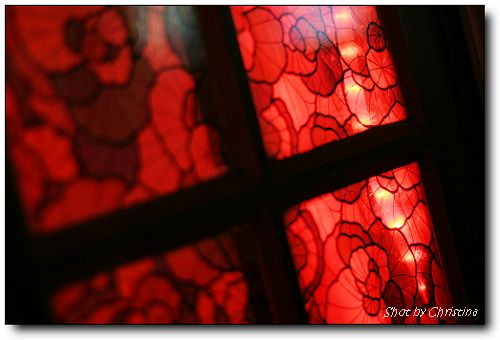
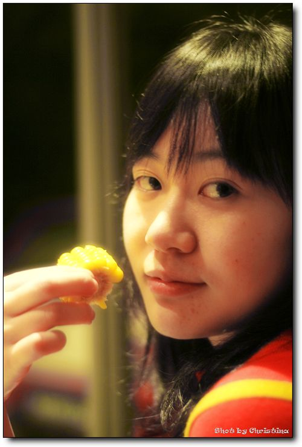
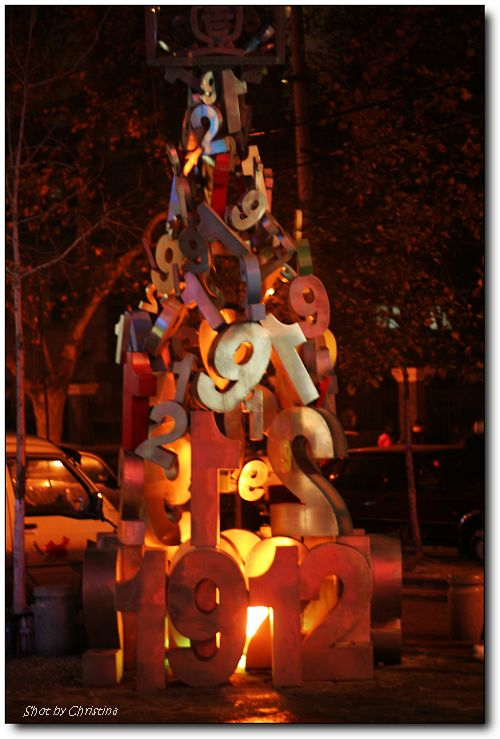
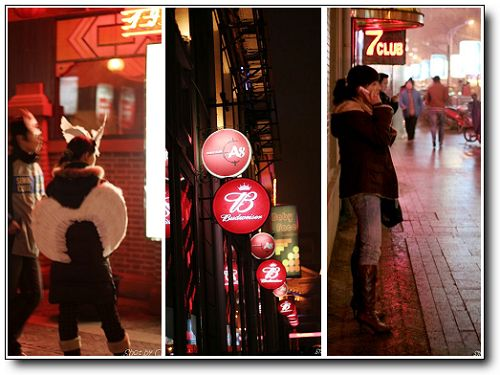
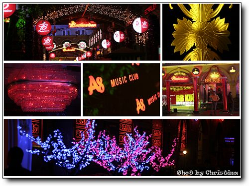
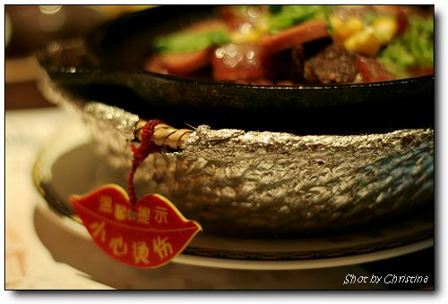

# 元旦假期

假期从一号开始渐行渐快乐，三天假期不够饱满的完成自己的事情，贪恋放假的日子，开始喜欢逛装饰城了。整个假期没有人给我拍下一张清晰的照片，这世上有“铁手”吗？Canon防抖功能的镜头是不是真正能解决这个问题？2000年那会儿我在关注什么？现在发现有些动画片很好玩，看了几集《蜡笔小新》，不停发笑。小新最初给我的印象是有次公司组织到外地旅游，当时汽车上放的是《蜡笔小新》，一个经理上小学的儿子几乎能背下来所有小新的台词，连声音都学得很象，那时我特排斥这类片子，觉得弱。现在我却弱起来咯。  
   
   
   
   
  
   
   
  
  
   

---

## 评论（5）

**angie** · 2007-01-04

不错.

**[灰](http://yaohui.blogbus.com)** · 2007-01-04

超喜欢前面两张，尤其是第二张。呵呵，用什么相机拍的啊？

**Christina** · 2007-01-04

CANON EOS350D~~~人像定焦镜头。

**Sherry** · 2007-01-05

璀璨的灯光下，我一张老脸映得通红。。。感觉有点怪，麻烦你把我那张去掉吧。。

**[May](http://blog.sina.com.cn/u/1224876730)** · 2007-01-09

这些照片拍的真好，看到后我的心里有一股暖意。Sherry很漂亮也很清纯. Christina很时尚。

