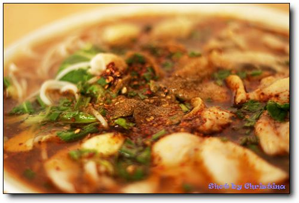

# 水煮鱼片米线

这是昨天中午的午饭。因为想要吃鸭脖子，下班后开车出去，本想去湖南路美食一条街买久久鸭，鉴于中午休息时间短，就在夫子庙觅食啦。周末吃了太多甜食，恨不能吃口盐，周一的午饭更是想吃咸的辣的。  

---

## 评论（7）

**Michael** · 2007-01-10

光圈大了点,这样景深就太小了. 只能看到中间的一小块区域  
八一医院门口的东山老鹅不错的说，楼主有空可以去试一试.

**vodka** · 2007-01-10

To Michael:你只想从照片里看清楚一碗米线么？

**Christina** · 2007-01-10

楼上讲话真逗儿哎~~:D

**CC** · 2007-01-11

是那家从新街口搬过去的桂林米线吗？好怀念哦！

**Michael** · 2007-01-12

To vodka, 我是想看看米线旁边白色的是什么东西。看起来不错的样子。你要是盯着中间那一点看，是不是感觉有点变形呢？

**Christina** · 2007-01-12

米线旁边白色的是鱼片~~  
你盯着什么东西看，时间长了都变形的，呵呵：D

要是我再去这家米线馆，一定帮你拍张照片哦。要是实在想吃，去买现成的调料自己下着吃吧~我还欠下人家黄昏时的鼓楼照片没拍的，希望周末是好天气~~

**Michael** · 2007-01-12

all my best wishes

