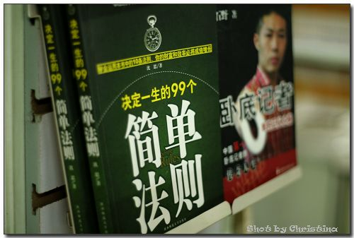
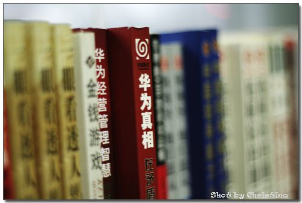
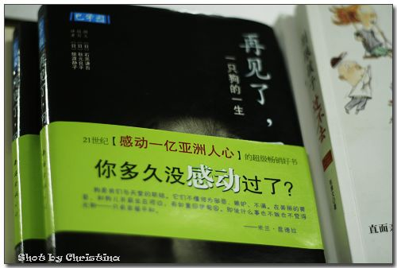

# B.O.O.K

周末逛书店，太多的书让人无从下手。  
最后挑了本中美文化差异方面的书，不晓得为什么挑这本书，或许是好奇心的缘故吧...“好奇害死猫”？太奇怪的名字，还没看过这部电影！  
  
Live，just as a pig！  
周末生活总结。  
  
99个法则，简单也变得不简单了。  
   
很喜欢《华为真相》这张PP，可惜画面虚了，555~~~  
   
我也不知道自己多久没感动过了，生活仿佛处于停滞不前的状态。  

---

## 评论（3）

**[Michael](mailto:michael_bian79@hotmail.com)** · 2007-01-15

就是铁手也有抖的时候啊，：）  
这张图上的“since 2002”看起来不错。有点专业了。

**[yezi](mailto:cecilyyeh@gmail.com)** · 2007-01-15

有空可以看看 好奇害死猫，片子看到结尾你会认为剧情简单； 我看片子得出的结论是 最毒莫过夫人心哪。 不过话说回来，第三者终归没有好果子吃。片子挺现实的，人心哪。看看无妨喏。

**[joanna](mailto:joanna72082@gmail.com)** · 2007-01-16

虽然被挡住，书应该是〈再见了，可鲁〉吧？多年前买的，很感动，尤其最后，可鲁弥留时候，最初的主人对其说：到了天堂，一定记得你叫xx（这里是可鲁主人的姓，时间太久，淡忘了:\_p)看的当时，眼泪就哗哗了。

