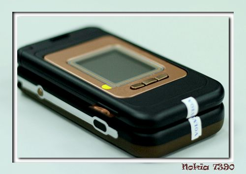
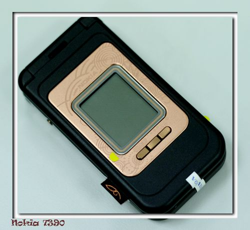
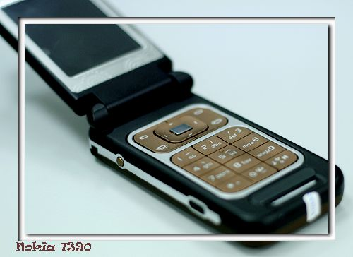

# 新手机@Nokia 7390

收到Angie从上海帮偶购买的[Nokia 7390](http://www.phonedaily.com/mobile/phone/?prod_id=2440) ，因为南京水货市场没有这款手机。感叹：还是大城市好！之前曾考虑过Nokia N72、N73，N72塑料感太重，一圈金属条过于突兀。N73键盘小，材料手感单薄，智能手机容易死机。7390是8倍数码变焦兼自动聚焦功能，300万像素，最大可拍摄2048×1536分辨率的图片，这是吸引我的最主要因素。手机3G功能目前国内还是个摆设，花多余的钱就为了放在那里储备到花儿谢了。有朋友说：“7390黑铜色不是很女性化，蛮中性的。”偶受到7390浅粉色的百般诱惑终究还是选择了耐脏的深色。黑色表面磨砂亚光，没有那种廉价的塑料感，让人欣慰。Nokia的吝啬之处在于永远标配1块电池、1个旅行充电器，永远没有电脑数据线，NND~~偶是Nokia品牌拥护者，除此之外就是使用习惯让偶一直对它偏爱，么办法！  
  
苹果的[iPhone](http://news.google.com/news?q=IPHONE&hl=zh-CN&lr=&newwindow=1&sa=X&oi=news&ct=title)国外上市时间是2007年6月，对于iPhone的唯一顾虑是电量持续使用时间，这款从外型到功能都超眩的手机会是很多手机玩家的不二选择。价格还算合理，4G的USD500，8G的USD600，一旦国内销售估计价格上还会多出15%~20%的银子，或许不止。这个畸形的消费市场什么事情都可能发生！买东西有时是心情有时是心跳。偶曾电话咨询过10086，iPHONE的GSM制式国内可以使用。不过要等最先购买的“小白鼠们”的实验结果才能确定其优劣。  
  
   
   

---

## 评论（12）

**[youzi](mailto:123@yahoo.com)** · 2007-01-16

去看了DETROIT AUTO SHOW，上次去DETROIT AUTO SHOW 是两年前，今年的AUTO SHOW 明显感到高科技的手段多了，巨大的显示屏幕震耳欲聋的音响，还有各种仿真的驾驶体验，除了高档豪华车，如LAMBORGHINI，FERRARI，ROLLS-ROYCE，BENTLEY，还有很多大众品牌的汽车，无论是MERCEDES，PORSCHE等大众豪华汽车，还是FORD，TOYOTA，GM。。普通汽车都可以坐上去体验一下。

LAMBORGHINI ($400，000)  
  
BENTLEY ($220,000)  

**[youzi](mailto:123@yahoo.com)** · 2007-01-16

个性十足的JEEP ($30,000)  

体验驾驶MERCEDES跑车的感觉 ($100，000)，这辈子应该有希望买的起  

PORSCH 的SUV

**[youzi](mailto:123@yahoo.com)** · 2007-01-16

还有一个感受就是亚洲人很多，也知道是中国人，日本人，还是韩国人，吃饭的时候碰到两个女孩说中文，和她们聊了几句才知道她们是东北一家汽车杂志的记者，国内记者和业界就来了50多人。

**[绿恐龙](mailto:http://www.dlog.cn/dinosaur)** · 2007-01-17

生命不息 折腾不止！

**[Martin](mailto:martinmwq@yahoo.com)** · 2007-01-17

不错的手机，单从普通功能来讲，s40不错而且也很稳定，不过不知道能不能通过nokia software update升级软件,可以试一下，如果你有sub-mini usb.  
也不知道你知不知道这几个tricks

\*#06#

\*#0000#

\*#7370#

\*#2820#

**[afan](http://afan1.blogchina.com)** · 2007-01-17

我也刚签了个新手机，三星 A710，居然没有游戏，郁闷，然后还没有cell infor告诉现在的信号站名

**[afan](http://afan1.blogchina.com)** · 2007-01-17

sorry, A701

**[afan](http://afan1.blogchina.com)** · 2007-01-17

http://www.samsung.com/au/products/mobilephones/mobilephones/images/l\_a701.jpg  
最好的是带来一张512M的mini SD卡，可以用来当mp3 player

**[Christina](mailto:hqoo@hotmail.com)** · 2007-01-18

偶一直是SONY和NOKIA的忠实用户~~  
偶这人死脑筋，买衣服也是，不过一旦设计风格变化偶立马不去那家店。有人说偶是日本最多的那类血型...是A还是AB型？搞不清楚~偶也不知道自己是什么血型滴。

**[youzi](mailto:123@yahoo.com)** · 2007-01-18

CHRIST，我是AB血型，你小时候是不是一个假小子，爱和男孩玩不爱和女孩玩。  
我太太对电器和汽车一窍不通也不感兴趣，她的车买了一年了还不知道自己的车是什么牌子。手机也是一样，不过，对什么鞋子皮包衣服首饰化妆品很在行，每星期都逛MALL。

**[Christina](mailto:hqoo@hotmail.com)** · 2007-01-19

我可不是假小子，只是喜欢车和电子产品而已~  
女人都会喜欢鞋子皮包衣服首饰化妆品的，我也不例外。

小时侯和男生女生都能玩到一起，不过不太喜欢婆婆妈妈过于矫情琐碎的人，不会以性别来选择玩伴。不过和一群唧唧喳喳，香气扑鼻、花枝招展的女人在一起会不适应。倾向与朴实内敛，谦和自然，性格开朗的人交往。

**[nick](mailto:nickchan929@hotmail.com)** · 2007-01-20

真的好久没见到你咯~~两年多了~~原来的两个中国茶。。。现在又是一个新的中国茶。。。变化着~~~  
看看你照片多了几分女人的成熟。。。你不太记得我了吧，天堂隔壁我们聊过。。。：）我会常来~~

