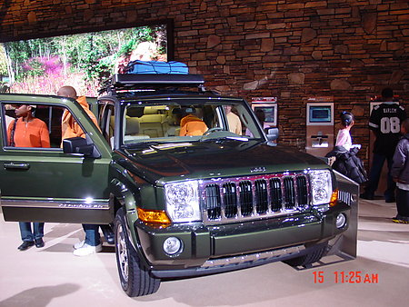
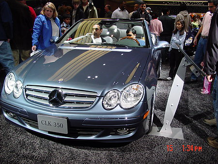
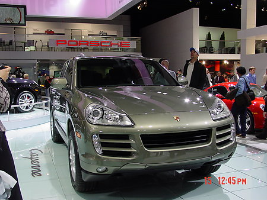
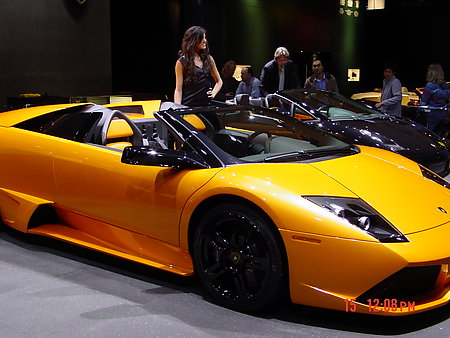
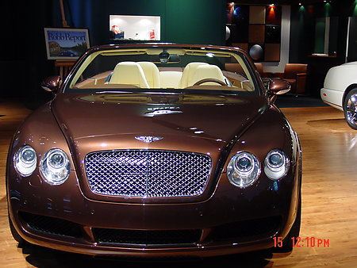

# 来自youzi的信息

去看了DETROIT AUTO SHOW，上次去DETROIT AUTO SHOW 是两年前，今年的AUTO SHOW 明显感到高科技的手段多了，巨大的显示屏幕震耳欲聋的音响，还有各种仿真的驾驶体验，除了高档豪华车，如LAMBORGHINI，FERRARI，ROLLS-ROYCE，BENTLEY，还有很多大众品牌的汽车，无论是MERCEDES，PORSCHE等大众豪华汽车，还是FORD，TOYOTA，GM。。普通汽车都可以坐上去体验一下。  
  
还有一个感受就是亚洲人很多，也知道是中国人，日本人，还是韩国人，吃饭的时候碰到两个女孩说中文，和她们聊了几句才知道她们是东北一家汽车杂志的记者，国内记者和业界就来了50多人。  
  
个性十足的JEEP ($30,000)  
   
  
体验驾驶MERCEDES跑车的感觉 ($100，000)，这辈子应该有希望买的起  
   
  
PORSCH 的SUV  
   
  
LAMBORGHINI ($400，000)  
   
  
BENTLEY ($220,000)  

---

## 评论（5）

**[Martin](mailto:martinmwq@yahoo.com)** · 2007-01-16

我记得你原来的另外一个blog也让成员发布blog来着

**[Michael](mailto:michael_bian79@hotmail.com)** · 2007-01-16

mercedes 的跑车看起来很好，德国车！  
bentley长的像我的拖鞋...

**[Christina](mailto:hqoo@hotmail.com)** · 2007-01-16

那你天天踩着bentley。。。不要太爽啊。。。哈哈哈哈。。。

**[youzi](mailto:123@yahoo.com)** · 2007-01-16

BENTLEY基本是岁数大的商人和律师买，就像ROLEX 手表一样，就是一有钱有势的符号，我也不喜欢BENTLEY，ROLLS-ROYCE，

**[Winter Lau](http://www.dlog.cn/javayou)** · 2007-01-17

那辆奔驰确实不错，我喜欢！

