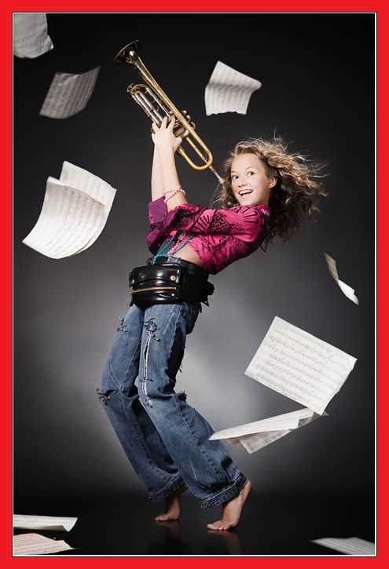

# 态度&方式

传上这张快乐飞扬的图片调剂一下最近的情绪，我想我现在需要的是一次旅行，一个休假。春节....如果不作计划那么永远是为他人而过的节日！自我...是不是等同于自私？  
  
近来文字中常能见到“态度”二字，“态度决定一切”、“有态度的都市生活”、“态度是一种女人”、“态度决定胜负”、“爱情态度”.....“态度比能力更重要”。亲戚家孩子智商正常，数理化成绩总是不理想，课堂上最认真的那个又是他，态度是否真能决定结果？**过于渲染和粉饰的态度一定有虚假成份！**借用高光光blog中评价《满城尽带黄金甲》的两句：“是不是人没有感情就要虚张声势来掩盖呢？没有了实际的内核，就需要用视觉效果来冲击观众...”  
  
谈到旅游，有人问我为什么喜爱？能去自己向往的地方会兴奋，不同的风景人文，拍摄不同内容留下别样记忆，复印机下的生活暂时被改变了。他说：“那些照片你已经看了几十遍了...”我无法解释一遍一遍又一遍百看不厌的原由，就好象有人每天习惯性抽几支乃至几十支烟。有些人的兴奋感与压力消解在办公室、酒吧和运动场或是阅读、影音和性爱中，这应是方式范畴了？  
  
合作态度一致，方式不同，结果是否是所期望的那样？  
  

---

## 评论（3）

**youzi** · 2007-01-25

昨天在海外一个网站发了一个2005年回云南的帖子，有兴趣可以可以看看。

[天是故乡的兰，水是故乡的甜](http://web.wenxuecity.com/BBSView.php?SubID=travel&MsgID=65651 "1")

[天是故乡的兰，水是故乡的甜](http://web.wenxuecity.com/BBSView.php?SubID=travel&MsgID=65661 "2")

**youzi** · 2007-01-25

你们知道还有一种读法，会读吗？？

秀山轻雨青山秀，香柏鼓风古柏香

**ILN** · 2007-01-26

“能去自己向往的地方会兴奋，不同的风景人文，拍摄不同内容留下别样记忆，复印机下的生活暂时被改变了” Nice saying!  
Allow me to share our close encounter with nature;

Family’s “Happy Feet”  
http://www.imagestation.com/picture/sraid223/p5f169bae22501fda83bd844285daee09/eaf16b4c.jpg

Dance with waterfalls (real waterfalls).  
http://www.imagestation.com/picture/sraid223/pbd8e129f69d3671ec31edea6fefc7157/eaf16b49.jpg

Captain and his coach (I’m shooting the picture)  
http://www.imagestation.com/picture/sraid223/p197dfa201efe810317c5e595befd4b26/eaf16b48.jpg

On the top looking down (Two hours from where we live by car).  
http://www.imagestation.com/picture/sraid223/p01bcaa1827c6d036dc0ea0c96af2bb43/eaedfa76.jpg

