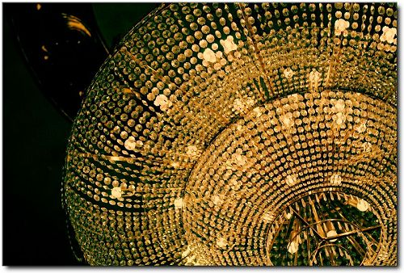
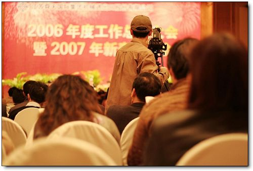
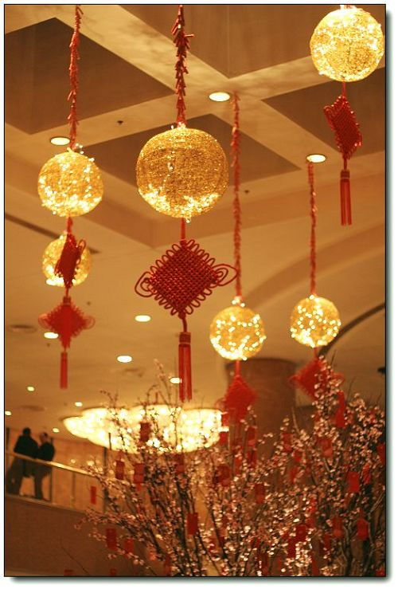
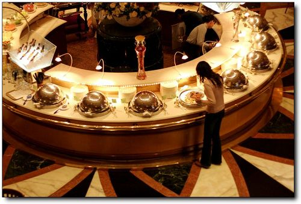
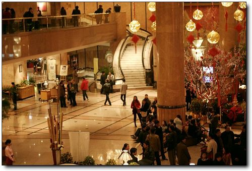
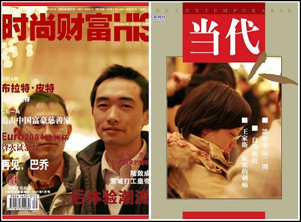
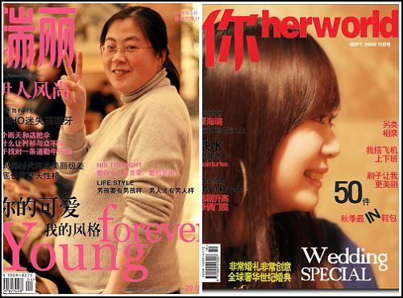
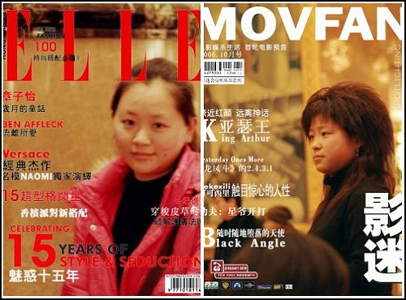
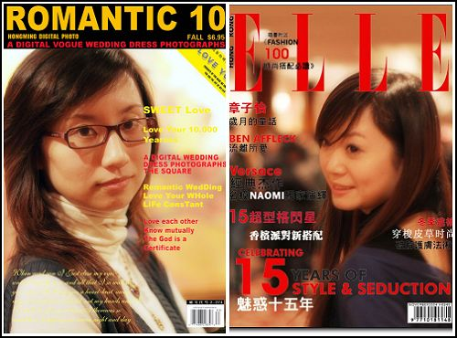

# 2006年度工作总结会

[more pix here。。。。。。](http://photo.lifetea.org/v/live/2006meeting/)  
  
   
   
   
   
   
  
  
同事都上杂志啦@\_@  
   
   
   

---

## 评论（8）

**youzi** · 2007-02-07

现在什么人都能上杂志封面？？

**ILN** · 2007-02-07

Nice work! It would be even better if they put on little bit makeups. BTW, what do you do at work? Marketing Dept.?

**Christina** · 2007-02-08

采购这块儿。

**TY** · 2007-02-08

你好！一直在关注你的博，很喜欢。  
我想请教你一个问题，你是怎样把相片做成杂志封面的呢？谢谢了：）

**Michael** · 2007-02-09

PS的水平不错

**Michael** · 2007-02-09

拍那些灯的时候,要是烛光时间再长一些应该会好一些,不过可能要架子了

**CAICAI** · 2007-02-10

喜欢你的第一张，所以又拿来用在MSN，不介意吧。

**Faye** · 2007-02-11

奇怪,我的留言上不去吗? 期待一句答复竟然是一再丢失

